# 8. Self-hosted E2B on the local AMD machine

**Result:** an official E2B Runtime service runs on this machine in a dedicated Ubuntu 24.04 VM, with Kubernetes managing its components. SDK operations and a full Uni-Agent ReAct SWE-bench task passed. This original small VM was retired after migration to [experiment 11](../11_local_e2b_capacity/README.md); its disk and all results below are retained.

## Access

| Client | Control API | Sandbox execution traffic |
|---|---|---|
| Host shell | `http://127.0.0.1:18090` | `http://127.0.0.1:18091` |
| Existing `ua-lab-cpu` container | `http://172.30.90.1:18090` | `http://172.30.90.1:18091` |

The generated local key is stored in `/home/yuhanya/uni-agent-lab/secrets/local-e2b/host.env` and `container.env`, both mode 0600. It is different from the earlier remote service key. [STEPS.md](STEPS.md) shows usage without printing it.

## Deployment

The outer Ubuntu 22.04 host keeps its 5.15 kernel and ROCm installation. E2B's current preflight requires an x86-64 kernel of at least 6.8, so a dedicated KVM VM supplies the required kernel. Nested KVM is enabled, and E2B runs real Firecracker microVMs inside it.

| Component | Configuration |
|---|---|
| Outer VM | `ua-e2b-local-20260916`, 16 vCPU, 64 GiB RAM, 200 GiB sparse disk |
| VM address | `192.168.122.196`, reserved for its MAC on the existing libvirt network |
| Guest | Ubuntu 24.04.5, kernel `6.8.0-139-generic` |
| Kubernetes | Single-node K3s `v1.36.4+k3s1`; namespace `e2b`, StatefulSet `e2b` |
| E2B source | Commit `e7b22501988c826563bf1b3cf0d22a1183e7affe`, official Kubernetes Embed manifests |
| Sandbox memory pool | 32 GiB of 2 MiB hugepages, reserved inside the VM |
| Templates | `base` (2 vCPU / 1 GiB), plus the pinned Flask SWE image (4 vCPU / 8 GiB) |
| Host access | Managed SSH tunnels; systemd unit `ua-e2b-local-tunnel.service` |

The VM is configured to autostart; K3s, the guest network rules, and the host tunnel have startup services. A Kubernetes Pod restart was tested. A complete outer-host reboot was not tested.

## What passed

- SDK create, liveness, destroy, and confirmation that a destroyed sandbox is no longer running.
- Command working directory and environment variables; separate stdout/stderr and a nonzero exit code.
- Text files and a byte-for-byte 1 MiB binary round trip.
- A persistent Bash stdin session retaining its working directory and exported environment.
- Four concurrent sandbox create/execute/delete operations.
- The same SDK checks after restarting the E2B Pod, using the existing key and templates.
- Real SWE-bench issue `pallets__flask-5014`: failing baseline, passing official patch, and a successful ReAct repair through Uni-Agent Task and Gateway. The full rollout took **77.29 seconds**, produced one valid token/mask/logprob trajectory with **4,779 generated tokens**, and cleaned up its execution and fresh verifier sandboxes.

The task used fixed Qwen3-Coder-30B-A3B-Instruct weights through a temporary vLLM ROCm container. That test container was stopped afterward. This is deployment acceptance, not a new model-quality benchmark or RL training run.

## Local configuration choices

- **DNS:** the pinned E2B runtime writes `8.8.8.8` into sandbox images. That resolver is unreachable from this site. A VM-local rule forwards only E2B DNS requests to the existing libvirt host resolver. Other sandbox traffic retains the E2B execution path.
- **Memory and startup:** a Kustomize overlay reserves 32 GiB of sandbox hugepages, caps ClickHouse at 4 GiB, preserves the required init-container order, and builds the default template with 1 GiB RAM.
- **Lifecycle quota:** the seeded local team permits up to 3,600 seconds per sandbox. The Uni-Agent wrapper applies that setting instead of the earlier remote experiment's 5,400 seconds; the E2B provider's execution/file methods are reused.
- **Access:** E2B internal control ports are blocked on the VM external interface. API and execution ports are forwarded to loopback and the existing lab Docker bridge. The ready container stores credentials without logging them.

## Scope and limits

This is the official single-node Embed architecture, with local configuration changes. It is not a validated multi-node or highly available deployment. Kubernetes manages the E2B service Pod; individual sandboxes are managed by E2B's orchestrator as Firecracker VMs.

Nested virtualization can affect performance. The four-sandbox test checks functionality, not maximum capacity. The pinned orchestrator emits a warning about resetting `memory.peak` on this kernel; interval peak-memory reporting is degraded, while the tested sandbox operations and verifier completed.

## Evidence and operation

- [Deployment audit](results/deployment-audit.json)
- [SDK checks before restart](results/sdk-smoke-before-restart.json) and [after restart](results/sdk-smoke-after-restart.json)
- [Uni-Agent result](results/uni-agent/result.json), [trajectory audit](results/uni-agent/trajectory-audit.json), and [verifier](results/uni-agent/verifier.json)
- [Code and configuration hashes](results/source-manifest.json)
- [Usage, management, and replay steps](STEPS.md)

Complete runtime assets and logs: `/home/yuhanya/uni-agent-lab/local-e2b-20260916`. Credentials are kept separately under `secrets/local-e2b` and are excluded from this report.

[Back to overview](../README.md)
