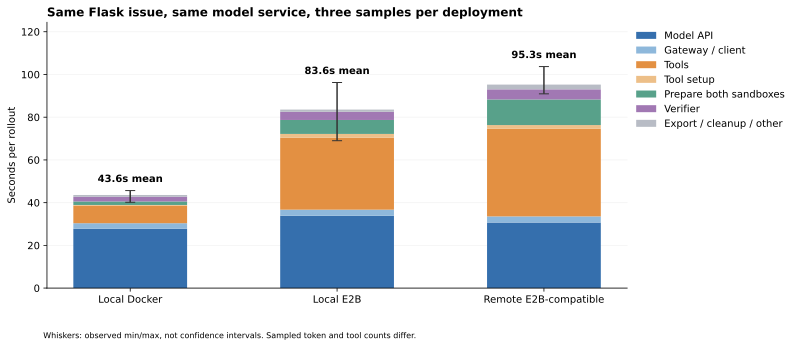
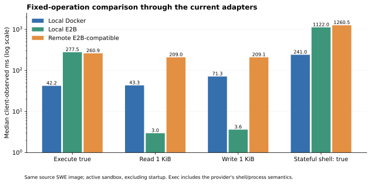

# 9. The same SWE task on Docker, local E2B, and remote E2B

**2026-09-16. Fixed Qwen3-Coder-30B-A3B-Instruct; Uni-Agent ReAct, Gateway, and fresh SWE verification. No training update.**

We repeated `pallets__flask-5014` three times on each deployment, using one shared model service and alternating the order. The task asks the agent to reject empty Flask Blueprint names. All environments came from the same pinned SWE image digest.

| Measurement | Local Docker | Local E2B | Remote E2B-compatible |
|---|---:|---:|---:|
| Resolved / valid trajectories | 3/3; 3/3 valid | 3/3; 3/3 valid | 3/3; 3/3 valid |
| Mean complete rollout | 43.58 s | 83.56 s | 95.26 s |
| Mean model API time | 27.76 s | 33.88 s | 30.69 s |
| Mean tool-call time | 8.27 s | 33.66 s | 40.99 s |
| Mean preparation: agent + verifier | 1.66 s | 6.54 s | 12.00 s |
| Mean verification | 2.17 s | 3.82 s | 4.74 s |
| Observed total-time range | 40.2–45.7 s | 69.0–96.2 s | 90.9–103.7 s |
| Mean generated tokens | 4380 | 5225 | 4752 |
| Mean tool calls, including submit | 28.3 | 31.3 | 32.3 |

These are independently sampled trajectories. Different token counts, commands, and tests change the amount of work, so total-time ratios are not pure platform speedups. Three repeats of one previously observed issue are not a general SWE-bench score.

## Fixed tool operations

To separate tool execution from model sampling, each deployment also ran the same 100 fixed operations. These measurements use an already-running sandbox; they exclude image/template builds and sandbox preparation.

| Median operation | Local Docker | Local E2B | Remote E2B-compatible |
|---|---:|---:|---:|
| SDK/provider exec: true | 42.2 ms | 277.5 ms | 260.9 ms |
| Read 1 KiB | 43.3 ms | 3.0 ms | 209.0 ms |
| Write 1 KiB | 71.3 ms | 3.6 ms | 209.1 ms |
| Read 1 MiB | 46.1 ms | 43.5 ms | 238.3 ms |
| Write 1 MiB | 71.5 ms | 48.0 ms | 219.1 ms |
| Stateful tmux shell: true | 241.0 ms | 1122.0 ms | 1260.5 ms |

Local E2B removes much of the remote cost for file operations, but the current exec path still has a substantial startup cost. One tmux no-op makes four exec calls plus one file write, magnifying that cost. Local deployment alone does not remove the adapter's call sequence.

## Why local E2B exec can still be slow

E2B Python SDK 2.49.1 implements `commands.run()` using `/bin/bash -l -c`. Our provider maps Uni-Agent argv execution onto that SDK call. The official E2B template provisioning script adds shell-profile sourcing, and the SWE image contains Conda initialization. A local network therefore does not guarantee a cheap one-shot command.

After the nine main runs, we timed Bash startup **inside one disposable local E2B sandbox**, with no network round trip between measurements. Ten login-shell runs had median **267.0 ms**; ten `--noprofile --norc` runs had median **1.0 ms**. This isolates login initialization overhead. The saved startup-script excerpts show Conda initialization, but this probe does not isolate the cost of each individual startup line. [Evidence](results/login-probe.json)

- Persistent-stdin no-op prototype on **Local E2B**: median **44.1 ms**, 30 commands, cwd/environment preserved.
- Persistent-stdin no-op prototype on **Remote E2B-compatible**: median **209.5 ms**, 30 commands, cwd/environment preserved.

The persistent-shell results are transport prototypes, not full SWE task runs with an optimized provider. The primary comparison uses the same tmux tool on all three deployments.

**Next implementation to evaluate:** initialize the shell environment once per sandbox/session; use a native persistent shell for agent commands and a native argv path for simple metadata operations. Preserve cwd, environment, timeouts, cancellation, and output semantics, then repeat the task comparison.

## Fairness and scope

- Six fresh baseline/gold controls passed qualification; initial repository HEAD and Git tree matched across all three deployments.
- One pinned vLLM ROCm image and serving replica: BF16, TP1, AITER + graphs, 128K context, 16 active sequences, 8192 batched tokens, GPU memory fraction 0.65. The configured sandbox limits were 4 CPU / 8 GiB.
- ReAct used 100 steps, up to 4096 new tokens per model call, temperature 0.2, top-p 0.9, and no explicit sampling seed. Every rollout used a separate fresh verifier and retained its token/mask/logprob audit.
- Local E2B runs inside the dedicated KVM VM and is accessed through managed SSH tunnels. Remote E2B is the supplied compatible service; its internal implementation has not been identified. CPU, storage, kernel, and network placement differ.
- Matching source images and repository trees do not imply identical full filesystems: E2B provisioning adds runtime components and shell setup. Fixed-operation timings include these provider semantics, not just wire latency.
- Images/templates and model weights were already available. Cold download/build time, training updates, and multi-node scaling were not measured.
- The study model was stopped afterward; the local E2B service and reusable templates remain available. Cleanup targeted only this study's instances.

## Evidence

[Per-run CSV](results/cases.csv) · [Tool calls](results/tool-calls.csv) · [Controls](results/controls-audit.json) · [Cleanup](results/cleanup-audit.json) · [Replay steps](STEPS.md)

Full logs, spans, trajectories, and GPU telemetry remain at `/home/yuhanya/uni-agent-lab/results/sandbox-three-way-20260916T094603Z`. [Copied artifact hashes](results/source-manifest.json).

[Back to overview](../README.md)
