# 10. Local OpenSandbox and a full Uni-Agent rollout

**Result:** OpenSandbox runs in a second dedicated Ubuntu 24.04 VM, using its Kubernetes/containerd backend. A new Uni-Agent provider passed real sandbox checks, then ReAct resolved the same Flask SWE-bench issue through Task, Gateway, model inference, independent verification, and trajectory export.

The OpenSandbox service remains running. The earlier E2B VM and API remain available.

## Access and deployment

| Item | Value |
|---|---|
| Host API endpoint | `http://127.0.0.1:18094` |
| CPU coordinator endpoint | `http://172.30.90.1:18094` |
| Execution routing | SDK `use_server_proxy=True`, through the same API endpoint |
| Credentials | `/home/yuhanya/uni-agent-lab/secrets/local-opensandbox/{host,container}.env`, mode 0600 |
| Outer VM | `ua-opensandbox-local-20260916`; 16 vCPU, 64 GiB RAM, 200 GiB sparse disk |
| VM IP | `192.168.122.178`, reserved on the existing libvirt network |
| Kubernetes | K3s `v1.36.4+k3s1`, node `ua-osb-node` |
| Helm chart | Official `opensandbox-0.2.2` |
| Released images | Server `v0.2.3`, controller `v0.2.0`, execd `v1.1.0` |
| Python SDK | `opensandbox==0.1.16`, installed in a separate SDK directory |

Kubernetes manages the OpenSandbox API server, Operator, `BatchSandbox` resources, and workload Pods. Each sandbox is a container workload using the VM's kernel. This deployment does **not** add a Firecracker VM per sandbox, and Kata/gVisor are not enabled. The outer KVM VM provides separation from the AMD/ROCm host, whose 5.15 kernel remains unchanged.

## Acceptance results

| Check | Result |
|---|---|
| API authentication | Requests without a key return 401 |
| Command output and exit status | Preserved stdout/stderr, blank lines, trailing newlines, and exit code 7 |
| Large output | 100 KB output preserved |
| Files | Text and byte-for-byte 1 MiB binary round trips passed |
| Native Bash session | Working directory and environment persisted; nonzero commands handled |
| Timeout and cancellation | Commands stopped; delayed marker files were not created |
| Cleanup | Session close and sandbox stop are idempotent |
| Parallel sandboxes | Four create/execute/delete operations passed |
| API Deployment restart | Existing sandbox Pod UID, file, cwd, and shell variable survived |

The restart check replaced the API Pod, then reconnected to the same sandbox and native shell session. It did not test VM/node failure, snapshot restore, or a multi-node deployment.

## Full SWE-bench example

Task: **`pallets__flask-5014`**, rejecting empty Flask Blueprint names.

| Stage | Result |
|---|---|
| Original code with official tests | Unresolved, evaluation completed |
| Official reference patch | Resolved, evaluation completed |
| Uni-Agent + ReAct candidate | **Resolved; reward 1.0; finished** |
| Fresh verifier sandbox | Passed; candidate test-path changes filtered before grading |
| Token trajectory | **1 valid trajectory**, 5,489 generated tokens, masks and finite logprobs checked |
| Cleanup | Execution and verifier sandboxes removed |

The single complete rollout took **101.30 seconds**, including about **27.22 seconds** to prepare its two sandboxes, **36.14 seconds** of model API time, and **27.62 seconds** in agent tool calls. It used fixed Qwen3-Coder-30B-A3B-Instruct weights on the same pinned vLLM ROCm configuration as experiment 9. The temporary inference replica was stopped afterward.

This is an end-to-end acceptance run, not a performance ranking against experiment 9: it is one sampled trajectory and uses a newly implemented native-shell adapter. No SFT or RL parameter update was performed.

## Provider design

[provider.py](code/provider.py) registers `opensandbox` through Uni-Agent's existing sandbox registry. The driver imports it before constructing the Task, so the upstream registry and agent implementation remain unchanged.

- Lifecycle uses SDK create/destroy with explicit CPU, memory, timeout, metadata, and proxy routing.
- File operations use the native SDK byte APIs.
- Stateful shell uses `create_session`, `run_in_session`, and `delete_session`. The SWE environment initializes Conda once when that session opens.
- The pinned execd protocol exposes text events with line delimiters removed. To preserve Unix text output required by Git patches and test logs, the adapter captures and base64-frames stdout/stderr within the same command, then decodes it before returning observations to Uni-Agent. It avoids additional file-read requests for normal command output.
- Command deadlines are enforced server-side, with explicit interruption when the client task is cancelled.

The provider checks were run against real Kubernetes sandboxes. They cover the behaviors used here; they are not a complete certification of every shell feature or arbitrary image.

## Operations and limits

The API is exposed through a separate NodePort Service and managed SSH tunnels. One API replica uses a VM-local SQLite path; this is not a high-availability setup. Sandboxes are created directly without a warm pool. Pause/resume, snapshot storage, multi-node scaling, and stronger container runtimes were not configured or tested.

The SDK directory is `/home/yuhanya/uni-agent-lab/envs/opensandbox-sdk`; existing E2B dependencies were not replaced. Runtime files and full logs are retained at `/home/yuhanya/uni-agent-lab/local-opensandbox-20260916`.

[Usage and replay](STEPS.md) · [Deployment audit](results/deployment-audit.json) · [Provider checks](results/provider-smoke-final.json) · [Restart check](results/restart-probe.json) · [Uni-Agent result](results/uni-agent/result.json) · [Artifact hashes](results/source-manifest.json)

[Back to overview](../README.md)
