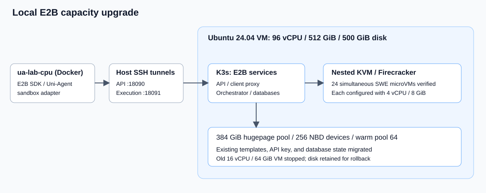

# 11. Larger local E2B for concurrent workloads

**Result:** replaced the 16-vCPU / 64-GiB E2B VM with a fresh **96-vCPU / 512-GiB VM**, migrated the existing templates and credentials, and verified **24 simultaneous SWE-bench sandboxes**. The new service is running. The old VM is stopped and its disk is retained. OpenSandbox remains running separately.

This experiment validates sandbox infrastructure and concurrent SWE-bench verification. It does not add a model rollout, a SWE-bench solve-rate benchmark, or an RL training update. The earlier complete Uni-Agent rollout remains documented in [experiment 8](../08_local_e2b/README.md).

## Deployment and migration

| Item | Current value |
|---|---|
| VM | `ua-e2b-96c512g-20260916`, IP `192.168.122.239` |
| CPU / memory / disk | 96 vCPU / 512 GiB / 500 GiB sparse disk |
| Guest | Ubuntu 24.04, kernel `6.8.0-139-generic`, K3s `v1.36.4+k3s1` |
| Sandbox runtime | E2B Orchestrator creates nested Firecracker microVMs |
| Sandbox memory pool | 384 GiB of 2-MiB hugepages; 196,608 pages |
| NBD devices / warm pool | 256 / 64 |
| Host API / execution | `http://127.0.0.1:18090` / `http://127.0.0.1:18091` |
| CPU container API / execution | `http://172.30.90.1:18090` / `http://172.30.90.1:18091` |
| API credentials | Existing `secrets/local-e2b/{host,container}.env` still works |
| Template IDs retained | `base`: `uckk5539uvrjduteyr5a`; Flask: `6gz72hgrq9yqwt3l2vd1` |

The host kernel and ROCm installation were unchanged. K3s manages the E2B service containers; E2B Orchestrator manages Firecracker sandboxes. These microVMs are not individual Kubernetes Pods.

Migration used a cold application backup: verified no active sandboxes, scaled the old E2B StatefulSet to zero, backed up `/var/lib/e2b`, and stopped the old VM. The archive checksum was verified before restoration. The database, template storage, seed state, and Kubernetes API Secret were restored into the fresh VM. Stable SSH tunnels were repointed to the new address. Both the old VM disk and private backup remain available.

The deployment manifests come from runtime commit `e7b22501988c826563bf1b3cf0d22a1183e7affe`; the shipped service binaries remain pinned to their original versions. Exact image and artifact pins are in [kustomization.yaml](configs/deploy/upstream/kustomization.yaml), including Orchestrator `v0.16.202609130627-59497eb9134` and Firecracker `v1.14-0.2.0`. No custom E2B runtime binary was built.

## Acceptance results

| Check | Observed result |
|---|---|
| SDK lifecycle, files, execution | All 9 checks passed before and after a full VM reboot; includes 1-MiB binary files, exit codes, persistent shell state, four concurrent creates, and cleanup |
| Concurrent real environments | 24 API-listed, live sandboxes; independently observed 24 Firecracker processes |
| Sandbox configuration | Each used the existing Flask SWE image with 4 vCPU / 8 GiB; total configured allocation 96 vCPU / 192 GiB |
| Actual verification | 12 baseline controls remained unresolved; 12 official-gold controls resolved; **24/24 expected results** |
| Verifier concurrency | 24 overlapping verifier request intervals |
| Creation / workload time | 0.75 s to create the batch; 7.77 s for parallel preparation and verification |
| Full VM restart | API and all 8 service containers recovered automatically in 148.69 s; subsequent SDK smoke passed |
| Final state | 0 active test sandboxes; new E2B healthy; old VM off; OpenSandbox healthy |

The concurrency check calls the existing `ProfileE2B` sandbox adapter and `uni_agent.tasks.swe_bench.reward.compute_reward`. It uses the pinned `pallets__flask-5014` template, applies the official gold patch in half the sandboxes, and grades all copies with the existing verifier. All sandboxes are created before a barrier releases concurrent execution. Cleanup is checked independently through the SDK.

After reboot, the replay driver was also exercised with two Flask environments: one baseline and one oracle. Both returned the expected result and were cleaned up; these two auxiliary checks are recorded separately in `results/driver-replay-2` and are not included in the 24-environment measurement above.

The creation measurement uses an already-built, locally available template. It excludes initial template builds and does not predict cold-image performance. The 28.99-s total also includes the host observation barrier and cleanup. Guest-wide CPU sampling peaked at approximately **30.53 busy cores**; the test did not saturate all 96 vCPUs. Configured guest memory is not equivalent to resident memory used by this small Flask test. Resource samples include a gap during the host barrier; raw timestamps are retained.

## Capacity settings and practical limits

- The local team's concurrent sandbox quota was raised from **20 to 64** through a local administrator override in `public.project_limits`. Other limits were preserved: at most 8 vCPU / 8 GiB per sandbox and a one-hour lifetime. This was a local database configuration change, not a new public API.
- The checked runtime source defaults to **3 simultaneous start/resume operations per node** and **200 running sandboxes per node**. The client test uses a creation semaphore of 3. These defaults are separate from the team's quota; the burst limit was not benchmarked or changed.
- **64 is a quota ceiling, not a measured capacity claim.** This run established 24 live environments on one node. At 4 vCPU per task, begin real agent workloads around 16–20 concurrent sandboxes to leave CPU headroom for E2B, database services, and bursty test execution; tune using workload measurements.
- The 384-GiB hugepage pool leaves roughly 120 GiB of guest-visible non-hugepage memory for the OS, services, and caches. CPU, hugepages, disk I/O, NBD devices, and creation limits can each constrain concurrency.
- This remains a single E2B worker with local storage and local SSH access. Larger resources do not provide multi-node placement or high availability.

## Evidence and operation

[Run and manage it](STEPS.md) · [Final deployment audit](results/deployment-audit.json) · [Concurrency summary](results/concurrency-24/summary.json) · [Live guest snapshot](results/concurrency-barrier-guest.json) · [Migration backup](results/migration-backup.json) · [Quota change](results/project-limits.json) · [Source checksums](results/source-manifest.json)

The runtime directory is `/home/yuhanya/uni-agent-lab/local-e2b-96c512g-20260916`. This report includes code, manifests, diagrams, and raw verification evidence. Credentials, the private migration archive, VM disks, installed packages, and container layers are excluded. Earlier experiment results remain historical evidence and were not regenerated.
