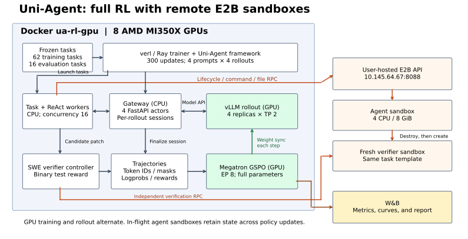

# 12. Full ReAct RL with a remote E2B service

**Status: paused at the user's request after a second GPU hardware fault.** The latest attempt completed optimizer step **112/300**. The retained checkpoint is **step 100**; steps 101–112 were executed but are not saved in a newer checkpoint. Training and automatic recovery/finalization are stopped. No four-GPU training run was started.

The actual workload used Uni-Agent ReAct, bundled verl and the user-hosted E2B service at `10.145.64.67:8088`. Each optimizer step consumed four task prompts with four rollouts each. Up to sixteen real sandboxes were active, with 4 CPU and 8 GiB per sandbox. Each episode used an agent sandbox, then a fresh verification sandbox. The model, tools, tests, binary reward, backward pass and weight synchronization were exercised together.

At step 100, the fixed evaluation changed from **7/16** to **8/16** resolved tasks. This is preliminary evidence on a small qualified subset, not a completed 300-step experiment or proof of general improvement.

[Original W&B run](https://wandb.ai/yuhanya-amd/uni-agent-swe-rl-rocm/runs/ua-qwen30b-e2b-20260916) · [Continuation W&B run](https://wandb.ai/yuhanya-amd/uni-agent-swe-rl-rocm/runs/ua-qwen30b-e2b-20260916-r3) · [Runtime directory](/home/yuhanya/uni-agent-lab/rl-swe-e2b-20260916) · [Operation steps](STEPS.md)



## Run configuration

| Item | Setting |
|---|---|
| Model | Qwen3-Coder-30B-A3B-Instruct, full parameter RL |
| GPU platform | 8 AMD MI350X GPUs |
| Docker base | `verlai/verl:rocm7.14_torch2.12_release_0724` |
| Agent / trainer | Uni-Agent ReAct / bundled verl, GRPO advantages with GSPO loss |
| Training / evaluation | 62 qualified SWE-reBench tasks / 16 fixed SWE-bench Verified tasks |
| Global prompt batch | 4 prompts per step |
| Rollout n | 4 responses per prompt: 16 trajectories per update |
| Task concurrency | 16; global sandbox creation concurrency 3 |
| Sandbox | User-hosted E2B API at `10.145.64.67:8088`; 4 CPU / 8 GiB per environment |
| Main training target | 300 optimizer steps |
| Checkpoints | Every 100 steps, keep the latest one |
| Evaluation | Before training, then steps 100, 200, and 300 |
| Context / episode limits | 40,960 total tokens, 4,096 tokens per turn, 60 ReAct turns |

The original model weights remain separate from the training checkpoints. Each task uses an agent sandbox followed by a fresh verification sandbox. Test edits are excluded from the candidate patch before independent verification. The verifier uses the corresponding Uni-Agent SWE reward implementation.

## Confirmed evidence so far

- The two-step pilot completed backward passes, successful optimizer updates on all eight ranks, sampled parameter changes, and synchronization back to the rollout engines. [Pilot proof](results/pilot-proof.json)
- The main run's training-before-update evaluation resolved **7/16 tasks (43.75%)**. This is a small fixed evaluation subset, not a full SWE-bench benchmark score.
- At step 100, the same evaluation resolved **8/16 (50%)**. One additional resolved task is preliminary evidence; it does not establish a reliable generalization gain.
- Sixteen real SWE sandboxes coexisted and were successfully cleaned up. [Capacity check](results/sandbox-capacity-16.json)
- A controlled command comparison measured **249.7 ms** using the SDK's login-shell wrapper and **7.6 ms** using direct envd process RPC. Exact output, files, persistent shell state, Conda, cancellation, and real Flask verification checks passed. [Execution comparison](results/native-exec-comparison.json)

The main run uses direct execution and records per-task API timings, model round trips, verifier body time, sandbox lifetimes, GPU usage, trainer phases, and sampled optimizer parameter changes. Windowed session metrics on W&B are explicitly named `sandbox/window_*`; they are not exact consumed-batch means.

## Read the current progress

```bash
python3 /home/yuhanya/uni-agent-lab/rl-swe-e2b-20260916/code/status.py
```

The main log is `logs/main-training.log` under the runtime directory. `results/main-metrics.jsonl` contains the actual completed step numbers, including step 0 for the initial evaluation. The main run is detached from the interactive connection.

The final report will quantify reward/evaluation changes, effective gradient updates, rollout waiting, policy computation and weight synchronization, RPC overhead, sandbox occupancy during generation pauses, and measurement limitations. Credentials and model checkpoint payloads are excluded from this document bundle.
