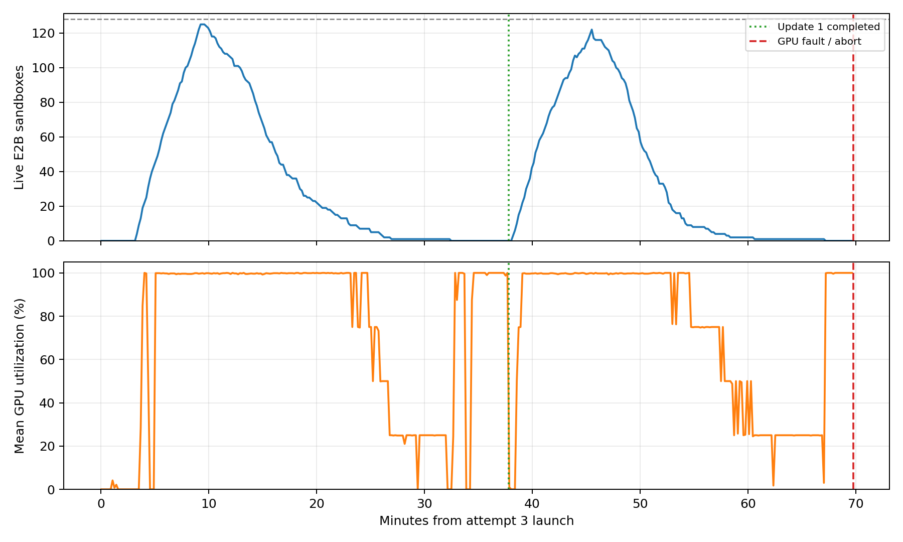

The three-step run was interrupted during step 2 by a driver-reported GPU hardware error. **One of three training steps completed. No trained checkpoint was saved.**

The experiment used Qwen/Qwen3-Coder-30B-A3B-Instruct on eight AMD MI350X GPUs, Uni-Agent ReAct, colocate_async, GSPO with R3 Router Replay, prompt batch 16, rollout n=8, an episode concurrency cap of 128, a 131,072-token Agent budget and up to 200 turns. The user's E2B endpoint was http://10.145.64.67:8088 (user-reported 192 CPUs, 1 TB RAM and quota 512).

| Training step | Completed rollouts | Resolved rollouts | Optimizer update |
|---|---:|---:|---|
| 1 | 128 | 26 | Completed on all eight ranks |
| 2 | 128 | 32 | Interrupted before completion |
| 3 | 0 | — | Not started |

Step 1 had mean reward **0.203125**, policy loss **0.075133** and gradient norm **0.084919**. All eight ranks reported a successful optimizer update. Parameter sampling detected **1149/131072 changed elements**, with maximum sampled absolute change 1.9073486328125e-06. New weights were synchronized and used for the second rollout batch. This proves an actual update occurred; it does not establish a benchmark improvement, and the different batches are not a controlled evaluation comparison.

Step 1 took 35.32 minutes: rollout collection 29.58 minutes, actor update 4.41 minutes. All **256 completed trajectories** passed checks for token/mask/logprob alignment, finite logprobs and reward agreement.

The separate capacity test verified **128 simultaneously live SWE sandboxes**, 128 successful command checks and zero residual instances. During training the maximum ten-second sampled live count was **125**. All 256 training sandboxes were cleaned; the post-failure check also found **zero remaining run-owned sandboxes**. Sandbox resource-metric queries returned no usable CPU/memory/disk samples, so no whole-node utilization claim is made. Creation timing in the raw results includes admission waiting; execution timing excludes waiting at the RPC gate.

The failure occurred at approximately **2026-09-20 09:52:53 UTC**. The kernel reported an **uncorrectable ERREVENT_ATHUB_INTERRUPT on PCI 0000:66:00.0**, alongside new correctable xgmi_wafl errors on **0000:96:00.0**. ROCm then reported GPU Hang and aborted the processes. The driver automatically reset all eight GPUs and explicitly reported lost VRAM contents. No manual GPU reset, host reboot or driver change was performed. These logs identify a hardware/driver-level failure; they do not by themselves identify which physical component or firmware/driver defect requires repair.

Checkpoint saving was configured for step 3. Because the process died before that point and the driver lost VRAM, the step-1 weights are **not available as a checkpoint**. A later attempt must restart from the original model, after the machine's GPU/interconnect problem has been addressed. The old 300-step experiment and its checkpoint 100 were not resumed or modified.

Recorded preparation and adaptations:

- All 1,150 official SWE-reBench rows were retained. Fresh E2B image-template builds failed server-side, including a minimal import-only probe. For the bounded smoke run, ready-template tasks were ordered first without model-success filtering; the first 48 training tasks were prepared, of which 32 were actually used across two rollout batches. The planned 48 tasks had no instance-ID overlap with the 500 Verified tasks.
- Async warmup prefetch was disabled, and a 48-prompt guard prevents failure-driven expansion into unprepared tasks. Each rollout uses one independent sandbox for agent execution and final scoring.
- Existing task templates lacked tmux. Verified Debian packages were cached and installed into each fresh sandbox without modifying task source or grading rules.
- The E2B API enforces a one-hour requested lifetime. The runtime therefore uses 3,600 seconds, while retaining the 128K/200-turn Agent budget.
- ROCm settings include TP1/PP1/CP4/EP8 for the actor, TP2 for four rollout replicas, eager inference, chunked prefill, compatible kernels and expandable_segments=False. Resolved configuration and immutable image information are retained.
- Attempt 1 stopped at a wrapper initialization error. Attempt 2 initialized the models but its two-hour sandbox requests were rejected; failed-group refills then reached unmapped tasks. This was corrected and checked with the complete Task configuration before attempt 3.
- Before attempt 3, eight-GPU numerical/collective tests, CP4/EP8 topology tests, Ray GPU mapping, 128-sandbox acceptance and all 48 base/reference task checks passed. Passing a short preflight did not guarantee sustained stability under this workload.

Evidence: [fault summary](results/failure-summary.json), [kernel event summary](results/kernel-fault-summary.txt), [full kernel window](results/kernel-fault.log), [optimizer evidence](results/optimizer), [training metrics](results/train-metrics.jsonl), [trajectory audit](results/trajectory-audit.json), [capacity test](results/capacity-128.json), and [configuration](configs/train.yaml). Raw full logs and trajectories remain in `/work/experiments/colocate-e2b-3step-20260920` inside the container. This report excludes credentials, weights and installed environments.
