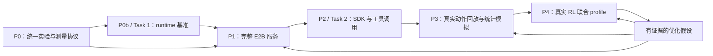

# E2B Sandbox for Agentic RL：分层性能实验总方案

版本：v0.1，2026-09-20 UTC。本文件保留完整设计；随后已执行阶段0/1/2的一轮基线与诊断，见[实际结果和范围](../../../sandbox/benchmark/REPORT.md)。原生runtime专项、真实动作回放、真实RL联合profile及长稳认证不在本轮已完成范围内。

制定本方案时用户正在使用Sandbox服务，因此最初只做规划。随后阶段0/1/2获得授权并完成一轮执行，范围和失败记录以上方实际报告为准。Task 1为尚待独立执行的原生runtime基准，Task 2官方SDK脚本已完成，入口见[任务记录](BENCHMARK-PLAN.md)。

## 1. 最终目标与实验问题

最终目标是在 Agentic RL 中识别 Sandbox 对轨迹供给和训练吞吐的限制，找到可验证的优化方向，并形成能重复执行的容量评估与回归套件。

实验必须分别回答：

1. 当前配置的配额/准入限制在哪里，资源真正的性能瓶颈在哪里？
2. 相同负载经过 runtime、完整服务、SDK 和 Agent 工具适配后，延迟与吞吐分别如何变化？
3. 实际工具模式、工作集、并发和等待间隔如何改变 Sandbox 压力？
4. Sandbox 优化能否增加有效轨迹供给、减少训练等待，同时保持任务与训练正确性？

沿用此前业务描述作为初始设计锚点：**常态关注 256 个工作实例、容量观察延伸到 512、常用 sandbox 4 GiB**。这些是测试目标，不是已验证的满负载承诺。绝对延迟/错误率 SLO 在低负载基线和 RL 时间预算明确后冻结；冻结之前只报告曲线和边界，不宣布“最大可用并发”。

容量定义：在指定模板、工作负载、内存实际使用和调用节奏下，满足延迟/错误率目标、队列不持续增长、资源与回收行为稳定的最大有效吞吐。配置上限、SLO 边界、资源耗尽边界分别报告。

## 2. 总体分层与原有 Task 的对应

| 阶段 | 入口与范围 | 要回答的问题 | 主要交付 |
|---|---|---|---|
| P0 测量准备 | 版本/拓扑、语料、计时、观测、负载发生器 | 数据是否可信、各层是否能关联？ | 实验协议、manifest、观测覆盖表、低负载正确性记录 |
| P0b Runtime 核心，Task 1 | 官方 `BenchmarkConcurrentResume`，直接 Factory | 热恢复成本、并行恢复曲线、页模式影响 | runtime 延迟/吞吐/失败曲线 |
| P1 E2B 完整服务 | 经正式形态网关，薄 HTTP/Connect 等协议客户端 | 控制面与数据面的容量、准入、排队和内部瓶颈 | 服务负载曲线、资源拐点、阶段时间线 |
| P2 SDK，Task 2 起点 | 官方 Python/Code Interpreter SDK；扩展必要场景 | 完整客户端体验、连接/重试/流处理与工具封装影响 | SDK 曲线、匹配请求对照、流式计时 |
| P3 真实数据驱动的回放/模拟 | 固定真实高层工具动作；另建统计负载 | 可重复条件下真实调用形态的压力、长尾及容量 | 回放语料、保真校验、负载预测与瓶颈报告 |
| P4 真实 RL 联合 profile | Agent、模型、SDK、E2B、verifier、learner | Sandbox 是否限制实际训练，优化是否有效？ | 关键路径、有效轨迹/训练吞吐、A/B 结论 |
| 横向工作 | 稳定性、恢复、观测开销、优化与回归 | 收益是否持续，代价是什么？ | 长稳记录、优化账本、回归基线 |

P0b 不等于 P1：Factory 基准绕过 API、SDK、团队配额和线上启动准入。P1 与 P2 通过匹配请求对照衔接；不需要对每个操作重复一套完全不同的压测系统。



## 3. 统一测量协议

### 3.1 每个数字必须说明计时边界

| 指标 | 定义 | 不可混用的指标 |
|---|---|---|
| Runtime 恢复 | Factory.ResumeSandbox 开始至返回，包含 envd 初始化等待 | Firecracker 单条 resume action、SDK create |
| SDK 创建 | 客户端开始调用至 SDK create 返回 | API handler 日志时间 |
| 首次可用 | 客户端开始 create 至指定首条探针命令成功完成 | 仅 API 201 或 envd health |
| 命令首输出 | SDK 调用开始至第一条输出事件 | HTTP 连接/流建立 |
| 命令完整耗时 | SDK 调用开始至完成事件、输出消费完毕及 SDK 返回 | HTTPX send 返回 |
| 命令内部工作 | guest 中命令 wall/user/system time | 整个 SDK/RPC 往返 |
| 文件操作 | 发起至全部字节传输并通过内容校验 | 仅响应头时间 |
| 销毁/回收 | 删除请求返回；另记 API 不可见与进程/资源清理完成 | 把删除 204 当成资源已完全释放 |
| Episode/rollout | 明确开始至有效轨迹及评分完成 | 单条命令或未评分 trajectory |

本地持续时间用单调时钟；UTC 用于跨主机关联，同时记录时钟偏差。不同机器的单调时钟不能直接相减。父子 span 有重叠，采用独占时间或关键路径分析，不能把 SDK、HTTP、tool 的嵌套时间重复相加。

### 3.2 请求、重试和失败都进入分母

同时记录 planned/offered、实际 dispatch、服务接收/准入、成功完成以及满足 SLO 的操作数。记录 logical operation 与每次 physical attempt、退避和重试；分别给首次尝试与含重试的完整体验。

延迟图必须配超时、拒绝、取消、错误率及未完成数。成功样本分位数不能单独证明服务稳定。429 配额拒绝、启动准入/503、内部错误、网络失败、guest 命令预期非零退出、结果校验失败分别归类。HTTP 200 不等于命令正确；预期失败的业务命令也不等于基础设施失败。

每次运行固定预热、稳态、突发、停止发新请求、排空和清理的边界。有限批次总时间与稳态吞吐分别报告，不把准备或排空成本隐藏进另一指标。

### 3.3 统计与对照

- 先用短 pilot 估计请求数和方差，再确定正式时长。常见稳态点可从预热 1–2 分钟、测量 5–10 分钟、至少 3 次独立重复开始；这些是起始设计，不代表所有场景的固定预算。
- 在主要拐点和高方差点追加重复；低频生命周期操作按实际样本数决定测量长度。P99 标注样本数与不确定性，不用 20 个样本宣称稳定长尾，不默认报告 P99.9。
- 以独立运行/时间块评估区间，避免把相关请求都当作独立样本。固定随机种子，保留运行顺序和全部失败轮次。
- A/B 尽量交错执行，模板、输入、资源、缓存、客户端及重试政策保持一致。先做一因子实验定位收益，再对证据支持的相互作用做少量组合。
- 不能将不同时间、模板和计时口径的均值直接相减，并把差值全部称为 SDK 开销。

## 4. 工作负载目录

所有场景有版本、固定输入、明确输出/状态断言。先覆盖代表性操作，再增加专项；不从第一天做所有参数的笛卡尔积。

| 类别 | 初始用例 | 主要变量及校验 |
|---|---|---|
| 生命周期 | create→envd ready→首条命令；delete；pause→resume | 普通热模板、首次访问模板、内存工作集、恢复状态校验；模板构建另测 |
| 短命令 | `true`、固定输出、Python 解释器启动 | 首输出/完成、固定输出字节数、退出码 |
| 状态工具 | stateful shell、编辑文件、cwd/env 跨命令保持 | 工具调用与底层 RPC 次数、状态/文件断言 |
| 文件 | 1 KiB、64 KiB、1 MiB、16 MiB 读写 | 内容哈希、缓存状态、并发、传输路径 |
| CPU | 固定输入和次数的哈希/计算；固定测试集 | 工作量一致、内部 CPU/wall、正确输出 |
| 内存 | 分配并真实触碰 64/256/512/1024 MiB 的受控工作集 | 实际触页、驻留、缺页、回收；不以 malloc 或模板标称值代表使用量 |
| 磁盘 | sandbox 内固定测试文件的顺序/随机读写 | fio 参数、文件大小、缓存/fsync语义；不对宿主原始块设备运行 |
| 网络 | 本地受控服务的请求/固定数据流 | RTT、吞吐、并发、连接复用；外部下载另作明确场景 |
| 固定混合 | 读文件→计算→写文件→等待的固定循环 | 工作比例、think time、状态断言 |
| 模板构建专项 | 固定镜像、依赖、build/ready | 镜像拉取、解包、构建、快照与发布阶段分别计时 |

“冷/热”拆开描述：模板制品是否存在、主机 page cache、guest cache、客户端连接、解释器/kernel 是否初始化，不能只用一个 warm 标签。冷缓存实验在隔离环境控制，不能在正在使用的共享 VM 随意 drop_caches。

## 5. 负载矩阵与执行策略

### 5.1 独立轴

- `N`：驻留/存活 sandbox 数量，候选 1、8、32、64、128、256、512。
- `C_start`：客户端在途创建/恢复数；与服务端准入值分开记录。先测客户端 1/2/3，再在专门负载实验中保持服务端准入=3、以受控的更高客户端负载观察拒绝/等待。提高服务端准入属于另一项参数实验。
- `C_tool`：在途工具操作数；先在预创建 sandbox 上测，使它独立于启动准入。
- `lambda`：每秒计划到达数，和实际发出的速率分别记录。
- `A`：驻留实例中活跃实例比例及工作负载类型。
- `M`：每实例实际触碰/驻留内存，另记模板配置内存。

256 个等待模型的实例不等于 256 个同时跑 pytest 的实例。512×4 GiB 满用需要 2 TiB，超过当前 VM 可见内存；容量点必须附实际工作集，不安排无边界的写满实验。

### 5.2 两种发生器模式

**固定并发（closed loop）**：固定数量的 worker，完成后再发下一次请求；用于客户实际使用方式和每请求成本曲线。

**固定到达率（open loop）**：按预定时刻发请求，观察排队和超载；计划发送时间、实际发送时间、发生器迟到/丢弃、服务拒绝分别记录。不能因服务变慢而自动减发，再把平稳曲线当成无饱和。

发生器排队必须有界，记录客户端在途上限命中、排队和丢弃；分别报告“计划到达→完成”和“实际发出→完成”的延迟。服务端仍限制 3 个启动时，客户端不能始终也限到 3 后将所有额外等待留在发生器，并据此宣称测到了服务端的过载行为。现有容量脚本拒绝 `--inflight > 3`，正式服务压测需在统一 runner 中实现明确的准入测试模式，不通过静默移除保护来改变历史脚本含义。

先用固定并发估计吞吐范围，再用附近若干到达率覆盖健康、拐点、轻度超载。初始倍率可参考估计吞吐的 25%、50%、75%、100%、120%，实际以资源范围和排空能力收敛，不承诺机械跑满。

### 5.3 控制矩阵规模

1. 各操作在低负载下通过正确性与计时验证。
2. 选少量驻留锚点，如 N=1、64、256，分别做粗并发/到达率扫描。
3. 找到吞吐停止增长、长尾加速或首次 SLO 失败附近，再加密档位。
4. 在关键点增加真实工作集、第二种模板和混合负载；512 点是容量扩展，按观测结果进入。
5. 大页、启动准入、连接复用等优化只在相关场景与代表点对照，不将所有因素全组合。

记录启动限流造成的拒绝和资源饱和造成的退化，不能把“3 个准入名额”当成机器只能同时承载 3 个请求的证据。

### 5.4 负载发生器自身验证

发生器记录 CPU、内存、事件循环迟到、连接/FD、实际 dispatch lag。将发生器放在与被测 VM 分开的 CPU 资源上；必要时以增加 worker/第二发生器验证曲线是否变化。本机回环/宿主到 VM 路径和未来远端网络路径分别标记。

只有发生器能按约定产生负载且仍有余量，才可把曲线拐点归因于服务。SDK 会话与连接的创建/复用策略必须固定并记录。

## 6. 各阶段的具体工作与准入条件

### P0：准备与低负载校验

- 冻结源码/补丁、二进制、SDK、镜像 digest、模板 build、guest/host kernel、Firecracker、CPU/NUMA、VM磁盘及网络拓扑。
- 固定操作合同、重试/超时、结果校验、清理归属和资源上限；先保证功能正确。
- 验证计时字段、实际请求数、状态关联、原始数据落盘、发生器能力以及观测开销。
- 将绝对 SLO 和测量误差容忍度列为待冻结参数；不以任意阈值替用户业务需求下结论。

进入下一阶段的条件：关键字段完整、阶段口径可解释、低负载结果符合预期、测试实例归属清楚并能确认清理、发生器没有成为瓶颈。

### P0b：原生 runtime，Task 1

保留上游并发基准，N=1 作为同口径串行基线。先用普通页、原生 512 MiB 规格，再增加 4 GiB 规格；规格改变采用新构建身份。准备/预热/清理与恢复计时分开。

它调用真实 Firecracker/KVM，但不走当前服务 API。并发入口使用真实 cgroup manager；辅助 BaseImageLaunch 使用 Noop cgroup，二者不能未经控制直接合并。原生基准的普通页开关是 `DISABLE_HUGE_PAGES=true`。

输出并发—单实例延迟、并发—整批耗时/吞吐、失败原因，并在需要时开启短 trace 解释阶段。不能用它证明 SDK 用户端启动吞吐。

### P1：完整 E2B 服务

**控制面**经与生产相同形态的网关调用 API：创建、删除、暂停恢复、查询；单独衡量请求到达、准入、调度、内部调用与就绪。

**数据面**在预创建 sandbox 上执行命令、文件、流/端口请求；入口使用实际 HTTP/Connect 等协议，保持与 SDK 对照组相同的请求语义、认证和数据。薄协议客户端不改走内部管理端口来代替外部服务路径。

输出吞吐、长尾、错误、队列/在途量、资源的对齐曲线。在完整服务里将同时运行数和同时启动数拆开，保留当前准入=3 的基线。

### P2：SDK 与 Agent 工具封装，Task 2

以官方 `code-interpreter-python/tests/performance.py` 为来源基线，先完成串行 create、health 命令和两次 Hello world；原脚本只有 20 轮和基本统计，需要明确结果校验、异常回收、逐样本数据及单调计时。

再扩展真实 SDK 的并发、命令/文件/状态 shell、输出大小与连接复用，对齐 P1 的代表点。Code Interpreter 需独立准备匹配的普通页模板，不能默认 base 支持 run_code。

SDK 完整耗时与服务端阶段的差异包含网络、排队、协议、序列化、流消费和 SDK 逻辑，不把差值一概命名为 SDK 开销。特别记录请求开始、命令开始事件、首输出、最后输出/EOF、SDK 返回。

进入 P3 前：SDK 和薄客户端在相同输入下功能一致，差异有阶段证据；不能仅凭一个平均值宣布某层慢。

### P3：真实数据驱动回放与模拟

**P3a：固定真实高层工具动作回放。** 从历史 transcript 提取 tool name/arguments、顺序和状态依赖，通过原生 Toolbox 执行，重新生成本轮 RPC。保留 tmux、cwd、env、文件修改和同一 episode 的串行因果关系。固定动作回放用于性能保真，不重新调用模型作决策。

**P3b：统计负载模拟。** 从已验证语料提取工具比例、payload/输出大小、生命周期频率、活跃比例、到达/等待分布和长尾，生成可控混合负载。标明它不保留完整命令语义；不能把 `sleep(历史耗时)` 称为真实 CPU/I/O 工作回放。

回放需要以下步骤：

1. 建 corpus manifest：按任务、episode 长度、工具/资源类型、成功失败和长尾分层选取代表集；先小集合校验再扩展。保留有代表性的失败/循环案例。
2. 固定初始 Git tree、模板、依赖和适配器版本。镜像可能有额外环境设置提交，仅恢复数据集 base commit 不足以重现环境。
3. 对声明工具、实际执行、skipped、观察消息、文件 payload、env/timeout 和时间覆盖逐项审计。缺失内容不能静默补齐；不完整样本只回放可验证前缀或标记为不可回放。
4. 每步检查退出状态、观察结构和重要文件；首次实质状态分歧即停止并记录。末尾核对 patch/官方 verifier；预期失败作为语义的一部分保留。
5. 保留两种调度：有证据的原始等待/到达节奏，以及保留依赖但去除外部模型等待的尽快执行模式。命令内部 sleep/I/O 属于动作语义，不删除。
6. 历史没有精确 LLM 等待时间时，明确采用模拟分布；不能将 exec 之间所有空档都标成模型时间。到达缩放不能破坏 episode 内依赖。

输出有效回放数、覆盖/剔除/分歧率、任务与工具吞吐、关键路径、RPC 放大次数、延迟和资源分布。回放 verifier 结果是保真检查，不代表新模型能力。

### P4：真实 RL 联合 profile

先接一段可控的小规模真实运行，校准 P3 预测，再扩大到代表性训练窗口。沿用用户真实训练拓扑，不默认在当前 Sandbox 节点额外启动模型或 learner。

关联 episode/tool/SDK/API/sandbox/command/verifier/learner；测模型请求排队与生成、环境准备、工具等待、测试评分、轨迹回传、batch 尾部等待、learner 等待、更新、权重同步和 checkpoint。异步训练还需 policy version、轨迹年龄与丢弃原因。

主要业务指标：

- 有效且完成评分的 trajectories/min、有效 environment steps/s；同时说明分母与失败样本。
- 完整 episode 延迟和 batch 尾部；Sandbox 等待在关键路径上的占比。
- learner 等待比例、训练更新/单位时间、GPU 活动作为辅助信号。
- 任务成功/奖励分布、轨迹有效性和训练数值是否出现回归。

只有真实 RL 的重复对照支持，才宣称训练加速。组件快了、CPU 更满、回放吞吐更高都不能单独证明 RL 改善。短期 profile 也不能证明训练收敛更好。

## 7. 观测与诊断设计

### 7.1 分层信号

| 层 | 需要的信号 |
|---|---|
| 发生器/SDK | 计划/实际发送、逻辑/物理请求、连接/流时间、重试、事件循环迟到 |
| 网关/API | request ID、sandbox路由、upstream连接/响应、状态、准入与请求阶段 |
| orchestrator | 网络/NBD分配、快照/磁盘/内存、UFFD/预取、Firecracker恢复、envd初始化、回收 |
| sandbox/guest | 命令内部wall/CPU、工作集、I/O、输出、工具状态；按需要采样 |
| 外层VM | 每核CPU/调度、PSI、磁盘队列/await、TCP、cgroup CPU/throttle/memory.events/io.stat/pids |
| 物理宿主机 | QEMU线程、CPU/NUMA、物理盘和网卡、steal/调度影响；区分其他用户负载 |
| RL | Agent/model/tool/verifier/learner 的事件与依赖 |

保留网络邻居表溢出、NBD占用、FD、进程数、临时磁盘和清理延迟，避免仅盯 CPU/RAM。cgroup/RSS 与 guest 应用内存不是同一个口径；memory.peak 不是每个采样区间峰值。

### 7.2 两种观测模式

**最小模式**用于主要性能数字：客户端事件、必要的服务日志和 1–5 秒资源采样；短请求的阶段用事件/span，不靠 5 秒 CPU 样本推断。正式数字前做带/不带记录的对照，量化观测开销。

**诊断模式**用于复现的健康点、拐点和典型长尾：短窗口 OTel trace、pprof CPU/heap/goroutine/Go trace；有内核/虚拟化证据时再上 perf/eBPF。记录额外开销，不能把重 profiling 结果与最小模式混为同一基线。

当前核验的实际限制：

- 当前 API/orchestrator/client-proxy 未配置 `OTEL_COLLECTOR_GRPC_ENDPOINT`，主 `telemetry.New` 使用 Noop。但后续执行阶段核对到 API team observer 和 orchestrator sandbox observer 独立创建 exporter，当前仍有向空地址导出的 `missing address` 日志；不能从主 provider 的 Noop 推导全部遥测都已禁用。
- 当前源码 tracer 使用 `AlwaysSample()`。不能假定设置通用 `OTEL_TRACES_SAMPLER` 环境变量就会降采样；collector 后采样也不能免除应用产生 span 的成本。
- API 会移除外部传入的 `traceparent`。先建立显式 operation/attempt→sandbox/execution 关联；需要无歧义逐请求串联时，再做经过验证的实验 request ID 记录，不能假定端到端 trace 自动连通。
- 现有 Nginx 日志缺统一请求 ID、sandbox 路由与完整 upstream 分段；补齐配置可能触发组件变更，纳入后续准备窗口。
- 旧 profiling 的 HTTPX send span 对流式响应可能只到打开流，必须补命令/代码执行流的结束边界。

### 7.3 统一数据合同

每条记录至少可表达：

```text
schema_version, experiment_id, run_id, phase, scenario_version
worker_id, episode_id, operation_id, attempt_id, parent_id, dependencies
sandbox_id, execution_id, template_build, runtime_version, sdk_version
operation, arguments_ref, payload_ref, input_bytes, output_bytes
planned_offset, dispatch_time, first_output_time, completion_time, duration
status, http/rpc_code, exit_code, error_class, retry/backoff, state_check
source_record_ref, completeness, instrumentation_mode
```

正文/文件 payload 在私有语料中按内容哈希引用，报告保留元数据和脱敏样例；认证由运行配置注入。不能把命令中的密钥直接替换成无效占位符后仍称为等价回放。唯一 ID 保存在日志/trace，不作为时序指标的高基数标签。

## 8. 优化假设与验证闭环

| 观测到的现象 | 候选方向 | 验证方法与代价 |
|---|---|---|
| 创建在准入处拒绝、资源仍有余量 | 提高启动准入、平滑突发 | 匹配负载 A/B；记录长尾、错误、资源突发，不能仅看成功峰值 |
| 快照/缺页/预取占比高 | 普通页/大页、预取和缓存策略 | 同模板/内存工作集对照；同时比较内存预留和容量损失 |
| 一次工具产生多次串行 RPC | 持久会话、批量读写、减少轮询 | 同高层工具语义与结果，记录 RPC 数、取消/超时和状态正确性 |
| SDK等待增加、服务内部时间稳定 | 连接池、复用、序列化、流消费 | 匹配协议/SDK请求与发生器头部空间，不用平均值差直接归因 |
| verifier CPU/I/O 长尾 | 固定依赖、资源分配、评分并发 | 保持测试内容和评分一致，观测 episode/batch 尾部 |
| 磁盘/网络/表项/FD限制 | 存储布局、连接与系统容量参数 | 以相应计数/队列证据验证，同时检查回收和资源成本 |
| 模型/learner才是主要等待 | RL排程、并发、服务拓扑 | 通过真实RL关键路径验证 Sandbox 优化是否有可见收益 |

每个优化建立记录：假设→证据→唯一变更→配对输入→重复结果/区间→正确性→资源代价→是否接受→回归用例。冻结前留出一组未参与调参的回放任务/模板作验证，避免只对测试集调优。

同一修改至少回到相关低层基准和代表性 P3 用例；涉及训练供给的结论再回到 P4。参数收益与软件/内核升级收益分别归档。

## 9. 稳定性、超载与恢复

同时覆盖稳定驻留和持续创建/销毁。先短稳态，再中等时长 soak，最后在资源窗口允许时做覆盖数小时的长稳回放；记录性能随时间的趋势和所有泄漏/残留。

检查 CPU/memory/FD/NBD/网络表项/临时磁盘是否随循环单调增长，实例和资源是否在排空后恢复。采集负载下降后的恢复时间。超载时区分队列增长、准入拒绝、超时和内部失败，并记录重试是否放大压力。

组件重启、节点故障等故障注入是后续独立实验，不属于当前计划讨论中已执行或可以对在线任务直接做的动作。当前宿主与 VM 有真实用户任务，K8s namespace 不能隔离共享 CPU、RAM、磁盘、网络表或核心 Pod。

## 10. 测试环境与执行边界

当前正式服务继续运行。现在允许的工作是文档、代码/数据结构审计和已有资料整理。负载执行安排在后续明确的隔离环境或维护窗口。

- Runtime 原生基准自行管理网络/NBD和固定代理端口，不直接与现有 daemon 共享这些资源并跑。
- 完整服务基准优先使用与正式部署拓扑/版本一致的隔离测试实例；若隔离实例资源更小，结果按其规格报告，不外推为当前 192 vCPU/约1.5 TiB VM 的容量。
- 对当前全规格部署测容量需要专门窗口；单纯“另起一个 Pod/namespace”不是独立实验环境。
- 每次执行明确资源范围、停止阈值、唯一 run 归属、排空/清理策略和回退步骤。不得清理其他用户实例。
- 当前长期监控按此前用户要求保持停止。实验所需临时采集单独标识生命周期，不自动恢复旧采集任务。

## 11. 工程组织与交付物

建立一个版本化套件，共用配置解析、场景合同、负载调度、记录与校验/清理逻辑；thin protocol、SDK、工具回放是不同 adapter。已有脚本作为来源与用例，保留原样参考及适配 diff，逐步收敛到统一 runner，避免每个场景独立统计、定义不同的 P95。

拟定结构（当前只规划，不创建空目录）：

```text
benchmark/
  protocol/          # 指标、schema、错误分类与场景合同
  scenarios/         # 固定输入、模板声明、负载矩阵
  adapters/          # runtime / protocol / SDK / Toolbox replay
  runner/            # 到达调度、归属、结果校验与清理
  analysis/          # 从原始数据生成汇总和图表
  regression/        # 小型确定性回归集
```

运行目录放 `/data2/yuhanya/e2b-benchmark/<experiment>/<run>/`：manifest、逐请求 JSONL、资源序列、trace/profile、清理报告和派生汇总。它是后续拟用位置，本次未创建运行环境。文档仓库仅保存方案、轻量代码、统计、PNG/SVG/PDF图表与复现说明，不放原始大日志、模型或磁盘。

每个正式报告至少包含：

1. 拓扑/版本/配置/数据/观测模式和实际执行命令。
2. offered—achieved—SLO达标吞吐曲线。
3. P50/P95/P99 对并发/到达率曲线，以及错误/超时/重试、队列/在途量。
4. 驻留数/实际内存/活跃比例的容量图；CPU、I/O、网络和系统限制对齐时间线。
5. 代表性操作的阶段分解与关键路径；控制面、数据面、SDK分别标明。
6. P3语料覆盖、保真/分歧、混合负载和有效回放吞吐。
7. 优化 A/B 的收益区间、资源成本、回归和未改善场景。
8. 长稳/回收/恢复趋势；P4阶段的轨迹供给、learner等待、训练吞吐与正确性边界。

分析应能从保存的原始数据重新生成图表。用确定性用例校验计时、分页、重试归因、回放状态和清理，不在普通 CI 中运行满载/破坏性实验。先建立轻量功能回归，再把经批准的性能回归放到专用环境。

## 12. 当前可复用材料与缺口

### 已有起点

- [Task 1/2 入口与准备记录](BENCHMARK-PLAN.md)。
- [512 容量脚本](code/test_4k_capacity.py)：真实 SDK、归属清理、创建计时与分页；当前不是完整持续压测框架。
- [历史监控说明](monitor/README.md)：VM/宿主机/cgroup/事件采集，可复用采样与分析思路，需升级当前遥测说明。
- `Agentic_RL/uni-agent-experiment/07_swe_sandbox_profiling`：工具/文件微基准、分层 profile 和已发布汇总；旧路径的原始数据需核对。
- `/data2/yuhanya/swe-e2b-rl-20260914/run/swe8b300_20260914_a`：历史 episode transcript、sandbox events 和 attempts 中 RL 阶段指标。

### 本次只读语料审计发现

历史 episodes 目录有 184 个 JSON，其中 175 个标记 valid、覆盖 34 个任务；其余包含旧 schema 或历史 running 标记。这不是当前活跃任务数，也不能直接作为独立 rollout 样本数。

175 个 transcript 中有 3,931 个声明工具调用、3,930 个对应观察消息；观察消息仍可能表示 skipped。sandbox events 有 14,767 条 exec，可见 argv/cwd/退出/时长/输出字节，但缺完整 env/timeout、文件写 payload和成功 file-read 记录，create也缺完整开始区间。它们支持高层动作回放准备，不支持直接声称完整底层 RPC 精确重放。

07 profiling 的 argv_preview 截断、file-write只记路径/字节；发布的 timeline 去掉部分父子标识，不能从图上恢复精确依赖 DAG。部分历史原始 spans 路径当前不存在，需要确认迁移/归档位置。首先建立完整性清单，再决定可回放子集及补采字段。

## 13. 推荐推进顺序

1. 完成 P0 的协议、环境、观测与语料 manifest；冻结第一批代表性操作和基线。
2. 完成 P0b/Task 1、P1 与 P2/Task 2 的基础曲线，定位第一个可重复的限制；低层实验可以交错开展，测量口径统一。
3. 校验真实高层动作小集合，建立 P3 回放和统计模拟，再扩展覆盖及稳态/长尾场景。
4. 对已定位限制做少量 A/B，建立稳定性和回归证据。
5. 用 P4 真实 RL profile 校准并验证收益，决定下一轮优化；保留未解决问题及证据缺口。

每阶段形成可独立审阅的数据包和结论，不以“脚本跑完”作为完成标准。执行时长取决于测量方差、语料可重放率和服务窗口，不在尚未运行前给出保证完成日期或性能提升承诺。
