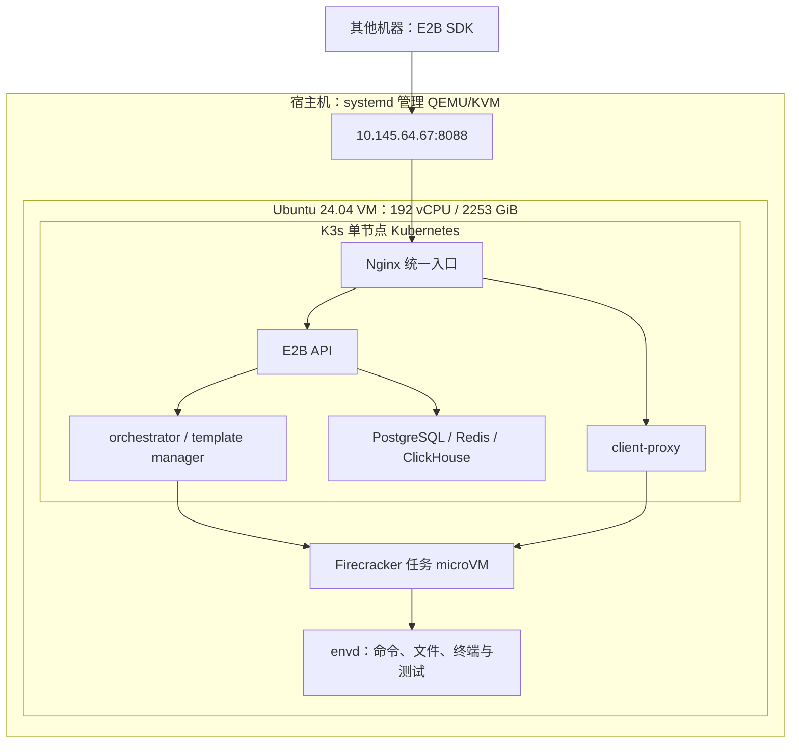

# 本地 E2B Sandbox 服务

**换机器手动搭建：[完整步骤 README](README-REPRODUCE.md) · [复现材料包](releases/e2b-manual-setup-20260924.tar.gz)。** 从建 VM 到编译、安装、取 key 和测试，区分宿主机与 VM 内命令。下文保留原部署与实验记录。

服务已可用，统一入口为 **http://10.145.64.67:8088**。E2B 的控制 API 和沙箱数据请求共用该地址；客户端同时设置 `E2B_API_URL` 和 `E2B_SANDBOX_URL`。这是内网地址，调用机器需要能路由到该网段。

本次正式训练的后台性能采集已于 2026-09-16 23:52 UTC 停止，历史数据保留，详见 [监控说明](monitor/README.md)。采集期间每 5 秒记录 VM/宿主机性能，每分钟采集服务与事件，每 15 分钟生成一小时汇总；原始数据位于运行工作区的 `monitoring/`，未复制进本仓库。

本项目只提供 sandbox 服务，不依赖 vLLM，不在此 VM 内运行模型训练。实际测试包括 E2B SDK、原生 Uni-Agent 工具和一个 SWE-bench 环境的 verifier 对照。

任务记录：[E2B benchmark 计划](BENCHMARK-PLAN.md)。原生runtime专项仍待独立执行；官方SDK脚本已在后续阶段0/1/2实验中执行，结果见下方benchmark目录。

完整实验设计：[面向 Agentic RL 的分层性能实验总方案](BENCHMARK-PROGRAM.md)，覆盖测量协议、服务/SDK压测、真实数据回放、真实RL联合profile、优化对照与稳定性回归。阶段0/1/2本轮已执行，见[benchmark结果](../../../sandbox/benchmark/REPORT.md)；其他阶段仍为后续计划。

日常查看：[进入 VM、盘点 Firecracker、查看实例活动和 SDK 列表](INSPECT.md)。

## 客户端接入

API key 保存在宿主机私有文件 `/home/yuhanya/.config/e2b-local-20260916/client.env`，权限 0600，不包含在本仓库。宿主机使用 `source` 加载该文件；其他机器由服务所有者安全分发 key。

```bash
pip install e2b==2.49.1
export E2B_API_URL=http://10.145.64.67:8088
export E2B_SANDBOX_URL=http://10.145.64.67:8088
export E2B_API_KEY='<API_KEY>'
python code/client.py
```

默认模板是 `base`（2 vCPU / 512 MiB）。通用 4 GiB 模板为 `base-4k-4g`（2 vCPU / 4096 MiB）。已有 91 个可用模板已迁移为普通页快照，原名称、CPU 和内存规格保留。模板资源与外层 VM 资源是两个层级。

**当前配置（2026-09-22）**：VM 配置为 **2253 GiB（约 2.2 TiB）**，每节点创建/恢复准入和目标团队/节点存活配额均为 **512**。使用普通 **4 KiB** 页，不预留 HugeTLB 池。内存是 VM 的逻辑上限，宿主机其他任务仍会占用物理内存；512 个实例的持续满载能力尚未验收。详见[本次调整](VM-MEMORY-20260922.md)。9 月 20–21 日的结果保留在历史记录中。

扩容时定位并修复了默认 ARP 邻居表容量 1024 导致的约 350 实例卡点。阈值调整后，实测邻居项峰值 1546，溢出计数没有新增。启动准入曾从 3 调到 1024，9 月 22 日按用户要求改为 512。运行配额与创建并发仍是两个独立限制。详见 [历史迁移说明](4k-512.md) 和 [历史验收汇总](results/4k-512-summary.json)。

## VM 与服务结构



| 资源 | 实际配置 |
|---|---:|
| 外层 VM CPU | 192 vCPU，宿主机 CPU 192–383 |
| 外层 VM 分配内存 | 2253 GiB，约 2.2 TiB |
| VM Linux MemTotal | 少于 2253 GiB，需扣除系统与内核保留；见本次实测记录 |
| Sandbox 内存页 / HugeTLB 池 | 普通 4 KiB / 0 GiB |
| 团队 / 单节点运行配额 | 512 / 512 |
| 每节点创建 / 恢复准入 | 512 |
| NBD 设备 / 邻居表硬阈值 | 1024 / 16384 |
| 活动 VM 磁盘 | `deployment.json` 的 `root_image` 指定当前文件；本次保留已有磁盘 |
| K3s | v1.36.4+k3s1 |
| E2B Runtime | e7b22501988c826563bf1b3cf0d22a1183e7affe + 本地普通页/配额/启动并发补丁 |
| Guest kernel | 6.8.0-139-generic |

VM 由 `e2b-sandbox-vm.service` 直接管理，没有注册到 libvirt，因此 `virsh list` 不会列出它。宿主机访问：

```bash
/data2/yuhanya/e2b-local-20260916/code/vm-ssh
sudo systemctl status e2b-sandbox-vm.service --no-pager
```

VM 内访问 Kubernetes：

```bash
sudo k3s kubectl get nodes
sudo k3s kubectl -n e2b get pods
```

SSH 管理端口是宿主机 loopback 12222；客户端 API 使用上述非 loopback 地址。统一网关按 `E2b-Sandbox-Id` 请求头，将沙箱请求送到 client-proxy，其余请求送到 API。SDK 自动携带沙箱路由头。

## 已验证结果

- SDK 2.49.1 的 9 项检查通过：错误 key 拒绝、Linux 命令、中文文件、二进制文件、exit 7 与 stdout/stderr、cwd/env、续期与存活、同一地址访问沙箱 HTTP 端口、销毁确认。
- 同时存在的 8 个沙箱通过独立文件与命令检查，全部清理。创建并发限制为 2；这不是 192 vCPU 的满载压测。
- 原先的 `verdal_basic.py` 未修改，改用本地地址和 key 后通过。
- 原生 Uni-Agent / E2B 适配器的 9 项工具检查通过，包括 tmux 状态保持、编辑器和 submit；没有模型调用。
- Flask-5014 官方 verifier 对照通过：未修复 baseline reward=0，应用数据集中 gold patch 的 oracle reward=1。两者使用独立沙箱并清理。这是环境与评分验证，不是模型解决率。

详见 `results/` 中的机器可读结果。测试来自宿主机通过 `10.145.64.67:8088` 访问；未声称已从另一台物理机器验收网络路径。

## 复现与运维要点

完整运行工作区为 `/data2/yuhanya/e2b-local-20260916`；本目录只保留小型代码、配置和结果，没有 VM 磁盘、软件环境、模型或密钥。

在新机器复现时，先安装 QEMU/KVM，准备 Ubuntu 24.04 cloud image 和 SSH cloud-init，启用嵌套虚拟化。修改 `configs/deployment.json`、systemd 单元中的 UID/GID、CPU 集合、IP、路径及资源，然后创建磁盘并启动 VM。本次 cloud image 的 SHA256 在 `results/ubuntu-image.json`；其下载 URL 中的 `current` 会更新，精确复现应保留原镜像或取得相应归档版本。

从上述 E2B commit 下载 `embed/kubernetes` 到运行目录 `vendor/e2b/embed/kubernetes`，按 [普通页复现说明](4k-512.md) 应用原补丁，再应用[启动并发增量补丁](patches/runtime-starting-concurrency.patch)，按[当前构建说明](STARTING-CONCURRENCY-20260921.md)编译。在 VM 的 `/opt/e2b-local` 放置 `code/`、`configs/`、`vendor/`，并将自定义二进制、SQL 目录及 host-setup 脚本放入 `custom-runtime/`，再运行 `code/install_guest.sh`。脚本校验初始化顺序和普通页配置，并应用网络容量配置与 Kustomize；已有部署不会重新生成 API 管理凭据。

现场修复的两个关键点已保留：

1. Kustomize 的资源补丁可能重排 init containers。`capacity.yaml` 显式保留官方顺序，否则 orchestrator 会早于制品下载和迁移启动。
2. E2B 默认 DNS 为 8.8.8.8，本环境无法直接访问它。VM 内的 `e2b-local-network.service` 将相关 DNS 请求转发到可用的 10.0.2.3；此地址是本次 QEMU user networking 的 DNS，迁移网络时必须调整。宿主机 DNS 未修改。

外层 VM 最初使用 Docker 包装 QEMU，遇到两次 stop 和一次容器删除事件后改为独立 systemd 服务，原磁盘保留。停止来源未确认。不要同时启动历史 Docker VM 与现有 systemd VM，以免争用磁盘和端口。

该部署是单 VM、单 K8s 节点、单节点 E2B Embed，使用本地持久数据，并非高可用架构。维护或重启 VM/核心 Pod 会中断运行中的沙箱；客户端需处理重试。HTTP 入口适用于当前受信内网；扩大访问范围前应增加 TLS 和相应网络隔离。默认 `get_host()` 的云域名未接入本地 DNS，访问额外沙箱端口可使用统一入口与 SDK 文档规定的路由头。

## 2026-09-16 磁盘扩容

已将现有根磁盘从 256 GiB 在线扩展至 1 TiB（1,099,511,627,776 字节）。通过正在运行的 QEMU 的 QMP `block_resize` 扩展 qcow2，再在 VM 内执行 `growpart /dev/vda 1` 和 `resize2fs /dev/vda1`。分区起始位置、UUID 和其他启动分区均保持不变。没有对运行中的镜像执行离线 `qemu-img resize`。

VM 没有重建或重启。扩容前建立的沙箱在扩容后仍可读取同一标记文件，扩容后新建沙箱也通过命令与清理检查；API 地址和原 key 均未改变。根文件系统约 991 GiB，其中约 971 GiB 可用，其余为系统数据和文件系统开销。详见 `results/disk-resize-1t.json` 和 `results/disk-resize-new-sandbox.json`。

qcow2 采用按需分配，1 TiB 是虚拟容量，未在宿主机预留等额空间。完成检查时 `/data2` 实际剩余约 1198 GiB，当前有足够的物理余量。后续仍需同时监控宿主机与 VM 内的磁盘空间。
