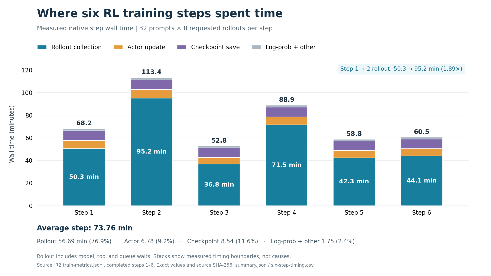

# Stopped-run review: configuration, sandbox reliability and completed evidence

Subsequent user discussion and intended future policy are recorded in [DECISIONS-20260921](DECISIONS-20260921.md): 20-step saves, latest-only checkpoint retention, layered admission/timeout questions and prioritizing infrastructure. These are documentation-only decisions; the stopped run's configuration and checkpoints remain unchanged.

**Training was stopped at the user's request on September 21, 2026. Six native training steps and checkpoint 6 are complete. Step 7 was interrupted during rollout collection. The 100-step objective and post-training evaluation are incomplete.**

The evidence supports two distinct findings: the training/client configuration adds substantial waiting and checkpoint cost, and the sandbox service has real readiness/transport failures. The measurements do not establish that sandbox CPU or memory capacity explains the whole training time.

## Stop and preservation

- At 02:45:28 UTC, the exact R2 driver received SIGINT after the supervisor had received the stop request. Its own shutdown path stopped its Ray cluster and ran sandbox cleanup. The supervisor finished at 02:46:15 UTC.
- The dedicated training container stopped at 02:47:14 UTC. The host/VM samplers, model metrics collector and report publisher then exited through their scoped stop files.
- At 02:48:12 UTC, all these process IDs were absent, the container was stopped, run-owned sandbox cleanup had zero remaining instances and zero errors, and all eight GPUs had 0% sampled activity with approximately 0.3 GiB VRAM used each.
- Checkpoint 6 passed native manifest, file presence and size validation: 40 payload files, 427,535,690,122 bytes (398.17 GiB), including model/optimizer/scheduler/RNG/dataloader state. This stop did not reload all checkpoint-6 tensors. Checkpoint-1 reload had previously passed all eight rank proofs.
- Full payloads remain for checkpoints 1, 5 and 6. Directories 2–4 contain only small residual records; their directory names do not imply full recoverable checkpoints. Configured retention is two for the resumed attempt; the earlier checkpoint-1 payload is also present. Nothing was deleted during this review.
- The native driver records `KeyboardInterrupt` / `failed`, and the supervisor records exit 1. These are the requested operator interruption, not evidence of a new spontaneous training failure. Raw exit records are preserved.
- `admission-state.json` is the final pre-stop observation; its queued/active counters are stale after actor exit. They do not mean sandboxes are still running.

Private stop audit and frozen final records: `/data2/yuhanya/e2b-rl-pathfinding-20260920-r2/results/operator/stop-20260921/`. In particular, `request.json`, `driver-signal.json`, `container-stop.json` and `final-verification.json` record intent, identities, actions and results. No automatic restart is scheduled; further runs await the user's next instruction after analysis.

## What is complete

| Work | Executed scope | Outcome and boundary | Evidence |
|---|---|---|---|
| Phase 0: environment and measurement controls | Inventory, protocol/lifecycle checks, clock and file-transfer diagnostics, recording comparisons | Reusable baseline; full instrumentation-on/off overhead and exact cross-host timing remain unmeasured | [Phase 0](phase0-environment/REPORT.md) |
| Phases 1–2: service and SDK characterization | 104 valid main performance units, three setup failures, 42 supplemental units, six multiprocess cohorts; mostly 20–30-second windows | Measured command/file/lifecycle/startup behavior and failure cases. This is short-window characterization, not sustained RL capacity certification | [Service/SDK report](REPORT.md) |
| Phase 3: real tool replay | Eight historical 8B episodes across four tasks; 87 of 143 planned actions executed | Five full replay/verification matches, three observation divergences; all owned instances cleaned | [Replay](phase3-replay/RESULTS.md) |
| Phase 3: offline scheduling simulation | Historical 256-episode timings, 1,000 bootstrap resamples | A scheduling what-if using fixed durations; no SDK, model or GPU workload | [Simulation](phase3-replay/SIMULATION.md) |
| Phase 5: create-admission comparison | Two policies, three 32-sandbox cohorts each, 192 successful starts | Cohort median 71.16 to 44.42 seconds; individual create/setup calls became slower. This policy was not enabled in R2 and is not an observed RL speedup | [Gate comparison](phase5-optimization/RESULTS.md) |
| Phase 5: coexistence diagnostic | One target-256 trial, fixed Flask template, 4 vCPU / 8 GiB, three create workers | 177 resident instances passed light command checks; one preparation failure, 78 requests unissued, zero final residual instances. No hard capacity ceiling established | [Capacity](phase5-optimization/CAPACITY.md) |
| Training environment/reward qualification | 62 training tasks plus 16 evaluation tasks, unrepaired and oracle-patched controls | 0/78 unrepaired and 78/78 oracle resolved. These are scoring/environment controls, not model performance | [Run scope](phase4-rl/RUN-PLAN.md) |
| Phase 4: real RL | R1 failed before any update; corrected R2 completed native steps 1–6, then operator interruption in step 7 | Real updates and checkpoints; step-0 evaluation 6/16. No step-25 evaluation or final trained-model acceptance | [Native metrics](phase4-rl/results/stopped-20260921/six-step-timing.csv) |
| Reliability repairs | Ray cancellation reproducer, 11 real-Ray regression cases, eight real-sandbox integration cases, checkpoint save/load review | R1 permit leak repaired; checkpoint observer/scheduler fixes verified. These checks do not measure a production RL speedup | [Cancellation repair](phase5-optimization/GATE-CANCELLATION.md), [checkpoint compatibility](phase5-optimization/optimizer-checkpoint-compat/README.md) |

Existing reports, scripts, configurations and figures remain in their phase directories. The revised English presentation from the service/SDK work is [CPU Sandbox Benchmark Focused](briefing/data_driven_en_v2/CPU_Sandbox_Benchmark_Focused_EN.pptx); it predates this stopped-run review.

## Exact scope of the stopped training run

Run `ua-e2b-pathfinding-20260920-r2`, root `/data2/yuhanya/e2b-rl-pathfinding-20260920-r2`, used the requested `verlai/verl:rocm7.14_torch2.12_release_0724` image and Qwen3-Coder-30B-A3B-Instruct on eight MI350X GPUs.

Training sampled 32 prompts with eight rollouts each from **62 qualified SWE-rebench tasks**. Evaluation used **16 fixed SWE-bench Verified tasks**. Full 1,150/500 corpora were downloaded, but most templates were not prepared; no full-Verified claim is supported. Planned evaluation points were 0/25/50/75/100, so only the initial evaluation was reached.

The six completed batches contain 256, 255, 256, 255, 256 and 256 retained trajectories respectively, totaling **1,534**, with two failed training results in the completed prefix. This differs from the nominal 1,536 requested trajectories. Step 7's cancellation/unfinished records are preserved and excluded from the completed-step timing table.

The current supervisor's `--resume-owned` branch explicitly requires checkpoint 1. It was written for the one-time checkpoint-1 recovery test, not general recovery from checkpoint 6. A future resume must first review and correct that orchestration assumption, inspect checkpoint 6 and the dataloader/budget state, and verify native loading. Do not blindly reuse the old resume command or delete the stop request to restart.

## Where the measured time went

| Native phase | Mean per completed step | Share of six-step wall time |
|---|---:|---:|
| Rollout collection: model calls, environments, tools, verification and waiting | 56.69 min | 76.86% |
| Actor update | 6.78 min | 9.19% |
| Checkpoint save | 8.54 min | 11.58% |
| Old-policy log probabilities | 1.61 min | 2.18% |
| Weight synchronization | 5.47 s | 0.12% |
| Other recorded/residual step work | about 3 s | about 0.06% |
| **Total** | **73.76 min** | **100%** |

Completed steps range from 52.79 to 113.39 minutes. Checkpoint saves consistently take 510–516 seconds; rollout collection varies from 36.84 to 95.16 minutes. This identifies rollout variation and checkpoint cost as priority subjects without assigning all rollout time to the sandbox.

Step 1 and step 2 have nearly identical packed sequence sizes (8.678M versus 8.648M tokens), but rollout collection takes 50.32 versus 95.16 minutes. Actual model-output tokens rise only from 2.653M to 3.026M. Token totals alone do not explain the nearly doubled collection time; different tasks, individual long trajectories, admission delays, service/model waiting and retries must be separated.

Token accounting matters: in step 5 the packed total is **8.331M**, comprising approximately **2.668M model-output tokens, 5.067M interstitial/tool-context tokens and 0.596M initial-prompt tokens**. `response_length` includes subsequent context; `perf/throughput` is not a vLLM decode throughput measurement. Across the six steps, actual model output is approximately 2.523–3.026M tokens per batch and mean agent length is 38.3–42.1 turns.

## Configuration findings

| Item | Evidence | Assessment |
|---|---|---|
| Save every step, synchronously | `save_freq=1`, `async_save=false`; 8.54 minutes per step | Confirmed recurring configuration cost. Reducing it cannot remove the remaining 76.86% spent collecting rollouts |
| Full HF model export plus optimizer/extra state | `use_dist_checkpointing=false`, checkpoint save contents and actual files | Confirmed heavyweight save path. The 398 GiB total is not all HF model weights; per-component save time still needs measurement |
| Batch barrier on shared GPUs | Four TP2 vLLM replicas and learner share eight GPUs. After a batch is collected, replicas pause/sleep for logprob, update, save and weight sync; warmup batches=0 | Confirmed lack of full generation/update overlap. `async` denotes concurrency within rollout work, not removal of this barrier |
| Client create=3, exec=16 | Create permit remains held through readiness and tool setup. Ten shell initialization attempts spent 52–59 seconds of a 60-second budget waiting for exec permits | Confirmed client waiting and timeout-budget coupling. Raising the outer startup budget to 1,800 seconds did not fix the inner tool budget |
| Long task budget | Up to 131,072 tokens and 200 turns, with observed means around 40 turns | A substantial task workload. Lowering limits changes task-completion opportunity and must be evaluated as a quality/cost change |
| Eager vLLM, actor CPU offload, recomputation and CP4/EP8 | Settings are present in the archived and actual resolved config | Plausible tuning candidates, but their individual performance penalties and safe alternatives have not been measured |

The first batch's final 12 trajectories added **7.43 minutes**. Earlier in their lifetimes, create-gate waiting was substantial; within the final tail window, **85.9% of cumulative remaining session time was model roundtrips**, which include queueing, transport and generation. These are different time windows. The tail cannot be attributed wholly to sandbox commands or startup. See [the exact accounting](phase4-rl/FIRST-BATCH-ANALYSIS.md).

## Sandbox findings

| Observed issue | What the evidence establishes | What remains unknown |
|---|---|---|
| Creation/readiness failures | R2 HTTP 500 cases linked to `WaitForEnvd` initialization deadlines; a separate slow 1-create/s diagnostic also failed after 116 successful instances | Why the failed new guest did not become ready: guest execution, scheduling, snapshot/page loading and I/O have not been causally separated |
| Guest setup contention | A recorded dpkg-lock conflict occurred during tool preparation | Frequency across tasks and whether prebuilt templates eliminate the issue under matched load |
| File operation HTTP 502 | One R1 instance had a Redis catalog lookup deadline in client-proxy logs; the same instance subsequently verified successfully | Broader Redis/proxy failure rates and contribution to rollout tails |
| First-command errors | SDK C64 test: 18/192 first measured worker calls failed versus 1/171,318 later calls | Connection establishment, transport reuse and server-side first-use causes remain unresolved |
| Memory/capacity concern | Failure windows had substantial available memory; no observed memory PSI/NBD/ARP exhaustion explaining those cases | Neither a 177-instance ceiling nor ordinary 4 KiB pages as the failure cause is established |
| CPU saturation concern | One 15-second queued-startup sample averaged only 0.013 API cores and 2.26 orchestrator cores | This does not cover every phase or measure blocked time; failed-instance scheduling still needs tracing |

The phase-1/2 microbenchmarks mostly used prepared pools, short `true` commands or small files. Actual RL creates fresh heterogeneous SWE environments, prepares persistent tools, runs long command/test sequences and waits for model replies. Thousands of short commands per second do not predict end-to-end SWE rollout completion time.

Relevant evidence: [service/SDK conclusions](REPORT.md), [R2 startup diagnosis](phase4-rl/ATTEMPT-2-DIAGNOSTICS.md), [slow idle-pool failure](phase1-service/IDLE-POOL-RESULTS.md), [R1 failure analysis](phase4-rl/ATTEMPT-1.md), [profiling boundaries](phase4-rl/PROFILING.md).

## Analysis before another training run

No further workload is launched by this review. The following is the proposed order for deciding what to test next:

1. **Finish attributing the existing six batches.** Separate create/exec admission, actual SDK operations, model roundtrips, verification, retries and the final batch tail. Keep step-7 interruption outside the training-failure denominator. Identify which components explain step 2 versus the faster batches.
2. **Test sandbox readiness independently of the model.** Use one fixed template, bounded repeated creates and commands, with request-linked snapshot-load/envd-init timing and resource samples from the failed new instance at the time of failure. Vary one load parameter at a time.
3. **Test client scheduling with a faithful fixed workload.** Compare create permit scope with create3/exec16 held fixed, then exec admission separately. Confirm replay fidelity first; the historical eight-episode corpus only fully matched five episodes.
4. **Separate model serving and checkpoint costs.** Hold weights and request contents fixed when assessing vLLM modes; hold model/optimizer state fixed when comparing save paths and native recovery. Discuss save frequency independently from changes in the save format.
5. **Only then choose a short end-to-end comparison.** Preserve 32×8, tasks, model state and token/turn budgets while evaluating infrastructure changes. Compare completion, errors, useful trajectories, end-to-end time and sampled GPU activity. Do not restart the 100-step target before reviewing this evidence.

The current conclusion is therefore narrower than “the sandbox was built badly” or “long RL must take this long”: **we have confirmed expensive client/trainer choices and real sandbox reliability defects, but their relative contribution to every batch has not yet been established.**
