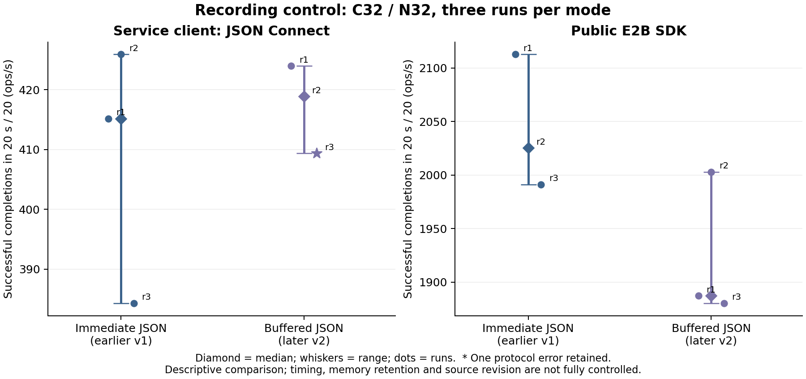

# 阶段 0：测量环境与口径验收

**阶段 0 已具备可复用的环境、协议、状态及计数口径检查。** 记录处理对照没有显示一致方向的吞吐收益，不能据此给出纯 JSON 记录开销百分比；完整关闭插桩/资源采样的 A/B 尚未做。本文只报告这些测量控制，不表示所有服务、SDK 或 RL 实验已经完成。

## 已建立的控制

| 控制 | 实际结果 | 解释边界 |
|---|---|---|
| 环境 / 资源采样 | VM 192 vCPU、约 1486.84 GiB；普通页；NBD 1024；有限 sampler 链路通过 | inventory 是 10:29 UTC 时点状态，测试前仍需重新检查外来负载 |
| 协议与计时格式 | command 3/3、file write 8/8、create/delete 3/3；全部清理 | 功能烟测，不据少量请求估计稳定尾延迟 |
| 生命周期状态 | 修正 root 用户与唯一路径后，pause / resume-connect / ready-probe 3 项通过 | 一次 roundtrip；保留最初权限失败记录 |
| 文件传输口径 | 14 个读取观察均内容 / SHA256 一致，清理成功 | 明确逻辑字节、压缩 HTTP entity 与 SDK counter 的区别 |
| 记录处理 | Service / SDK，各 3 次 minimal 和 3 次 buffered，C32/N32、20 秒 | 时间顺序、版本和内存保留未完全控制 |

CPU 核对记录将负载生成器限制到 0–15，分析限制到 16–31，QEMU 使用 192–383；宿主为两个 192 核 socket、每核一个线程。本报告生成时实际分析 affinity 已记录在 JSON。CPU 分开不等于消除共享内存、缓存或其他用户负载的影响。

## 记录处理对照

`minimal` 在每次操作返回后立即做 JSON 序列化和行写入；`buffered-events` 保留行对象，在测量、后验和清理后、最终 run 记录前写出。两者仍有单调时钟、行对象、内存结果数组、guards 和外部 sampler。单次 latency 的计时在记录前结束，因此比较主要反映事件循环与后续请求受到的间接影响。

**成功完成窗吞吐** = 严格在 `[start,end)` 内发起、且在 20 秒窗结束前成功完成并通过状态检查的请求数 / 20。窗内发起但窗后完成的排空请求不计入该吞吐；measurement标记但实际在窗外发起的记录也单独排除，不能混称为排空。全部measurement标记的记录仍与最终计数对账，所有失败均保留在对应分母和错误表中。表中为三次 run 的统计量中位数及最小–最大范围，没有把所有请求混池计算分位数。

| 调用路径 | 记录方式 | 成功完成窗 ops/s，中位 [范围] | 每 run 请求 P50 ms，中位 [范围] | 全部measurement标记失败 / 记录数 |
|---|---|---:|---:|---:|
| Service JSON Connect | minimal | 415.15 [384.30, 425.90] | 29.82 [28.21, 31.09] | 0 / 24,603 |
| Service JSON Connect | buffered-events | 418.85 [409.35, 423.95] | 29.19 [28.15, 29.33] | 1 / 25,140 |
| 公开 E2B SDK | minimal | 2025.25 [1991.25, 2112.80] | 10.52 [10.50, 10.80] | 0 / 122,682 |
| 公开 E2B SDK | buffered-events | 1887.20 [1880.20, 2002.90] | 10.36 [10.27, 10.37] | 0 / 115,502 |

边界核对：12份run中，严格窗内发起的排空数分布为 31条（1份run）、32条（11份run）。buffered SDK r1共37,776条measurement标记，严格窗内发起37,775条，其中31条窗后完成；另有1条成功请求`dd33add3fa754f11b8774539c41dfc56:37775`在截止点后1.798微秒才发起（start=32.22372951998841，end=32.22372772201197）。该记录保留在标签计数中，但不计入严格发起cohort或goodput，且不是窗内发起的排空请求。本次只是补齐边界分类与表述，成功完成窗吞吐数值不变。

Service 的 observed median 吞吐变化为 **+0.9%**，SDK 为 **-6.8%**。这两个数字是观察差异，不是插桩开销估计。baseline 在约 10:43–11:08 UTC 使用保存的 v1；buffered 在约 12:12–12:21 UTC 使用 v2 error diagnostics，未交错随机执行。缓冲还保留额外字典，可能改变 GC 和内存行为。不能将吞吐下降解释成“记录具有负开销”，也不能把某次上升直接归因于取消 JSON 写入。

Service buffered 第 3 次保留 1 条 `InvalidResult: Connect error: unavailable`，该 run 仍正常完成清理。请求总数为 8,220；本分析没有删除该 run 或把失败补成成功。其余 11 个对照 run 没有测量请求失败。



图中点表示独立 run、菱形表示中位数、线表示范围。两个调用路径使用独立坐标轴；此图比较各自记录方式，不把 JSON Connect 与 SDK 内部 transport 的差异称为纯 SDK 开销。原始逐 run 数字见 [JSON](results/recording-comparison.json) / [CSV](results/recording-comparison.csv)，[SVG](figures/recording-comparison.svg) 可用于汇报。

## 文件字节数不能混用

逻辑文件均为 1 MiB，native HTTPX 原始 entity 的实测值如下。原始 entity 不含 HTTP headers、传输分帧或 TCP/TLS 开销，不能当作网卡线速字节。

| 文件内容 / 编码 | 验证后的逻辑字节 | 原始 HTTP entity 字节 |
|---|---:|---:|
| 重复 x / gzip | 1,048,576 | 1,055 |
| 重复 x / identity | 1,048,576 | 1,048,576 |
| 确定性 SHA256 counter / gzip | 1,048,576 | 1,048,919 |

SDK 使用 pyqwest transport，送到 HTTPX 时可能已经解压并去掉 Content-Encoding；其 `num_bytes_downloaded=1,048,576` 和 `files.read` 返回值是这条路径上的解码后内容口径，不能证明线上传输了 1 MiB。`gzip=False` 本身也不能证明请求最终使用了 Accept-Encoding: identity。读取重复 x 的逻辑 MiB/s 因而不能直接报告成网络 MiB/s。完整 14 项观察、header 与 checksum 见 [file-transport-probe.json](results/file-transport-probe.json)。

## 生命周期与观测限制

首次 lifecycle preflight 在测量前发生 SandboxException，未完成 roundtrip，但清理成功；它对应默认 SDK 用户与现有 /tmp 文件权限的准备问题。改为 root 并为每轮使用唯一路径后，pause、resume-connect、ready-state-probe 全部成功，进程身份/内存计数与文件标记的检查通过。失败和修正后的源文件均保留在 [lifecycle-validation.json](results/lifecycle-validation.json)，这些结果不构成生命周期性能或可靠性 SLA。

有限 sampler 只读 `/proc`、sysfs 与计数器。初始两个 1 秒样本的 guest 采集 wall time 约 60 ms、host 约 2 ms；压力下采集耗时会变化，单次 wall time 不等于观测器 CPU 开销。短生命周期会遗漏在 cgroup 的两点增量之外，guest/host monotonic 时钟有各自原点，需用 UTC 对齐。全量采样有/无 A/B 尚未执行。

时钟补充：事后SSH括界发现VM UTC与host/client UTC约1秒级对齐不确定性；sampler传递时差也包含采集和传输。未平移的VM窗口均值只能近似归属，不能精确跨层关联；客户端单调计时、host/发生器同机CPU和VM内计数器峰值保持原口径。见[时钟对齐与假设性敏感性](CLOCK-ALIGNMENT.md)，该检查不证明历史偏移恒定，也没有调整系统时钟。

driver 的 event-loop lag 汇总来自整个后台循环，包括准备期，不能当成严格的 measurement-only lag 或直接等同 RPC queue time。对照也未保证每个 resident 的所有 RPC 连接都已预热。

当前 OTel 不能表述成“所有指标都已 Noop”。主 OTel 客户端在 endpoint 缺失时关闭，但独立的 API team 与 orchestrator sandbox observer 仍可能启动 exporter，产生空 endpoint 导出错误。这些遥测警告与 Firecracker 本地 /metrics socket 配置失败不是同一路径，也不等于业务请求失败；参见 [日志核对](../phase1-service/results/setup-failure-log-20260920.md)。本阶段未修改该服务配置。

## 复现与证据

```bash
taskset -c 16-31 /data2/yuhanya/e2b-benchmark/session-20260920/env/bin/python -B \
  /home/yuhanya/Daily_LLM/sandbox/benchmark/phase0-environment/analyze_controls.py
```

生成器只读已结束的本地 run，拒绝缺少最终 run 记录、未清理或零 measurement 的控制样本。源 JSONL、历史 v1、当前 v2、wrapper、transport/CPU 核对与输出文件的 SHA256 见 [manifest.json](results/manifest.json)。主实验的完整最终 source manifest 由总报告另行维护。原始私有材料在 `/data2/yuhanya/e2b-benchmark/session-20260920`，不复制密钥或业务日志到仓库。
