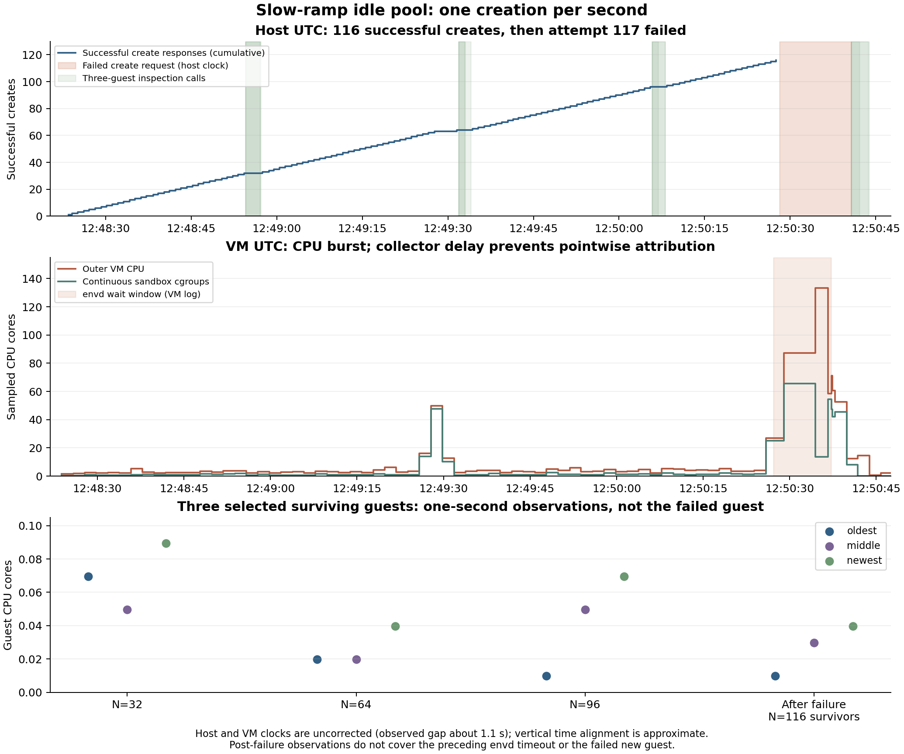
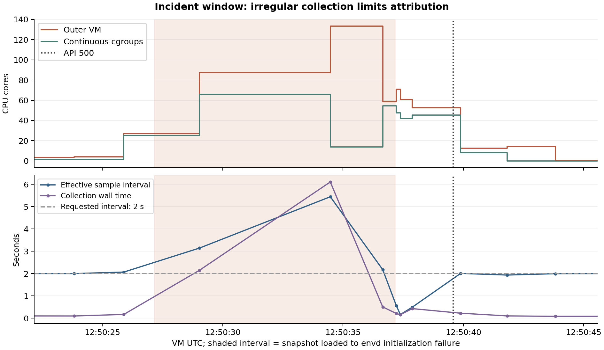

# 慢速建立空闲实例池：诊断结果

**降低到最多每秒一次创建，本次仍在第 117 次请求失败；此前 116 个实例成功建立，最终全部清理。** 这是独立的 slow-ramp 诊断 case4，不替换或增加正式矩阵中的三次 setup 失败。总耗时 288.87 秒，未达到 256 实例目标。

本次没有模型、测试套件或负载任务；每 32 个实例只在 oldest/middle/newest 三个 owned guest 内执行短 CPU 计数器检查。这些检查本身有开销，也会暂停后续创建。报告只分析已冻结输入；完整结果与来源哈希见 [idle-pool-summary.json](results/idle-pool-summary.json)。

## 创建、失败与清理

| 事件 | 时间 / 结果 |
|---|---|
| 开始（宿主 UTC） | 2026-09-20T12:48:22.267227+00:00 |
| 32 / 64 / 96 实例 milestone | 开始后 31.98 / 69.32 / 103.20 秒 |
| 成功请求之间最小开始间隔 | 1.000569 秒；没有追赶式突发 |
| 成功创建延迟中位数 | 0.372 秒；只是该诊断的描述值 |
| 第 117 次请求 | 宿主 12:50:40.691 返回 SandboxException / HTTP 500，耗时 12.570 秒 |
| 失败后操作 | 不重试创建；先检查三个已有实例，再清理 |
| 最终清理 | verified_zero，146 次空列表观察，0 次清理读/删错误；宿主 12:53:11.141 结束 |

这 146 次检查主要用于保留未知创建结果的 150 秒观察窗，不表示删除本身耗时 150 秒。外层资源记录在 VM 时钟 12:50:43.821 的采样已看到 FC/cgroup/NBD 都为零；这也是顺序采集的时点记录，不是精确的最后进程退出时间。



## 直接失败阶段已确认，CPU 原因仍未确定

关联日志识别出失败的新实例 `iqg9absq4klnsbwvsz7wn`。VM 日志中，Firecracker API 在 12:50:27.121 启动，snapshot load 在 27.163 完成（约 31.5 ms）；随后 envd 初始化等待在 37.165 失败，累计 58 次、单次 timeout 50 ms。API 在 39.578 返回 500，handler 耗时 12.5599 秒。直接失败阶段与正式 case2/3 的 envd 初始化超时相同，区别于 case1 的首次 metrics socket 连接拒绝。详见 [独立 case4 日志证据](results/idle-pool-case4-log-20260920.md)。

| 外层采样指标 | 本次结果 |
|---|---:|
| FC / cgroup / attached NBD 采样峰值 | 117 / 117 / 117 |
| VM CPU 采样峰值 | 133.46 核（192 核中的约 69.51%） |
| 连续 cgroup CPU 的独立采样峰值 | 65.74 核；与 VM 峰值不是同一时点 |
| CPU PSI some avg10 峰值 | 22.43% |
| 宿主负载生成进程 CPU 采样峰值 | 0.082 核 |
| 最低 MemAvailable | 1464.17 GiB |
| ARP entries 峰值 / 溢出新增 | 361 / 0 |
| 记录到的 cgroup throttle 增量 | 0 |

这里 117 个运行对象与 116 个成功 SDK handle 不矛盾：失败的新 guest 已部分启动，但 API 没有向客户端交付成功 handle。它不在后续三个 surviving guest 的检查样本中。观察到明显外层 CPU 和 cgroup 活动，宿主 driver 自身没有 CPU 饱和迹象；这不排除请求间接触发 guest/runtime 活动。本数据不足以给出精确的峰值 CPU 归属比例。



事发时单次采集 wall time 达 **6.103 秒**，调度迟到最大 **4.835 秒**；实际采样间隔从 **0.166 到 5.440 秒**，并非整齐的两秒。CPU、cgroup 和进程信息依次读取，因此不能在某一行直接用 VM CPU 减 cgroup CPU 来认定“剩余 CPU 属于管理层”，也不能把各自峰值相除。JSON 仅另保留完整落在 envd 等待窗内的名义区间加权描述，不补造边界样本。

## 三个 guest 的低 CPU 仅说明检查时的状态

| 检查时池大小 | oldest guest 核数 | middle guest 核数 | newest guest 核数 |
|---|---:|---:|---:|
| 32 | 0.070 | 0.050 | 0.090 |
| 64 | 0.020 | 0.020 | 0.040 |
| 96 | 0.010 | 0.050 | 0.070 |
| 失败后 116 | 0.010 | 0.030 | 0.040 |

**失败后的三个检查均在客户端错误之后发起（约宿主 12:50:40.695）**，分别在约 42.177、43.648、43.809 返回；各 guest 内计数间隔约一秒。它们只能证明这三个已存活 guest 在各自检查时 CPU 较低。它们没有覆盖此前的十秒 envd 等待，也没有检查失败的新 guest，不能由此排除 guest kernel、envd、其他 guest 或 KVM/VMM 的问题。

全部 12 个检查都返回约 80 个连续进程，采集器自身 PID 已排除。失败后的非零进程计数只有所选 guest 的 envd，各约 0.01 核；aggregate 仍包含采集器与内核记账等开销，不能将 aggregate 与进程和的差值再作精细归因。未采集进程 args/env，原始计数保存在私有 observations 文件中。

## 时钟域与结论边界

宿主客户端错误时间比 VM 的 API 结束日志晚 **1.113 秒**，但两端各自测量的请求时长仅差约 **10.0 ms**。低采集耗时的 137 个资源样本中，宿主接收 UTC 减 VM 采样 UTC 的中位数约 **1.175 秒**，范围 1.162–1.254 秒；该差还包括残余采集和输送时间。不能把它当成网络耗时，也没有足够证据给所有事件做精确时钟校正。图分别使用宿主与 VM 自己的时间轴，跨层判断优先使用已知调用顺序和各端单调时长。

外层 VM 内部计数峰值和宿主本地 driver CPU 不依赖跨机器 UTC 配准，但精确的跨层同时归属不成立。更完整的跨轮时钟与敏感性边界见 [CLOCK-ALIGNMENT.md](../phase0-environment/CLOCK-ALIGNMENT.md)；本诊断保留未平移的原始 VM 时间序列，事后检查不能证明历史偏移始终恒定。

本次证明“每秒一次创建”在当前部署与历史状态下仍可能触发 envd 初始化失败，不能把降速称为已验证修复；它没有测出一个固定的实例容量上限。检查只有一次慢速建立、三个位置抽样和事后窗口，CPU 活动来源与 envd 无法及时就绪之间的因果链仍未闭合。正式失败 repeat、这次独立诊断及其全部清理结果分别保留。

## 复现分析

```bash
taskset -c 16-31 /data2/yuhanya/e2b-benchmark/session-20260920/env/bin/python -B \
  /home/yuhanya/Daily_LLM/sandbox/benchmark/phase1-service/code/analyze_idle_pool.py
```

生成器只读取四个冻结的诊断文件和独立 case4 日志 JSON，不调用服务。输出包括 [summary JSON](results/idle-pool-summary.json)、[创建 CSV](results/idle-pool-creation.csv)、[资源时间线 CSV](results/idle-pool-timeline.csv)、[guest 抽样 CSV](results/idle-pool-guest-observations.csv) 及两张 PNG/SVG。来源与生成代码哈希见 [分析 manifest](results/idle-pool-analysis-manifest.json)。
