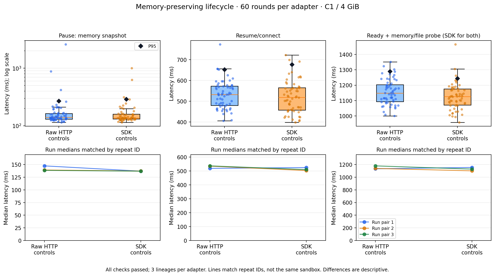

# 内存状态保留的暂停/恢复结果

原始HTTP控制和公开SDK控制各完成3次运行、每次20轮暂停/恢复，共120轮。360个测量阶段全部成功，内存/文件状态校验全部通过，6个sandbox lineage最终均清理完成。两种方式的典型暂停/恢复延迟接近；当前样本不支持将描述性差值当作确定的SDK额外成本。

| 阶段 | 适配器 | 样本数 | P50 ms | P95 ms | 最大 ms |
| --- | --- | --- | --- | --- | --- |
| 内存快照暂停 | 原始HTTP控制 | 60 | 139.75 | 270.13 | 2596.48 |
| 恢复/connect | 原始HTTP控制 | 60 | 532.11 | 652.75 | 774.05 |
| 恢复后状态探针（双方均SDK） | 原始HTTP控制 | 60 | 1147.57 | 1289.35 | 1351.94 |
| 内存快照暂停 | SDK控制 | 60 | 137.01 | 289.86 | 1002.91 |
| 恢复/connect | SDK控制 | 60 | 518.12 | 676.71 | 722.55 |
| 恢复后状态探针（双方均SDK） | SDK控制 | 60 | 1125.85 | 1243.88 | 1465.71 |

[可导出SVG](results/lifecycle/plots/lifecycle-stages.svg) · [JSON](results/lifecycle/summary.json) · [阶段CSV](results/lifecycle/stage_summary.csv) · [逐轮CSV](results/lifecycle/cycles.csv) · [配对运行中位数](results/lifecycle/paired_run_medians.csv)

## 什么被测量和验证

输入只包括`lifecycle-service-r1..3.jsonl`和`lifecycle-sdk-r1..3.jsonl`。前者对暂停发原始HTTP `POST /sandboxes/{id}/pause {memory:true}`，对恢复发`POST /sandboxes/{id}/connect {timeout:600}`；60次响应分别为204/201，排除原本已运行的200。后者使用public SDK pause/connect。**第三阶段双方都通过SDK启动Python命令并查询sandbox内常驻进程，因此包括进程启动、loopback HTTP和状态返回，不是envd初始化本身的纯耗时。**

每轮在暂停前更新文件marker，恢复后核验进程内生成、未落盘的随机token、递增counter、PID、guest boot ID和文件marker。记录中120个probe均有`memory_preserved=true`、`file_preserved=true`；每条lineage的token hash和PID稳定，counter顺序为2–21，120次paused listing也全部通过。boot ID在执行器中参与校验，没有把原始boot ID另行写入结果，故离线审计依据其state-check标志和冻结执行源码。失败预检与旧smoke不在输入集合中。

## 时间窗口与限制

fixture为`base-4k-4g`、2vCPU/4096MiB、普通4KiB页、单实例单并发；runtime和e2b版本与SDK应用场景一致。每次运行在同一个sandbox上连续恢复20轮，因此每adapter虽有60轮样本，但只有3条独立lineage，不能视为60个独立环境重复。

| 适配器 | 重复 | 整窗口 ms | 一轮P50 ms | 阶段外间隔 ms |
| --- | --- | --- | --- | --- |
| service | 1 | 38012.23 | 1818.06 | 1470.67 |
| service | 2 | 37928.24 | 1837.79 | 1178.55 |
| service | 3 | 41606.05 | 1896.79 | 1239.28 |
| sdk | 1 | 37882.09 | 1820.23 | 1177.08 |
| sdk | 2 | 37042.20 | 1792.95 | 1140.91 |
| sdk | 3 | 38170.51 | 1784.89 | 1471.93 |

单阶段计时排除marker更新、paused listing及最终清理；整窗口包含轮间准备/校验间隔。这里报告延迟和窗口耗时，不将阶段计数/整窗口称为服务吞吐。表中P50/P95是每adapter/stage合并60个观测的描述性分位数，区别于主矩阵的逐run汇总。图下方的Run pair仅将相同repeat编号配在一起，使用的是不同sandbox lineage，不是同一sandbox内A/B交叉。配对运行在时间上顺序执行，没有随机化或CPU/网络开销的逐调用因果分解，因此不能把SDK与HTTP差值直接称作SDK overhead。

原始HTTP pause有最大2596.48 ms的慢样本，SDK pause最大1002.91 ms；均保留在分布与CSV。P95为描述性统计，n=60的P99不用于稳定尾延迟承诺。图下半部显示3组运行中位数，避免只凭合并平均值解释差异。

恢复后状态探针占据每轮的大段等待，下一步应以阶段trace或固定轻量探针对照分解其首次命令/页面就绪成本，不能直接宣称控制API是唯一瓶颈。当前结果证明本fixture的状态保留和这120轮生命周期可用性，不代表重负载内存快照性能。

## 冻结材料与复现

[输入冻结manifest](../phase2-sdk/results/application/INPUTS-FROZEN.json)覆盖本报告六个运行和SDK场景三个运行，保存原始路径、SHA、只读副本及执行源码。分析仅使用冻结输入；源码为[analyze_application.py](../phase2-sdk/code/analyze_application.py)，运行固定在CPU16–31，不修改共享reporter或服务。
