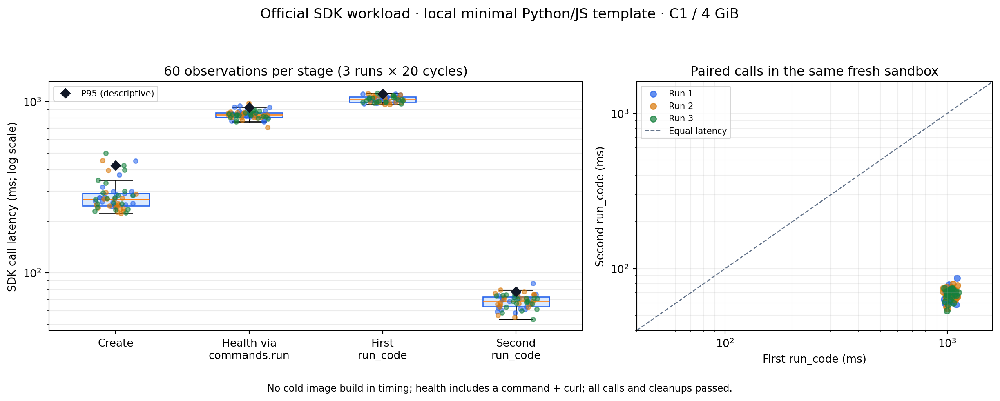

# 官方 SDK 场景结果

固定的3次运行全部完成：每次20个新sandbox、每个执行4个阶段，共240个操作全部成功并通过结果校验，60个sandbox均完成清理。创建通常约270 ms；首次curl健康检查约836 ms，首次解释器执行约1027 ms，第二次约68 ms（均为P50）。

| 阶段 | 样本数 | P50 ms | P95 ms | 最大 ms |
| --- | --- | --- | --- | --- |
| SDK创建 | 60 | 269.60 | 425.32 | 500.08 |
| 首次命令/curl健康检查 | 60 | 835.74 | 925.38 | 979.34 |
| 第一次run_code | 60 | 1026.74 | 1108.42 | 1121.57 |
| 第二次run_code | 60 | 68.39 | 77.83 | 86.88 |

同一sandbox内配对的60组`run_code`中，第二次全部更快；第一次/第二次耗时比的中位数为 **15.06**。从创建开始到第一次代码返回的配对实测P50为 **2155.13 ms**，这是每个cycle实际时间线计算值，不是把各阶段分位数相加。



[可导出SVG](results/application/plots/official-sdk-stages.svg) · [JSON](results/application/summary.json) · [阶段CSV](results/application/stage_summary.csv) · [逐操作CSV](results/application/operation_samples.csv)

## 实验口径

输入严格限定为`official-code-interpreter-r1..3.jsonl`。每次使用`Sandbox.create → commands.run(curl /health) → run_code(Hello World) → 再次run_code → kill`。计时是公开Python SDK调用返回的完整耗时，`run_code`包含消费响应流。健康检查同时包含命令启动和curl执行，不是纯HTTP ping或网络RTT。镜像下载/模板构建、setup smoke不计入这些样本。

环境为单节点`local-4k-512-20260920`、普通4KiB页、2vCPU/4096MiB、C1/N1。客户端`e2b==2.49.1`、`e2b-code-interpreter==2.10.0`。模板`benchmark-ci-minimal-20260920`保留固定上游server及Python/JS kernel，省略完整云端模板的大量包和其他语言；结果不能代表官方云端`code-interpreter-v1`。模板identity及准备验证的冻结副本位于`results/application/frozen-support`。

三个运行的整窗口边界及组成如下；整窗口保留迭代间清理和少量记录/校验间隔，最后边界在最终清理之前。**不把80个阶段数除以整窗口称为纯服务吞吐。**

| 重复 | 整窗口 ms | 四阶段计时合计 ms | 阶段外间隔 ms |
| --- | --- | --- | --- |
| 1 | 44949.45 | 44744.46 | 204.99 |
| 2 | 44370.82 | 44159.34 | 211.47 |
| 3 | 44841.83 | 44641.59 | 200.23 |

表中P50/P95是合并60个观测后的描述性分位数，与主矩阵“先算每run分位数、再汇总run”的口径不同。每阶段n=60来自3次运行。P99仅随JSON/CSV保留，不作为稳定SLA尾延迟结论。图中散点为原始样本，黑色菱形为P95；没有删除慢样本。所有成功和清理结论仅覆盖这60个新实例，不是可靠性保证。

## 对后续定位的意义

创建响应时间并不是首次应用结果时间。当前首条命令和首次解释器执行段明显比后续热执行更慢，应优先分解恢复后首次进程启动、解释器/页面就绪和客户端首次连接，而不能将其统称为SDK开销或网络延迟。是否能通过复用已就绪sandbox/context改善真实任务，需要后续回放验证。

## 复现与输入冻结

九份应用/lifecycle测量输入及执行manifest已共同冻结并校验SHA：[INPUTS-FROZEN.json](results/application/INPUTS-FROZEN.json)。这里只读取其中三份官方SDK运行；phase0预检、权限错误smoke和template smoke均排除。分析不调用服务。复现：

```bash
taskset -c 16-31 /data2/yuhanya/e2b-benchmark/session-20260920/env/bin/python \
  /home/yuhanya/Daily_LLM/sandbox/benchmark/phase2-sdk/code/analyze_application.py
```
