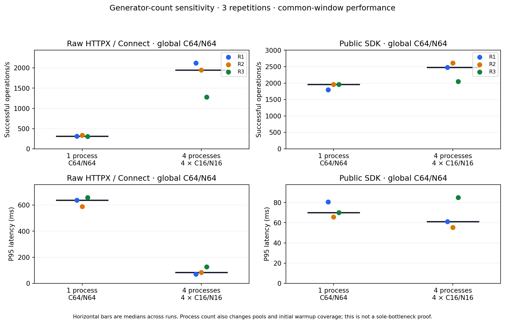
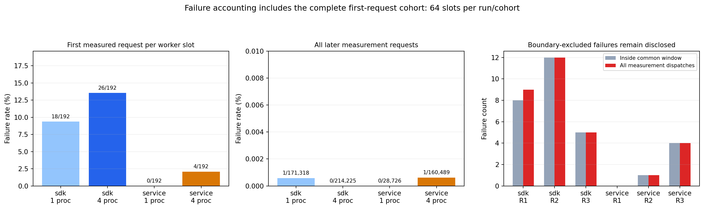
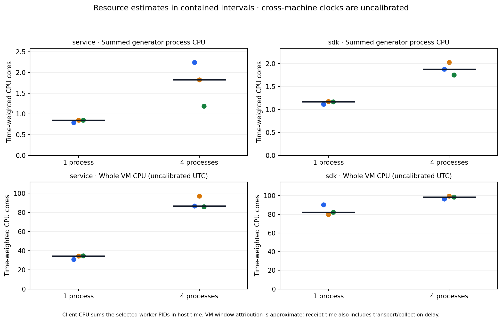

# 多进程压测端对照：公开SDK

总并发和存量实例均固定为64。将一个C64/N64进程拆为四个C16/N16进程后，3次运行的共同窗口成功吞吐中位数从 **1956.60** 变为 **2474.54 ops/s**，比值 **1.26**。这是压测端进程/transport连接池组织对结果的影响，不足以证明某一个组件是唯一瓶颈。

| 进程数 | 重复 | 共同窗口成功ops/s | P50 ms | P95 ms | 全部失败/总数 | first失败/64 | later失败 | 边界排除失败 |
|---|---|---:|---:|---:|---:|---:|---:|---:|
| 1 | 1 | 1794.77 | 19.93 | 80.63 | 2/53908 | 2/64 | 0 | 0 |
| 1 | 2 | 1956.60 | 19.85 | 65.57 | 5/58767 | 4/64 | 1 | 0 |
| 1 | 3 | 1958.63 | 19.71 | 70.05 | 12/58835 | 12/64 | 0 | 0 |
| 4 | 1 | 2474.54 | 12.88 | 61.12 | 9/74331 | 9/64 | 0 | 1 |
| 4 | 2 | 2613.04 | 12.25 | 55.38 | 12/78473 | 12/64 | 0 | 0 |
| 4 | 3 | 2051.35 | 13.63 | 85.01 | 5/61613 | 5/64 | 0 | 0 |



## 边界和失败统计

共同窗口性能严格使用四个worker测量窗口的交集，并且操作的start/end都必须落在交集内；单进程对照使用自身30秒窗口和同样的包含规则。这里的P95是start/end均落在窗口内的条件分布；完整measurement dispatch cohort（含drain）的P95另列在CSV/JSON的`all_dispatch_p95_ms`，不能直接与主报告含drain的P95混用。最终drain、开始边界之前的少量请求不用于共同窗口速率/延迟，但**所有标记measurement的worker操作仍进入失败审计**。两种计数有意并存，不将共同窗口失败数冒充完整失败数。

first定义为每个`(generator_index, worker_id)`按开始时间排序的第一条measurement请求，先在完整输入上识别，再检查其是否落入共同窗口；每个run/cohort固定64个first，三次共192个。later为其余所有measurement请求，包含边界/drain。四进程本适配器共 **26个失败**，其中first **26/192**，later **0/214225**；共同窗口外仍有 **1个失败**明确保留。

SDK四进程R1尤其需要区分：cohort原摘要共同窗口失败8个，而所有worker measurement操作失败9个；本报告以完整9个进行first/later和总体失败分析。协调器`status=passed`表示执行/窗口/清理条件满足，不代表操作零错误。



## 压测端和VM CPU

| 进程数 | 重复 | generator合计平均核 | VM平均核（UTC近似） | host覆盖% | VM覆盖% | receipt−guest中位秒 |
|---|---|---:|---:|---:|---:|---:|
| 1 | 1 | 1.11 | 90.19 | 93.3 | 93.4 | 1.195 |
| 1 | 2 | 1.17 | 79.96 | 90.1 | 93.1 | 1.203 |
| 1 | 3 | 1.17 | 82.35 | 93.3 | 93.3 | 1.194 |
| 4 | 1 | 1.88 | 96.37 | 92.1 | 93.3 | 1.213 |
| 4 | 2 | 2.02 | 99.66 | 93.3 | 93.3 | 1.198 |
| 4 | 3 | 1.75 | 98.55 | 92.9 | 92.9 | 1.201 |

四进程CPU在每个host采样间隔对四个worker PID求和，不使用manager PID替代。只采用完整落在测量窗口内的采样间隔，按实际间隔长度加权；没有把边界间隔的平均值拆分或把缺失进程视为零。host生成器计数与测量窗口处于同一主机时钟域。

**VM CPU目前按未校准的guest UTC窗口做近似归属。** 六个多进程capture中`received_utc−guest.utc`的下界约1.168–1.176秒、中位约1.192–1.213秒，提示不能默认跨机UTC已精确对齐；这个差还包含SSH传输/采集延迟，不能直接当作纯时钟offset或网络耗时。本报告保留未做偏移修正的VM均值及边界覆盖率，不能据此做亚秒级因果分解；host侧4PID合计不受这个跨机问题影响。覆盖率和排除的边界样本均在CSV/JSON中保留，CPU核数不等于整机百分比。

时钟核验和独立敏感性分析见[CLOCK-ALIGNMENT.md](../phase0-environment/CLOCK-ALIGNMENT.md)。当前表保留未修正值，不推定事后测得的offset在所有历史窗口恒定，也不支持精确的跨层开销归因。



## 控制条件和结论边界

基线与补充均为`base-4k-4g`、2vCPU/4GiB、普通4KiB页、`exec_true`、global C64/N64、30秒closed-loop，3个重复。四进程串行完成准备，再由barrier对齐测量；各进程只清理自己的run，cohort cleanup均通过。没有把后续idle-pool实验的输入或资源文件加入本集合。

拆分进程同时改变了Python解释器/GIL、HTTP连接池、SDK进程内共享transport及初始warmup覆盖。父runner只预热一个resident，因此单进程预热1个，四进程合计预热4个；其余first请求仍可能包含首次连接/首次使用效应。四进程prepare还各有一次模板检查。这是对压测器headroom的实验，不是仅改变CPU核数的理想单变量实验。

报告保留逐重复变动，不把3个重复当作稳定上限或显著性检验。P50/P95来自每次运行的共同窗口成功样本；配置级中位数是这3个逐run指标的中位数，没有平均分位数。first失败率的分母与总体/later不同，不能只看被大量后续成功请求稀释的总体错误率。服务/SDK对应源码hash和v1/v2差异保存在冻结输入/执行manifest中；本分析不修改benchmark或daemon。

[汇总JSON](../phase1-service/results/multigenerator/summary.json) · [逐运行CSV](../phase1-service/results/multigenerator/per_run.csv) · [first 768条CSV](../phase1-service/results/multigenerator/first_requests.csv) · [全部失败CSV](../phase1-service/results/multigenerator/failures.csv) · [资源CSV](../phase1-service/results/multigenerator/resource_samples.csv) · [输入SHA冻结清单](../phase1-service/results/multigenerator/INPUTS-FROZEN.json)

## 复现

```bash
taskset -c 16-31 /data2/yuhanya/e2b-benchmark/session-20260920/env/bin/python \
  /home/yuhanya/Daily_LLM/sandbox/benchmark/phase1-service/code/analyze_multigenerator.py
```

所有输入已完成后才按精确路径和SHA冻结，原始大JSONL保留在`/data2`；分析流式验hash，不复制大数据进文档仓库。PNG有对应SVG可导出。分析使用共享`analysis/resources.py`的解析规则，但没有修改共享reporter或执行任何服务请求。
