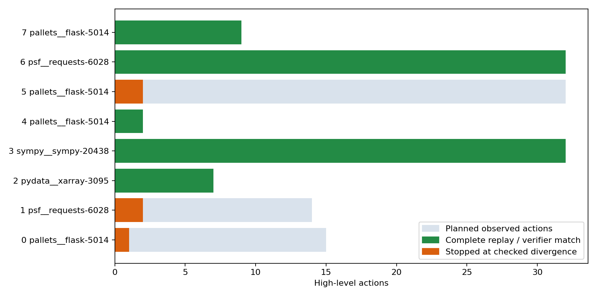

# Executed older 8B high-level replay

Executed 8 episodes across four historical SWE-bench tasks. Status counts: `{"observation_divergence": 3, "replayed": 5}`. Elapsed including cleanup: 104.20 seconds. Remaining instances owned by this invocation: 0.

| Episode | Task | Actions executed / planned | Result | Seconds |
|---:|---|---:|---|---:|
| 0 | pallets__flask-5014 | 1 / 15 | observation_divergence | 8.47 |
| 1 | psf__requests-6028 | 2 / 14 | observation_divergence | 10.28 |
| 2 | pydata__xarray-3095 | 7 / 7 | replayed | 48.28 |
| 3 | sympy__sympy-20438 | 32 / 32 | replayed | 50.62 |
| 4 | pallets__flask-5014 | 2 / 2 | replayed | 19.03 |
| 5 | pallets__flask-5014 | 2 / 32 | observation_divergence | 8.58 |
| 6 | psf__requests-6028 | 32 / 32 | replayed | 33.83 |
| 7 | pallets__flask-5014 | 9 / 9 | replayed | 23.24 |

Each episode stops at its first declared status/content/state divergence. Unexecuted suffixes remain unexecuted; a failed replay is not a zero-duration completed trajectory. Native verifier results are present only when the complete action sequence reached scoring.

The corpus comprises six historical E2B and two historical Docker episodes from older Qwen3-8B runs. The current SDK/template/provider environment differs from historical deployments. This measures replay coverage and execution behavior; it does not establish a training speedup or model improvement. Detailed extraction and initialization boundaries are in [METHODS.md](METHODS.md).

[Episode CSV](results/episodes.csv) · [Summary JSON](results/summary.json) · [SVG](results/replay-coverage.svg)
