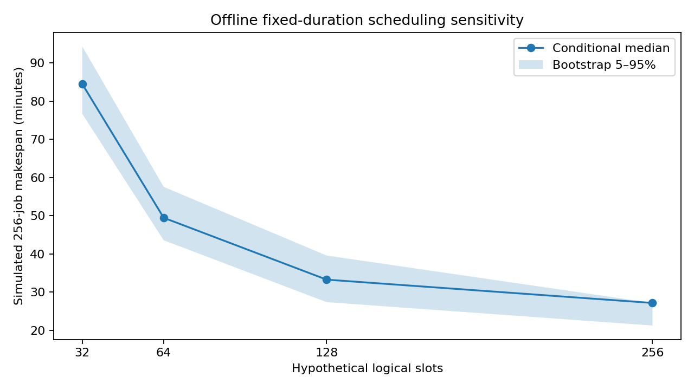

# Offline scheduling sensitivity

This is a fixed-duration queue model, separate from the real E2B action replay in [RESULTS.md](RESULTS.md). It makes no SDK, sandbox, model or GPU calls. Its inputs are the **newer historical 256 episodes / 32 groups of eight** in `sandbox/uni-agent-swe-bench/data/episodes.csv`; the real replay used the separately documented older 8B corpus.

All 256 hypothetical jobs arrive at time zero and enter a FIFO, work-conserving pool of identical logical slots. Each job's fixed duration is `episode_s - create_wait_and_api_s`. Removing that entire combined interval avoids adding another queue on top of the historical create queue; it also omits the SDK create service time because the historical measurement did not separate it. All remaining setup, model round-trip, tools, verifier and local gaps stay in the fixed duration proxy.

The calculation resamples 32 task groups with replacement, retaining the eight samples within each chosen group. It uses seed **20260920** and **1,000 replicates**. The bands below are empirical bootstrap percentiles conditional on those groups and assumptions, not confidence bounds for real service capacity.

| Hypothetical logical slots | Median simulated makespan, minutes | Bootstrap 5–95%, minutes |
|---:|---:|---:|
| 32 | 84.50 | 76.69–94.35 |
| 64 | 49.45 | 43.56–57.55 |
| 128 | 33.25 | 27.36–39.56 |
| 256 | 27.15 | 21.23–27.15 |



More slots reduce queueing by construction in this model. At 256 slots, every job starts immediately and the longest sampled duration determines completion. The median and upper percentile coincide because the longest observed group is included in more than half the bootstrap draws. Resampling observed groups cannot generate an unseen longer trajectory.

This model does not change service durations when concurrency changes. Actual model-serving, GPU, CPU, network, sandbox startup and tool contention would change them. It does not simulate learner updates, weight transfer, checkpoints, changing policies or RL batch dependencies. The two original 128-rollout cohorts are combined into one hypothetical arrival of 256 jobs, so the graph does not contain a measured 256-concurrency point. It must not be used as an E2B capacity estimate or an RL speedup prediction.

Reproduce with the saved empirical data:

```bash
/data2/yuhanya/e2b-benchmark/session-20260920/env/bin/python -B \
  /data2/yuhanya/e2b-rl-pathfinding-20260920/code/profile_simulate.py \
  --episodes /home/yuhanya/Daily_LLM/sandbox/uni-agent-swe-bench/data/episodes.csv \
  --output /data2/yuhanya/e2b-rl-pathfinding-20260920/results/phase3-simulation \
  --seed 20260920 --replicates 1000
```

[CSV](results/scheduling-sensitivity.csv) · [Assumptions, source hash and numerical output](results/scheduling-summary.json) · [SVG](results/scheduling-sensitivity.svg).
