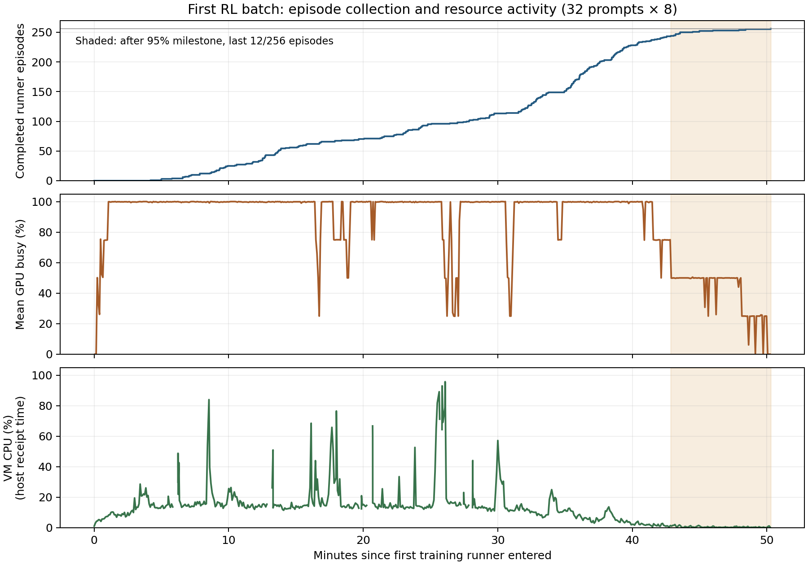
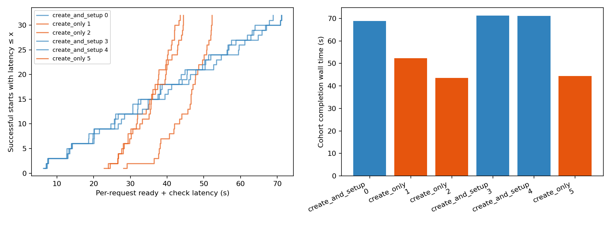
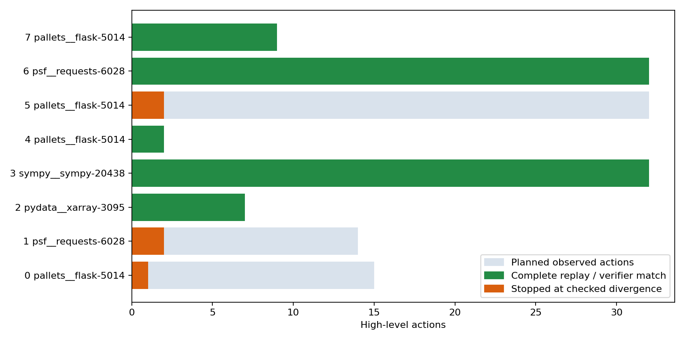

**Operator update, 2026-09-21T02:51:30.529640+00:00:** stopped at the user's request after six completed steps; checkpoint 6 retained. The trainer, dedicated container, supervisor and collectors exited; owned sandbox cleanup passed with zero residual instances. [Stop verification and analysis](../REVIEW-20260921.md).

Requested **100 training steps**; **6/100 recorded**, checkpoint **6**, state **stopped by user for analysis**.

Updated 2026-09-21T02:46:38.336123+00:00. Supervisor heartbeat: 2026-09-21T02:46:15.571977+00:00. Snapshot `539aeca1dc884e61b4f7d7b72ebb3ea6`.

Stopped run: `ua-e2b-pathfinding-20260920-r2`.
The requested training run has not yet passed final acceptance. Starting processes, agent turns and completed rollouts do not count as completed training steps.

Current-run baseline evaluation: **16/16 episodes completed**. This is episode progress, not optimizer-step progress.

The training subset contains **62 SWE-reBench tasks**; evaluation uses **16 SWE-bench Verified tasks**, at steps 0, 25, 50, 75 and 100. This is not a full 500-task Verified score.
Environment/reward controls resolved 0/78 baseline cases and 78/78 oracle cases. These **78 control cases** validate the prepared environments and scoring path; they are not the trained model's results.

[W&B run](https://wandb.ai/yuhanya-amd/e2b-rl-pathfinding/runs/ua-e2b-pathfinding-20260920-r2) — native initialization observed; remote delivery of every metric is not independently checked.

No remaining-time forecast is active while training is stopped.

Native records retain exit 1 / KeyboardInterrupt from the requested operator stop during step 7; this is not a new spontaneous failure.

**R2 first batch.** Collecting the first **256 rollouts** took **50.3 min**. The last 12 rollouts added **7.4 min (14.8% of the collection span)**; during that interval an average of **4.7 of 8 GPUs** had **less than 5% device activity**. Separately, the [startup diagnosis](ATTEMPT-2-DIAGNOSTICS.md) found ten shell initialization attempts that spent **52–59 s of a 60 s budget waiting for command permits**; all ten recovered on retry. This runner clock excludes policy updates and checkpointing. [Measurement details](results/first-batch-r2/first-batch.json).

**Previous attempt retained separately**

| Run | Native updates | Checkpoint | Training results |
|---|---:|---|---|
| `ua-e2b-pathfinding-20260920` | 0 | none | 85 at stall; 86 final |

R1's execution-admission cancellation leak was reproduced and repaired with ticket ownership; [fix and validation evidence](../phase5-optimization/GATE-CANCELLATION.md). The **185 startup/create cancellations** and **57 cancelled exec-gate waits** are different counters, not unique episode counts. R1 results are excluded from the active run's step and evaluation totals.

[Retained R1 report](ATTEMPT-1.md).

**Three measured findings**

The following pretraining measurements are retained, hash-checked R1 evidence. They are not measurements of the ongoing R2 training run.

1. **Client admission affects startup.** Across 3 baseline and 3 create-only cohorts, releasing the create permit after SDK create reduced median 32-instance cohort completion from **71.16 s to 44.42 s (37.6% lower)**. SDK-create P50 increased from 0.563 to 2.675 s, and tools-setup P50 from 2.920 to 10.569 s. The whole cohort improved while individual components slowed. This is a startup result, not an RL speedup; the training baseline retains the original gate policy.
2. **The coexistence check stopped before 256.** It observed **177 running instances**, with 177 command checks passed. One preparation call failed after 11.10 s; 78 planned creates were not dispatched. Final remaining instances: 0. A single failed attempt does not establish a capacity limit of 177. Server evidence points to a **generic envd initialization/readiness timeout after Firecracker start**. The message “syncing took too long” does not prove a clock-synchronization fault; client/server linkage is temporal/template/duration evidence, not a shared request-ID join.
3. **Real replay has a measured fidelity boundary.** Of 8 older 8B episodes, **5 matched through native verification** and **3 stopped at observation divergence**. The run executed 87 of 143 recorded actions and retained the unexecuted suffixes. This is a distinct corpus from the newer 30B 32-task/256-episode timing study.

**Native training timing**

| Step | Step wall, s | Rollout collection, s | Actor update, s | Weight sync, s | Checkpoint, s | Reward mean |
|---:|---:|---:|---:|---:|---:|---:|
| 1 | 4,093.17 | 3,019.42 | 440.56 | 5.43 | 516.35 | 0.2461 |
| 2 | 6,803.24 | 5,709.40 | 458.90 | 5.52 | 512.45 | 0.2353 |
| 3 | 3,167.60 | 2,210.37 | 354.08 | 5.30 | 510.21 | 0.2266 |
| 4 | 5,332.60 | 4,288.02 | 424.36 | 5.67 | 512.22 | 0.2588 |
| 5 | 3,526.84 | 2,537.64 | 383.36 | 5.33 | 510.13 | 0.2344 |
| 6 | 3,630.07 | 2,643.13 | 379.79 | 5.56 | 512.19 | 0.2695 |

These are native top-level timers for completed training steps only. Rollout collection includes environment/model/tool/verifier waiting. The listed components are separate intervals within step wall time; they are not an exhaustive partition. Evaluation timing is outside this table. No nested or parallel profile spans are summed into wall time.

[All recorded native step rows](results/published-native-steps.csv).

**Evaluation on the fixed 16-task subset**

| Training step | Resolved / expected | Evidence |
|---:|---:|---|
| 0 | 6 / 16 | Checkpoint-1 prefix task/session/reward join passed; evidence unchanged |

Latest train-filtered profile analysis: session states `{"cancelled": 44, "completed": 1534, "failed": 2, "unfinished": 210}`; quality issues **300**. Gateway phases are joined only through exact session identities. P3/P5 events and candidate gate policies are excluded.

[Replay evidence](../phase3-replay/RESULTS.md) · [Gate comparison](../phase5-optimization/RESULTS.md) · [Capacity diagnostic](../phase5-optimization/CAPACITY.md) · [Offline scheduling what-if](../phase3-replay/SIMULATION.md) · [Profiling boundaries](PROFILING.md) · [Snapshot validation and source hashes](report-validation.json).
