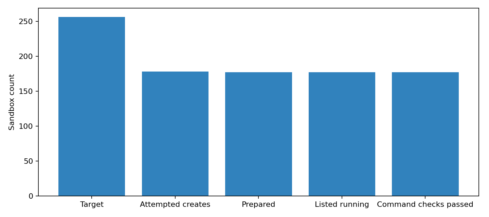

# Bounded 256-sandbox coexistence diagnostic

Result success=False. Attempted 178 of 256 planned creates; 78 not dispatched. Listed simultaneously running=177; command checks passed=177; remaining owned instances=0. Elapsed including cleanup=271.20 seconds.

Observed SDK specifications: `{"4vCPU/8192MiB": 177}`. States: `{"running": 177}`. Errors: `{"prepare:SandboxException": 1}`. Readiness retry events: 0.

Creates use three workers and the fixed Flask template. Every prepared instance executes a lightweight repository/command check. First preparation failure stops new dispatch; already in-flight operations remain accounted. Cleanup reconciles exact run/cohort ownership, including create outcomes whose acknowledgement was lost.

This checks simultaneous lightweight coexistence and command access. It does not allocate/touch every configured GiB, run sustained pytest load, establish a latency SLO, or prove 256 active RL environments can run without contention. A failure is diagnostic and does not imply 256 logical rollouts cannot execute by queueing fewer live sandboxes.

Only one target-256 attempt was made. Failure at index177 does not establish a deterministic capacity limit of177; the exception type alone does not identify its cause.

[Create CSV](results/capacity-creates.csv) · [Check CSV](results/capacity-checks.csv) · [Failure CSV](results/capacity-errors.csv) · [Summary JSON](results/capacity-summary.json)
