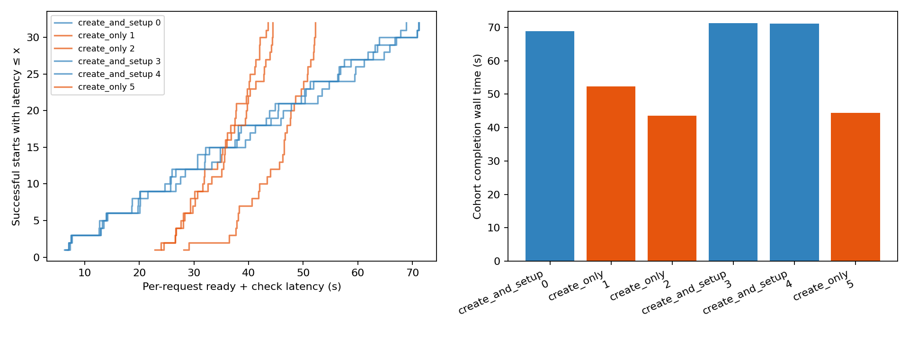

# Native-provider create-gate comparison

Executed 6 cohorts with 32 fresh PyJWT sandboxes/cohort, create permits=3, exec permits=16, local Ray GPU allocation=0. Order: create_and_setup, create_only, create_only, create_and_setup, create_and_setup, create_only.

| Policy | Cohorts | Successful / planned | Cohort wall median [min, max], s | Remaining |
|---|---:|---:|---:|---:|
| create_and_setup | 3 | 96 / 96 | 71.16 [68.87, 71.22] | 0 |
| create_only | 3 | 96 / 96 | 44.42 [43.60, 52.25] | 0 |

Per-request timing below pools the96 successful starts for each policy; it uses a different aggregation from the three cohort wall-time medians above.

| Policy | Create-gate wait P50, s | SDK create P50, s | Permit held P50, s | Tools setup P50, s |
|---|---:|---:|---:|---:|
| create_and_setup | 31.643 | 0.563 | 6.307 | 2.920 |
| create_only | 7.251 | 2.675 | 2.678 | 10.569 |

The shorter create-only cohort time is accompanied by longer SDK-create and tools-setup latencies in this run. Reduced gate waiting therefore does not mean every component became faster. These nested P50 values must not be summed, and they do not isolate server CPU, network or SDK overhead.

Both modes perform SDK create, readiness, cached tmux installation and the final repository/tmux check. The baseline retains the create permit through setup; create_only releases it immediately after SDK create returns. Per-attempt CSV separates gate wait, SDK create, readiness and setup spans. Cohort wall time includes all attempted starts and final checks, including failures; cleanup is reported separately in raw cohort records.

This is a startup-path comparison with one client process, one local Ray admission actor, one template and three requested repeats per policy. The fixed varied order reduces simple monotonic order effects but is not a randomized experiment. Results do not establish an RL throughput gain or an E2B server boot-time change.

[Attempt CSV](results/startup-attempts.csv) · [Cohort CSV](results/startup-cohorts.csv) · [Summary JSON](results/startup-summary.json)
