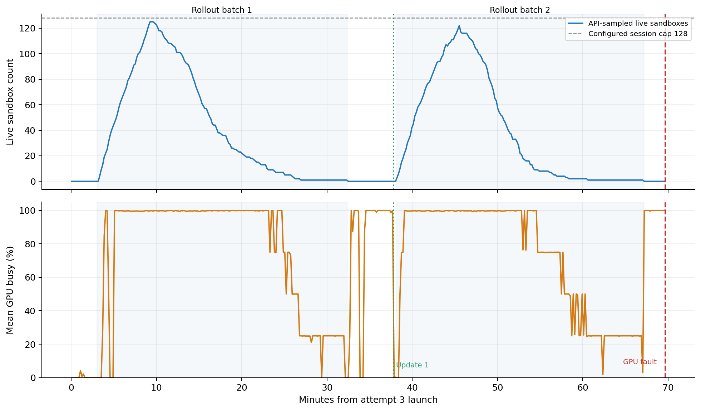

# Uni-Agent SWE任务RL分析报告

这份报告针对2026-09-20的3-step尝试：实际完成1次更新、256条rollout，在第2步被GPU不可纠正事件中断。重点分析时间构成、启动排队、同题8次尝试差异、verifier与工具RPC、长尾及故障恢复代价。

- **[中文详细报告（HTML）](REPORT.zh-CN.html)** · [Markdown](REPORT.zh-CN.md)
- **[English technical report（HTML）](REPORT.html)** · [Markdown](REPORT.md)
- **[同题8个sample交互查看器](explorer.html)**：选择32道题之一，比较总时间、模型等待、排队、工具和verifier。
- [256条sample明细](data/episodes.csv) · [32个题组明细](data/groups.csv)
- [统计口径与限制](METHODS.md) · [复算脚本](analysis/) · [原始来源hash清单](data/source-manifest.json)

主要结论：第1步rollout占约83.7%；客户端创建gate在create成功后仍被准备工作占用；两批90%样本完成后仍有32%/45%的墙钟时间；verifier平均11.9秒，远小于主要长尾；正式运行只有一次逻辑shell超时和一次参数错误，GPU/驱动稳定性是完成训练的首要阻塞。

报告保留可复算表格、11组PNG/SVG图和关键证据。分析只读取历史数据，没有重启训练、模型服务或sandbox。HTML与交互页面可以离线打开；没有外部CDN或服务依赖。
