# Uni-Agent SWE-agent RL: infrastructure and critical-path analysis

This report analyzes the **2026-09-20 three-step smoke run**, which stopped during trainer step 2 after a driver-reported uncorrectable GPU event. **One optimizer update completed; two batches of 128 rollouts completed; no trained checkpoint was saved.** The training data was SWE-reBench, not the 500-task SWE-bench Verified evaluation set. No full benchmark evaluation was run.

The questions are operational: where time went, why startup felt slow, what n=8 did to the completion barrier, whether verification or transport errors dominated, and which interventions have evidence behind them. Rollout timing statistics below come from the final runtime attempt's 256 completed episodes; the incident section separately covers earlier setup failures.

## 1. Findings that should drive the next run

1. **Rollout collection dominates the completed step:** 29.58 of 35.32 minutes (83.7%). Actor update took 4.41 minutes. Faster gradient updates alone cannot remove the largest delay in this run.
2. **The startup bottleneck is partly in our client-side gate, not a measured multi-minute E2B boot.** The create timer includes queue waiting. Three create permits remain held through readiness checks and cached tmux installation. Measured post-create work alone occupied at least **91.1% / 92.0%** of the three-permit capacity during the two creation ramps.
3. **Long tails leave useful capacity idle.** After 90% of samples had finished, batch 1 still needed **9.44 minutes** and batch 2 **13.08 minutes**. These tails consumed **32.2% / 45.1%** of cohort wall time. Their mean GPU busy levels were only **45.4% / 43.1%**.
4. **Verifier cost is small on the observed critical paths.** Its mean was 11.88s, P95 26.88s and maximum 48.83s. The final sample's verifier took just **15.73s / 6.35s**, versus last-sample gaps of **5.53 / 6.61 minutes**.
5. **Fine-grained tool transport is an optimization opportunity, but not the leading batch tail.** There were 44,645 instrumented agent-side RPCs for 9,950 logical tool actions, about **4.49 RPCs/action**. Most exec calls were short control operations; direct file reads/writes were much cheaper.
6. **Reliability is the first blocker.** A real update was verified on all eight ranks, then an ATHUB event and automatic all-GPU reset destroyed unsaved state. The next sustained run needs a repaired/validated GPU environment and a checkpoint policy suitable for that risk.

Use the [offline eight-sample explorer](explorer.html) to select any of the 32 tasks and compare its eight durations, phase costs, tokens and rewards. The [256-row episode CSV](data/episodes.csv) and [32-group CSV](data/groups.csv) contain the underlying measurements.

## 2. Experiment scope and accounting rules

| Setting | Actual run |
|---|---|
| Model | Qwen/Qwen3-Coder-30B-A3B-Instruct; full-parameter RL |
| Trainer | Uni-Agent + bundled verl, colocate_async, GRPO advantages / GSPO loss, R3 Router Replay |
| Hardware | 8 AMD MI350X; actor TP1/PP1/CP4/EP8; four TP2 vLLM replicas on the same GPUs |
| Sampling | 16 prompts/batch × 8 independent attempts = 128 rollout sessions |
| Budgets | 131,072 Agent tokens; 200 Agent steps; 3 requested trainer steps |
| E2B | User-hosted endpoint; reported 192 CPUs / 1 TB RAM / quota 512; 4 vCPU and 8 GiB configured per task sandbox |
| Client gates | 128 session cap; 3 combined create/readiness/provision permits; 16 instrumented exec permits |
| Dataset | All 1,150 official prepared SWE-reBench rows retained; ready-template tasks ordered first; first 32 tasks actually used |
| Scheduling deviation | Warmup prefetch=0; fixed 48-prompt submission cap for the planned three batches |
| Outcome | 1/3 updates completed, 256/384 planned rollouts completed, no step-3 checkpoint |

**A rollout means one independent attempt. A prompt group means one task with eight rollouts.** A task's eight attempts share the question, model version and recipe, but have independent writable sandboxes and different sampled action sequences.

**Instance quota and compute capacity are different.** At 128 live sandboxes, the configured envelopes sum to **512 vCPU and 1,024 GiB (1 TiB)**. The vCPU count is 2.67 times the reported 192 host CPUs; the memory envelope is approximately the reported entire host RAM, before host/services overhead, with TB versus TiB units unspecified. These are configured guest resources, not measured CPU demand or resident memory. The successful 128-instance check established that the platform admitted and exercised that many instances; it did not establish sustained full-load capacity. No server-side CPU, memory-pressure or disk measurements are available to decide whether actual contention occurred.

There are three different denominators in this report:

- **Trainer wall time:** the explicit non-overlapping timers for completed step 1. This is the correct view for “what percentage of a training step is rollout versus optimization?”
- **Cohort observation span:** earliest framework session-open to the last observed completion. This is reconstructed from session timestamps and differs slightly from the trainer's generation timer. It is the basis for startup ramps, tails and GPU occupancy.
- **Summed runner/sandbox time:** add durations across concurrent attempts. This measures accumulated occupancy or where individual attempts spend time. It can be many hours even when the batch finishes in half an hour; it must not be added to trainer wall time.

Structured event durations and runner/verifier timers have subsecond resolution. Model and logical-tool intervals are reconstructed from log markers with **one-second endpoint resolution**; each interval can be off by under about one second. Their component shares are approximate. Rounded framework timestamps can also make a subsecond finalization interval appear negative; the dataset preserves interval bounds rather than interpreting that as negative work. No E2B server-side boot trace, pure inference queue/prefill/decode split, server CPU/RAM utilization or checkpoint-write benchmark was available.

## 3. Where the completed training step spent its wall time

| Component | Seconds | Share of step 1 |
|---|---|---|
| Rollout collection | 1,774.94 | 83.746% |
| Actor logprob recomputation | 72.97 | 3.443% |
| Actor update | 264.62 | 12.485% |
| Weight synchronization | 5.08 | 0.239% |
| Advantages | 1.73 | 0.082% |
| Unattributed timer remainder | 0.10 | 0.004% |

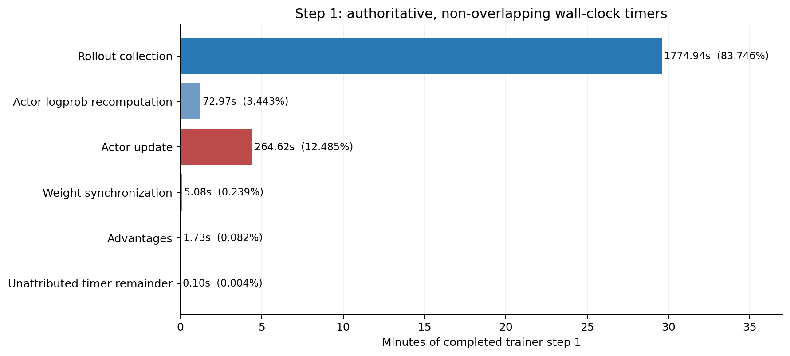

*Only completed trainer step 1 has a full authoritative phase breakdown.*


The small residual is only time outside these explicit timers; it does **not** mean orchestration overhead is negligible, because waiting, dispatch, RPCs and verification are included inside `gen`. Step 2's rollout completed, but its training-side computation was interrupted, so assigning a complete step-2 training percentage would be misleading.

The actor's reported MFU was **6.86%**, despite long stretches of nearly 100% GPU busy. MFU is an estimator tied to the model/FLOP accounting; GPU busy is a hardware utilization sample. They answer different questions. The run showed generic AITER/Torch fallbacks, Stream-K/GSU warnings and shape-driven Dynamo recompilation warnings. Those are reasons to profile kernels later, not evidence that any one warning caused the hardware event or a quantified speed loss.

## 4. The actual rollout and GPU timeline

| Metric | Batch 1 | Batch 2 |
|---|---|---|
| Prompt groups × n | 16 × 8 | 16 × 8 |
| Completed / resolved | 128 / 26 | 128 / 32 |
| Observed cohort span, min | 29.35 | 28.99 |
| Event-reconstructed peak live | 126 | 122 |
| 10-second API sampled peak live | 125 | 122 |
| Mean live sandboxes | 43.43 | 38.83 |
| Mean reported GPU busy | 77.37% | 71.93% |
| Time with mean GPU busy <50%, min | 7.14 | 8.32 |
| Model-generated tokens | 1,507,570 | 1,252,000 |
| Generated tokens / observed cohort second, all GPUs | 856.02 | 719.85 |

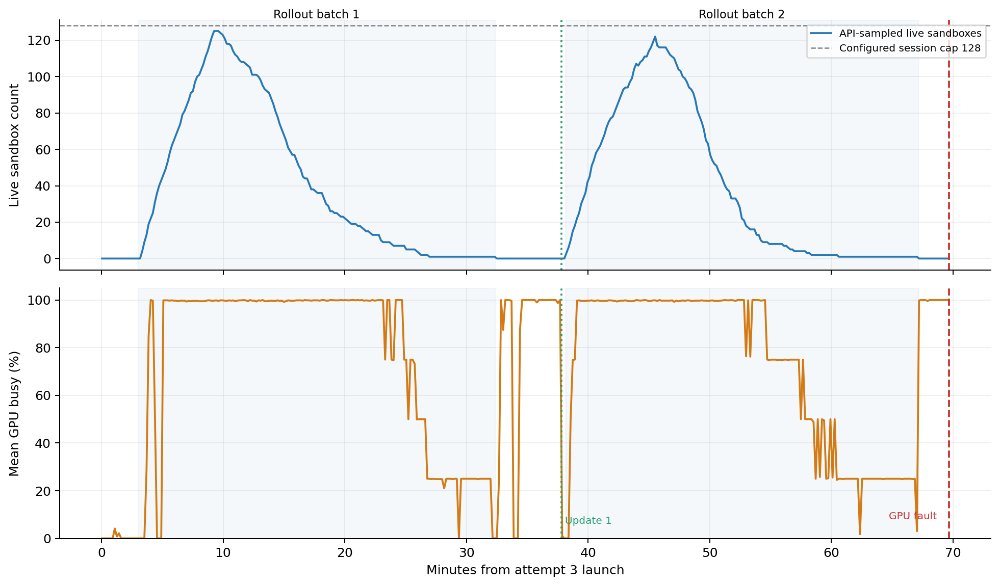

*Rollout bands, GPU utilization, completed update 1 and the later GPU fault.*


The 128-session setting did not mean 128 continuously live sandboxes. Client-event reconstruction found peaks of **126 / 122**, while ten-second API sampling saw **125 / 122**. The separate capacity check did hold and verify 128 live instances. Mean live counts of roughly **43 / 39** reflect creation ramp-up and completion tail-down, not a proof that the E2B service could only support that many.

With warmup prefetch disabled, this run effectively waited for all 16 groups of a batch before updating. It demonstrates **GPU colocation**, but is not a measurement of the best fully asynchronous/partial-rollout throughput. Idle capacity released by completed samples could not be filled with the next batch under this bounded schedule. The framework reported zero staleness in step 1, consistent with this behavior.

## 5. Why sandbox startup was slow

| Metric | Batch 1 | Batch 2 |
|---|---|---|
| First-to-last successful create, s | 358.88 | 440.51 |
| Last create after cohort session-open, s | 372.11 | 441.12 |
| Observed creation slope, instances/s | 0.354 | 0.288 |
| Creation wait + API P50, s | 133.79 | 175.68 |
| Post-create work still inside create gate, mean s | 7.76 | 9.54 |
| Of that: cached tmux provisioning, mean s | 2.35 | 2.91 |
| Of that: readiness/probes/other, mean s | 5.41 | 6.63 |
| Lower bound: gate capacity occupied AFTER create success | 91.1% | 92.0% |
| Dispatch/import log upper-bound median, s | 35.45 | 0.049 |

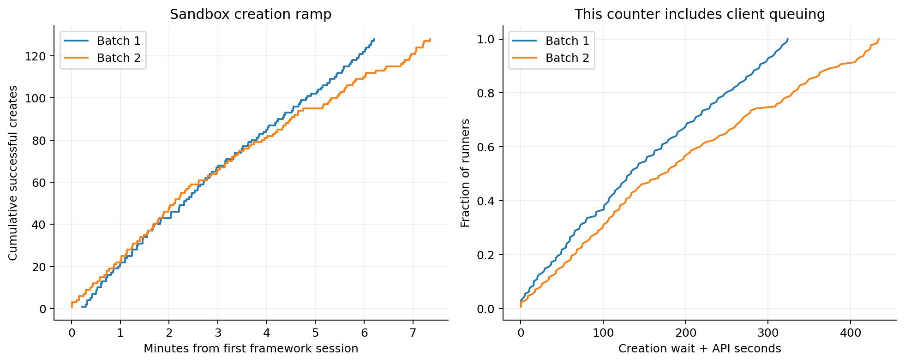

*The measured create duration includes waiting before the SDK create call.*


Across 256 runners, `created.seconds` had P50 **149.12s**, P95 **385.81s** and maximum **434.11s**. It would be wrong to report these as E2B cold-boot latency. The timer starts before acquiring the shared create semaphore; the SDK request begins only after a permit is obtained.

The permit is then retained for:

```text
E2B create → /bin/true readiness probe → command -v tmux
    → OS lookup → upload cached packages → dpkg install → tmux check
    → release create permit
```

The first three creation measurements, which precede a backlog, were **0.41–0.72s** in batch 1 and **0.58–0.63s** in batch 2. These are useful observations, not a service-wide boot-latency distribution. The API may return before the execution channel is ready.

After successful create returned, work still holding the gate averaged **7.76s / 9.54s**. Only **2.35s / 2.91s** of that was the explicitly timed cached-package upload/install; the remainder was readiness/probes/OS lookup and associated overhead. Summing the observed post-create hold intervals, clipped to the creation ramp, already occupies at least **91.1% / 92.0%** of the three-permit capacity. This is a direct lower-bound argument for a client-side bottleneck without guessing unknown API request-start times.

There was also a first-use runner dispatch/import effect: the framework-to-runner log delta had median **35.45s** in batch 1, versus a subsecond upper-bound median around **0.049s** in batch 2. The first batch had one outlier near **268s**. This delta combines scheduling, process startup/import and local entry overhead; it is not a pure Ray scheduler metric. Batch 2's longer create ramp despite warm workers shows that worker warmup alone does not solve the gate bottleneck.

**Intervention:** fix template building, bake tools into templates, and separate a small create-API gate from a separately bounded readiness/provision pool. Do not simply launch unbounded startup requests: the initial capacity test observed connection resets, and the passing retry changed both readiness probing and execution burst concurrency.

## 6. Per-runner time composition

| Runner component | Cumulative hours | Share of summed runner lifetimes |
|---|---|---|
| Creation wait + API | 12.06 | 23.15% |
| Post-create prep | 1.49 | 2.87% |
| Model roundtrips | 30.12 | 57.82% |
| Logical tools | 7.43 | 14.27% |
| Verifier | 0.84 | 1.62% |
| Destroy | 0.00 | 0.00% |
| Agent local/resolution residue | 0.07 | 0.14% |
| Other runner/resolution residue | 0.07 | 0.13% |

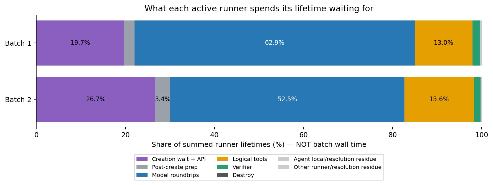

*Parallel accumulated time: do not read this as a training-step pie chart.*


| Component | Mean s | P50 s | P95 s | Max s |
|---|---|---|---|---|
| Runner total | 732.52 | 693.57 | 1,173.42 | 1,739.18 |
| Creation wait + API | 169.54 | 149.12 | 385.81 | 434.11 |
| Post-create preparation | 21.02 | 17.61 | 53.30 | 80.88 |
| Model roundtrips per runner | 423.53 | 374.00 | 794.75 | 1,472.00 |
| Logical tools per runner | 104.55 | 104.50 | 173.75 | 264.00 |
| Verifier | 11.88 | 8.72 | 26.88 | 48.83 |
| Destroy acknowledgement | 0.012 | 0.011 | 0.013 | 0.047 |

Total runner time was **52.09 runner-hours**, and acknowledged live sandbox time was **40.01 sandbox-hours**. Model-response waits overlapped **75.3%** of that live-sandbox residence and **80.0%** of Agent-loop time. This explains why many stateful environments can remain allocated while the model service controls progress. It does **not** measure sandbox CPU idleness; a background process may run while the Agent waits, and server CPU metrics were unavailable.

Post-create preparation includes readiness, cached tools, repository-history cleanup and shell initialization. Tool provisioning is nested inside it and must not be added again. The very small destroy acknowledgements do not prove that every server-side resource is physically reclaimed in 12ms; they measure the client-visible API operation.

## 7. Long-tail cost at n=8

| Tail measure | Batch 1 | Batch 2 |
|---|---|---|
| After 90% complete: remaining min | 9.44 | 13.08 |
| After 90% complete: share of cohort time | 32.2% | 45.1% |
| Mean GPU busy in that tail | 45.41% | 43.14% |
| After 95% complete: remaining min | 7.43 | 10.86 |
| Last one sample alone adds, min | 5.53 | 6.61 |
| Critical task | agronholm__anyio-639 | hylang__hy-2522 |
| Critical sample verifier, s | 15.73 | 6.35 |

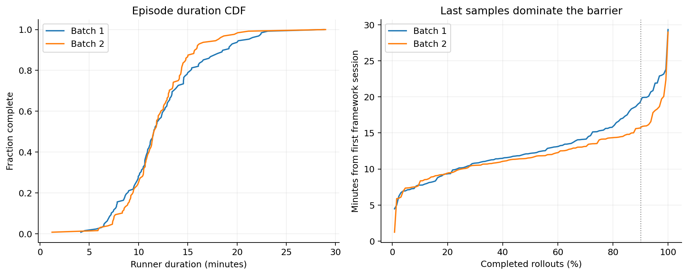

*Completion times use nearest-rank milestones: 90% means 116 of 128 samples completed.*


For a group, readiness waits for the slowest of eight attempts. For this no-prefetch batch, completion waits for the slowest of all 128 attempts. The median within-group slowest/fastest runner ratio was **1.69×**; the largest was **11.72×**. The median slowest/median ratio was **1.31×**.

This does not establish that n=8 is intrinsically worse than n=4 at fixed total rollout count: changing n also changes the number of distinct tasks and the learning signal, and the workload has not been rerun under those alternatives. It does show why “most samples are done” is a poor ETA signal for a blocking batch.

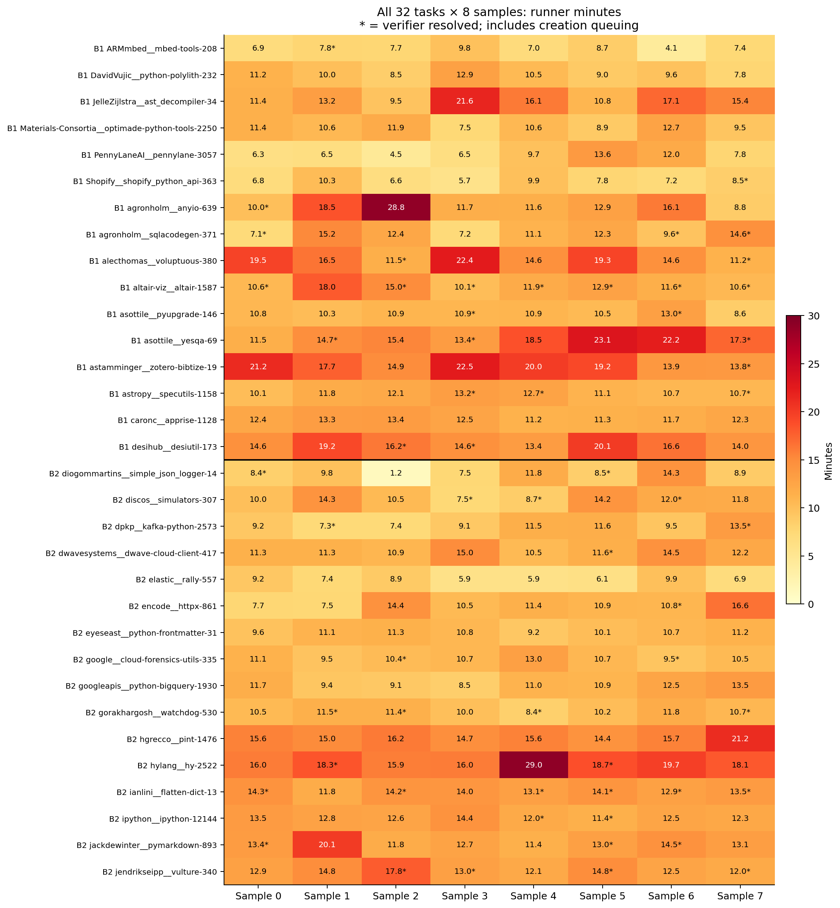

*Every measured task and all eight samples. An asterisk marks reward 1.*


### Case A: AnyIO is batch 1's critical group

The slowest attempt took **28.84 minutes**, versus **8.75 minutes** for the fastest. The slow attempt generated **43,223 tokens** across **110 Agent steps**, versus **7,326 tokens / 41 steps** for the fastest. Its **1,472s of model roundtrips** dominated its lifetime; the verifier took only **15.73s**. This is a workload/model-path tail, not an observed verifier bottleneck.

| Sample | Total min | Create+wait s | Model min | Tools s | Verifier s | Turns | Generated tokens | R |
|---|---|---|---|---|---|---|---|---|
| 0 | 9.98 | 100.95 | 6.05 | 104 | 18.96 | 46 | 8,997 | 1 |
| 1 | 18.47 | 106.82 | 13.85 | 142 | 15.77 | 78 | 20,819 | 0 |
| 2 | 28.84 | 101.40 | 24.53 | 128 | 15.73 | 110 | 43,223 | 0 |
| 3 | 11.69 | 108.67 | 8.15 | 74 | 17.56 | 35 | 12,447 | 0 |
| 4 | 11.55 | 114.02 | 7.58 | 93 | 17.96 | 40 | 11,422 | 0 |
| 5 | 12.90 | 121.16 | 8.55 | 107 | 18.07 | 42 | 12,620 | 0 |
| 6 | 16.08 | 111.18 | 12.37 | 81 | 16.71 | 47 | 19,358 | 0 |
| 7 | 8.75 | 114.55 | 4.72 | 95 | 18.74 | 41 | 7,326 | 0 |

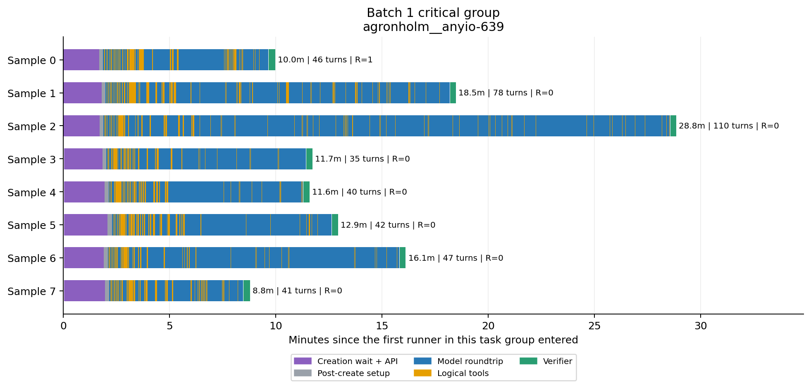

*Within-task timelines expose both staggered startup and different model/tool paths.*


### Case B: Hy determines the end of batch 2

The slowest Hy sample took **28.99 minutes** and generated **37,973 tokens**, compared with **15.90 minutes / 12,324 tokens** for its fastest peer. Its creation wait+API cost was **424.12s**, its model roundtrips **1,235s**, and its verifier **6.35s**. Startup and behavior both mattered. The final sample ended **6.61 minutes after the penultimate sample of the whole batch**.

| Sample | Total min | Create+wait s | Model min | Tools s | Verifier s | Turns | Generated tokens | R |
|---|---|---|---|---|---|---|---|---|
| 0 | 15.98 | 409.76 | 7.90 | 48 | 6.92 | 27 | 12,402 | 0 |
| 1 | 18.33 | 415.42 | 9.73 | 69 | 6.22 | 48 | 15,986 | 1 |
| 2 | 15.90 | 358.64 | 7.97 | 55 | 6.81 | 40 | 12,324 | 0 |
| 3 | 15.96 | 417.72 | 7.92 | 32 | 7.11 | 29 | 11,545 | 0 |
| 4 | 28.99 | 424.12 | 20.58 | 47 | 6.35 | 57 | 37,973 | 0 |
| 5 | 18.66 | 422.91 | 10.03 | 62 | 4.22 | 43 | 15,535 | 1 |
| 6 | 19.72 | 335.40 | 11.93 | 93 | 6.52 | 41 | 19,971 | 0 |
| 7 | 18.12 | 424.26 | 9.72 | 46 | 6.67 | 40 | 14,890 | 0 |

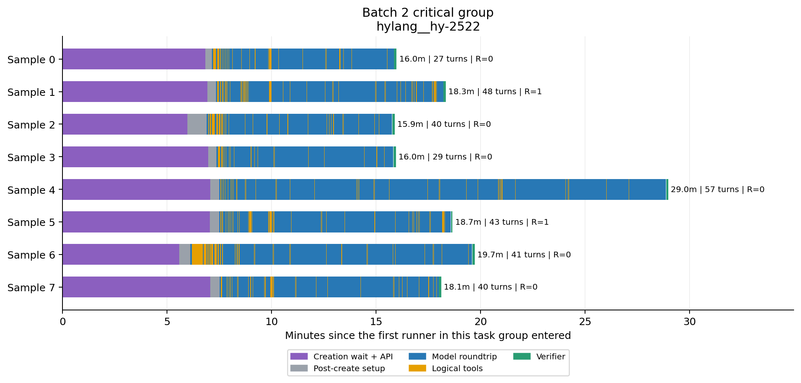

*The final Hy sample remains expensive after separating creation waiting.*


### Case C: a task with an 11.72× sample spread

For `diogommartins__simple_json_logger-14`, the fastest attempt took **73.41s** with **8 steps / 601 generated tokens**. The slowest took **860.08s** with **44 steps / 16,864 tokens**. This is the largest ratio in the dataset, but it was not the batch-2 critical path: a large within-task ratio and a large batch-level tail are different findings.

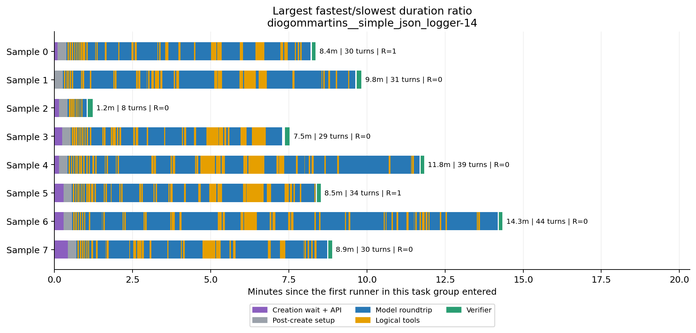

*An extreme sample ratio can coexist with a different task controlling batch completion.*


The computed “completed-sample waiting equivalents” in `groups.csv` are diagnostic slot-seconds, **not live sandbox time or GPU idle time**: completed samples had already been destroyed. They indicate opportunities a different scheduler might fill.

## 8. Sampling cost versus reward diversity

**9 of 32 groups (72 rollouts)** had identical rewards across all eight attempts. They consumed **25.7% of summed runner time** and **25.5% of generated tokens**. There were 9 all-zero groups and 0 all-one groups.

With group-normalized GRPO rewards, uniform-reward groups have zero reward-derived within-group advantage. This is useful cost/signal information, not a reason to retrospectively drop slow failures: their rewards were unknown beforehand, and changing group filtering changes data selection and refill demand. A later controlled study can compare n=4/B=32 and n=8/B=16 at 128 sessions, or evaluate supported group filtering, while tracking group reward variance, consumed data and refill cost.

## 9. Verifier, tooling and timeout behavior

### Verification was small and bounded here

All **256 evaluations completed with parseable test output**. There was no recorded verifier timeout; maximum call time was **48.83s** against a **600s** evaluator limit. Cumulative verifier time was **50.68 minutes**, but this was parallel across samples and therefore cannot be added as 50.68 minutes to the batch wall clocks. It was only **1.62% of summed runner lifetimes**.

The exact verifier timer includes any exec-admission waiting, SDK/transport and command execution. The inner instrumented exec timer begins after its gate; the difference is queue/wrapper overhead, not an independently measured server compute interval. An evaluation process completing normally is also distinct from tests passing: **58/256** rollouts resolved their tasks.

### Logical tools amplify into many RPCs

| Logical tool | Calls | Mean s | P50 s | P95 s | P99 s | Max s |
|---|---|---|---|---|---|---|
| shell | 4,791 | 3.36 | 2.00 | 8.00 | 28.00 | 138.00 |
| str_replace_editor | 4,923 | 2.16 | 1.00 | 6.00 | 19.00 | 31.00 |
| submit | 236 | 0.00 | 0.00 | 0.00 | 0.00 | 0.00 |

| Instrumented operation | Calls | Mean s | P50 s | P95 s |
|---|---|---|---|---|
| exec/agent | 34,403 | 0.4556 | 0.2897 | 0.8298 |
| exec/setup_or_cleanup | 2,329 | 0.9559 | 0.4960 | 2.0374 |
| exec/verifier | 256 | 11.7872 | 8.6475 | 26.7475 |
| file_read/agent | 3,219 | 0.0093 | 0.0080 | 0.0164 |
| file_write/agent | 7,023 | 0.0166 | 0.0059 | 0.0124 |
| file_write/setup_or_cleanup | 512 | 0.0065 | 0.0058 | 0.0098 |

The Agent is configured with `stateful_shell`, exposed to the model as `shell`. This provider does not implement the native persistent-shell interface, so the framework uses **tmux over one-shot exec**. A logical command writes an input file, sends a tmux command, polls an exit-code file, may wait on a tmux signal, then reads stdout/stderr. File editing also issues existence/type checks.

Of **36,988 exec RPCs**, **16,052 were `cat`**, **12,462 were `test`** and **6,073 were `tmux`**. Among execs attributed to Agent operation, **96.7% lasted under one second**. Direct file APIs had mean times around **9ms for reads** and **17ms for Agent writes**, while the median Agent exec RPC was **0.290s**. This suggests batching/control-protocol or native-session work is more promising than optimizing file payload transfer in isolation.

The instrumented exec gate reached 16 concurrent calls. It was fully occupied for **291.8s / 349.3s**, about **16.6% / 20.1%** of cohort spans. Average use of the 16-permit capacity was only **37.1% / 37.6%**. It can create burst queuing, but it was not continuously saturated. These intervals exclude direct readiness/provision operations and file APIs that bypass this gate.

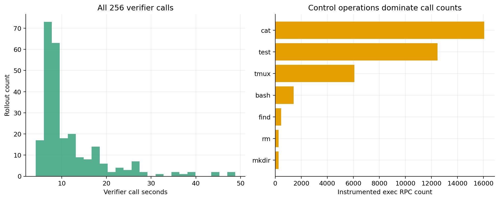

*Verifier distribution and the low-level control operations behind Agent tools.*


### Only one logical timeout and one format error

- **Shell timeout:** one Shopify sample issued `find /testbed -name "*.py" -exec grep -l "not all arguments converted" \;`, omitting the `{}` file placeholder. `grep` consequently reads standard input, consistent with the tool's interactive-wait timeout. The 120s command budget produced a **138s observed logical call**, including polling/interruption/output handling. The Agent continued and finished. This sample was not the batch critical path.
- **Format error:** one watchdog sample passed an extra `shell` argument to a function that only accepts `command`. Validation rejected it before normal execution; the Agent corrected the call. The logged interval rounded to zero seconds.
- **Main-attempt transport:** no recorded E2B create/readiness/destroy/exec-transport error events and no anchored model-client retry warnings. This does not include the earlier capacity-test resets or failed setup attempts.
- **Nonzero exec exits:** 7,530 were observed, but these are not an infrastructure-failure count. For example, `test` and polling `cat` normally return nonzero while a path/result does not exist.

None of the 256 episodes exhausted the configured Agent budget: all returned `finished=True`; observed Agent steps reached at most **110** and last-call context+completion at most **122,743 tokens**. The two long tails are therefore not evidence of hitting the 200-step or 128K limit.

## 10. Model service time and metric interpretation

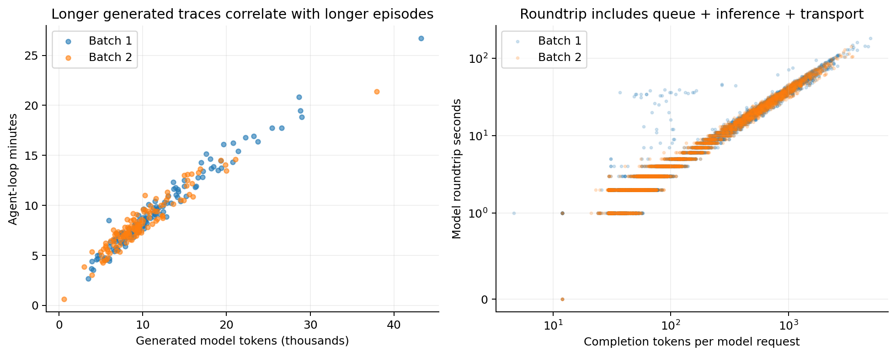

*Descriptive correlations; shared GPU load and different tasks prevent a causal latency claim.*


The logs contain **9,970 completed Agent model-query calls**, with **2,759,570 generated tokens**. These generated-token totals exactly match the exported trajectories' model-token masks for every episode. The API prompt-token sum is much larger—**200,993,200**—because multi-turn requests resend history. It is not a count of unique tokens physically recomputed on GPUs: prefix-cache hit data was not recorded.

Model-query roundtrip latency averaged **10.88s**, with **P50 3s, P95 45s, P99 76s, maximum 180s**. Completion sizes ranged from 7 to 4,972 tokens (median 75). A slow roundtrip is not automatically an infrastructure timeout: these are completed calls with different output sizes and input histories, and the measured interval combines client work, service queueing, inference and transport. Instrumenting those subspans is necessary before choosing between more serving capacity, better cache reuse or lower RPC latency.

Within task groups, demeaned Agent time and generated token count had Pearson correlation **0.976**. Across all episodes, the Spearman correlation between total runner duration and generated tokens was **0.779**. These support generated workload as an explanation for duration variation, while leaving queue, prefill, decode and transport contributions unresolved.

Three metric traps matter for this analysis:

1. `perf/throughput=267.19` is computed as **4,530,385 trajectory tokens / (2,119.43 step seconds × 8 GPUs)**. It is not decode-only tokens/s. Likewise the reported generation ms/token uses trajectory response length, which includes tool observations and history tokens.
2. In this version, V1 converts jagged data to batch-padded tensors before `compute_data_metrics`. `response_length/clip_ratio=1/128` and `prompt_length/clip_ratio=8/128` compare lengths with that padded batch maximum. They are **not sufficient evidence of exhausting the configured token limits**. Termination reasons and configured budgets are the appropriate checks.
3. Gateway `num_turns` counts user/assistant messages plus one. Every observed trajectory's counter is **Agent query count + 2**; the trainer's maximum 112 therefore corresponds to the Agent's 110 steps, not 112 model calls.

## 11. Infrastructure incidents and reliability cost

| Incident | Evidence and consequence | What the data supports |
|---|---|---|
| Fresh template builds failed | Multiple images and a minimal import-only probe returned internal errors during E2B environment initialization | Build path needs repair; reusing ready templates does not validate arbitrary new-image support |
| Initial capacity command resets | 126/128 checks passed first; two connection resets; all cleaned | Repeat passed 128/128 with readiness probes and reduced command burst concurrency; root cause was not isolated |
| Missing tmux in ready task images | Cached Debian tmux/libutempter packages installed at startup | Correctness recovered, but provisioning was placed inside the three-permit create gate |
| Lease mismatch | Training requested 7,200s; API rejected durations above one hour | Actual finalized Task YAML must be preflighted; capacity alone does not test all runtime settings |
| Failure refill escaped prepared prefix | Initial lease failures caused asynchronous refill into unmapped tasks | A bounded failure path is needed; the run added a 48-prompt guard and disabled extra warmup prefetch |
| Resource metrics unavailable | Explicit range queries failed and default range returned no samples | No CPU/RAM/disk utilization claim for the E2B server can be made |
| GPU event interrupted step 2 | ATHUB uncorrectable event at PCI 0000:66:00.0; XGMI events at 0000:96:00.0; automatic reset of all eight GPUs | Hardware/driver reliability is a blocker; exact component/firmware/software root cause remains undetermined |

The hardware event occurred around **09:52:53 UTC**. The kernel explicitly reported lost VRAM contents. The step-1 optimizer update was real (gradient norm **0.084919**, all eight ranks successful, **1,149/131,072** sampled parameter elements changed), and its new weights served batch 2. But saving was scheduled only at step 3, so **no resumable trained checkpoint survived**.

The GPU failure happened after batch-2 sandboxes were already cleaned. Thus “zero leftovers after the fault” does **not** prove cleanup would work if SIGABRT occurred mid-rollout. Python `finally` blocks did not complete after the abort. An independent run-ID-based lease janitor and heartbeat/exit recorder would protect the control plane more reliably. Some CPU runner/coordinator processes also received ROCm hardware exceptions; keeping non-GPU orchestration independent of the accelerator runtime should be considered where the framework permits it.

The complete attempt lasted approximately **69.75 minutes** before abort, including initialization and the partial second training computation. This is useful recovery-cost evidence. It is not a measured checkpoint overhead: no checkpoint write occurred, so that cost remains unknown.

## 12. Prioritized next experiments

| Priority | Change / experiment | Evidence motivating it | Acceptance measurements |
|---|---|---|---|
| P0 | Investigate GPU 0000:66:00.0 and XGMI-related events; validate sustained stability | Actual uncorrectable event and lost VRAM after a successful short preflight | Sustained representative workload, kernel/RAS evidence, no automatic resets; do not treat one short health pass as a repair |
| P0 | Repair new-image template builds | Ready-template workaround restricts deployability of the full recipe | Build and base/reference checks for the intended task set; preserve image digests |
| P1 | Bake tools; split create from readiness/provision gates | At least 91–92% of create-gate capacity was held after create success | A/B current gate vs pre-baked tools vs separately bounded readiness; ramp, first model request, resets, live cap and cleanup |
| P1 | Restore supported prefetch/partial rollout in a controlled run | 32–45% of cohort time remained after 90% completed | Prepare enough templates for lookahead; adjust the 48-prompt guard; compare consumed workload, wall time, GPU busy, staleness, reward and unused/cancelled sessions |
| P1 | Save each completed step during stability work; retain only the newest | One completed update was lost with no checkpoint | Measure actual save time/bytes and verify reload; balance overhead against observed recovery cost |
| P1 | Independent cleanup/heartbeat process | SIGABRT bypassed Python teardown; this fault occurred when no sandbox was live | Deliberate failure during active rollout in an isolated test; only run-owned cleanup; no orphaned leases |
| P2 | Native persistent shell or batched control operations | 4.49 instrumented RPCs per logical tool; cat/test/tmux dominate | Preserve cwd/env/output/interrupt semantics; replay representative tool workloads and validate final grading |
| P2 | Kernel/compile profiling after stability | Actor MFU 6.86%, eager inference and generic fallbacks | Controlled kernel/graph variants with numerical checks and end-to-end timing; no claimed speedup from warning text alone |
| P2 | n=4/B=32 versus n=8/B=16, or supported group filtering | Nine uniform-reward groups used about one quarter of cost | Same session budget, multiple repeats, reward diversity, refill cost, policy staleness and training quality |

The first performance changes should target **startup admission and rollout scheduling**, while preserving the semantics of the Agent and verifier. Optimizing a 12-second verifier first would leave the measured multi-minute tails largely intact.

## Appendix A. All 32 eight-sample groups

Durations below are precise runner-entry-to-return timers and include creation queuing. They are not all measured from a common batch start. The heatmap and interactive explorer expose each individual sample.

| Batch | Task | R=1 /8 | Fastest min | Median min | Slowest min | Max/min | Max/median |
|---|---|---|---|---|---|---|---|
| 1 | ARMmbed__mbed-tools-208 | 1/8 | 4.15 | 7.55 | 9.83 | 2.37× | 1.30× |
| 1 | DavidVujic__python-polylith-232 | 0/8 | 7.76 | 9.81 | 12.93 | 1.67× | 1.32× |
| 1 | JelleZijlstra__ast_decompiler-34 | 0/8 | 9.50 | 14.29 | 21.57 | 2.27× | 1.51× |
| 1 | Materials-Consortia__optimade-python-tools-2250 | 0/8 | 7.49 | 10.63 | 12.67 | 1.69× | 1.19× |
| 1 | PennyLaneAI__pennylane-3057 | 0/8 | 4.55 | 7.14 | 13.60 | 2.99× | 1.91× |
| 1 | Shopify__shopify_python_api-363 | 1/8 | 5.70 | 7.54 | 10.30 | 1.81× | 1.37× |
| 1 | agronholm__anyio-639 | 1/8 | 8.75 | 12.29 | 28.84 | 3.29× | 2.35× |
| 1 | agronholm__sqlacodegen-371 | 3/8 | 7.07 | 11.72 | 15.20 | 2.15× | 1.30× |
| 1 | alecthomas__voluptuous-380 | 2/8 | 11.21 | 15.51 | 22.40 | 2.00× | 1.44× |
| 1 | altair-viz__altair-1587 | 7/8 | 10.10 | 11.72 | 18.02 | 1.79× | 1.54× |
| 1 | asottile__pyupgrade-146 | 2/8 | 8.61 | 10.83 | 13.03 | 1.51× | 1.20× |
| 1 | asottile__yesqa-69 | 3/8 | 11.49 | 16.34 | 23.12 | 2.01× | 1.42× |
| 1 | astamminger__zotero-bibtize-19 | 1/8 | 13.77 | 18.42 | 22.47 | 1.63× | 1.22× |
| 1 | astropy__specutils-1158 | 3/8 | 10.12 | 11.43 | 13.16 | 1.30× | 1.15× |
| 1 | caronc__apprise-1128 | 0/8 | 11.18 | 12.34 | 13.41 | 1.20× | 1.09× |
| 1 | desihub__desiutil-173 | 2/8 | 13.37 | 15.39 | 20.13 | 1.50× | 1.31× |
| 2 | diogommartins__simple_json_logger-14 | 2/8 | 1.22 | 8.70 | 14.33 | 11.72× | 1.65× |
| 2 | discos__simulators-307 | 3/8 | 7.46 | 11.18 | 14.28 | 1.91× | 1.28× |
| 2 | dpkp__kafka-python-2573 | 2/8 | 7.35 | 9.33 | 13.47 | 1.83× | 1.44× |
| 2 | dwavesystems__dwave-cloud-client-417 | 1/8 | 10.53 | 11.45 | 15.00 | 1.42× | 1.31× |
| 2 | elastic__rally-557 | 0/8 | 5.88 | 7.15 | 9.92 | 1.69× | 1.39× |
| 2 | encode__httpx-861 | 1/8 | 7.50 | 10.86 | 16.57 | 2.21× | 1.53× |
| 2 | eyeseast__python-frontmatter-31 | 0/8 | 9.18 | 10.72 | 11.30 | 1.23× | 1.05× |
| 2 | google__cloud-forensics-utils-335 | 2/8 | 9.48 | 10.60 | 13.02 | 1.37× | 1.23× |
| 2 | googleapis__python-bigquery-1930 | 0/8 | 8.54 | 11.00 | 13.51 | 1.58× | 1.23× |
| 2 | gorakhargosh__watchdog-530 | 4/8 | 8.36 | 10.58 | 11.84 | 1.42× | 1.12× |
| 2 | hgrecco__pint-1476 | 0/8 | 14.36 | 15.62 | 21.16 | 1.47× | 1.35× |
| 2 | hylang__hy-2522 | 2/8 | 15.90 | 18.23 | 28.99 | 1.82× | 1.59× |
| 2 | ianlini__flatten-dict-13 | 6/8 | 11.80 | 13.77 | 14.31 | 1.21× | 1.04× |
| 2 | ipython__ipython-12144 | 2/8 | 11.43 | 12.56 | 14.38 | 1.26× | 1.14× |
| 2 | jackdewinter__pymarkdown-893 | 3/8 | 11.41 | 13.09 | 20.07 | 1.76× | 1.53× |
| 2 | jendrikseipp__vulture-340 | 4/8 | 12.00 | 12.96 | 17.83 | 1.49× | 1.37× |

## Appendix B. Reproduction and evidence

- [Measurement methodology and limitations](METHODS.md)
- [256 episodes](data/episodes.csv), [32 groups](data/groups.csv), [model-query intervals](data/model_requests.csv.gz), [logical-tool intervals](data/tool_actions.csv.gz), [RPC intervals](data/sandbox_rpc.csv.gz)
- [Derived summary](data/summary.json), [additional facts](data/additional-facts.json), [source SHA-256 inventory](data/source-manifest.json)
- [Raw completed-step metrics](evidence/train-metrics.jsonl), [fault summary](evidence/kernel-fault-summary.txt), [actual configuration](evidence/train.yaml), [provider implementation](evidence/source/e2b_provider.py)
- CPU-only reproduction: `python3 analysis/extract.py`, then `python3 analysis/render.py`, then `python3 analysis/write_report.py`. Extraction reads the original stopped runtime; figures can be regenerated using the included tables and copied evidence. Report generation also refreshes evidence copies from the original runtime. No model or sandbox is launched.
