# Uni-Agent SWE任务RL：基础设施耗时与瓶颈分析

本报告分析2026-09-20这次3-step基础实验。**实际完成1次optimizer更新、两批共256条rollout；第2步训练计算被GPU不可纠正错误中断，第3步未启动，也没有保存新的模型checkpoint。** 训练数据来自SWE-reBench，本次没有跑500题SWE-bench Verified评测。

这里把“一道题的8次独立尝试”称为一个**题组**，每次尝试称为一条rollout/sample。每批16个题组，`n=8`，共128条；它们各自使用独立sandbox。

## 1. 最值得关注的结论

- **rollout是完整训练step的主要耗时。** 第1步共35.32分钟，其中rollout收集29.58分钟，占83.7%；actor更新4.41分钟，占约12.5%。
- **启动慢主要不能解释为“E2B boot要几分钟”。** 创建计时包含客户端排队；3个创建名额直到就绪探测和tmux准备结束才释放。创建成功后的工作，就占掉了启动阶段至少91.1%和92.0%的这3个名额容量。
- **长尾比平均耗时更决定整批结束时间。** 两批在90%样本完成后，还分别等待9.44和13.08分钟，占整批约32%和45%；最后一个sample单独增加了5.53和6.61分钟等待。
- **verifier不是这次主要长尾。** 平均11.88秒，P95为26.88秒，最长48.83秒。两批最后结束的sample，verifier分别只用了15.73和6.35秒。
- **工具接口存在明显的细粒度RPC开销。** 9,950次逻辑工具调用对应44,645次agent阶段的已记录RPC，平均4.49次RPC/工具动作。`cat`、`test`、`tmux`占了大量调用。
- **首要阻塞仍是稳定性。** 硬件/驱动事件使已更新但未checkpoint的权重丢失。应先处理GPU/XGMI稳定性，再比较吞吐优化。

可打开[8-sample交互查看器](explorer.html)，按题目和耗时口径查看每组8个sample。原始抽取结果见[256条明细](data/episodes.csv)和[32个题组](data/groups.csv)。

## 2. 配置、范围与计时口径

模型为`Qwen/Qwen3-Coder-30B-A3B-Instruct`，单机8张MI350X；采用`colocate_async`、GRPO advantage / GSPO loss、R3 Router Replay。Actor为TP1/PP1/CP4/EP8，vLLM为4个TP2副本，两者复用同一组GPU。每批16题×8次尝试；Agent预算131,072 token、最多200轮。

自建E2B地址为`10.145.64.67:8088`，用户提供的配置为192 CPU、1 TB内存、配额512；每个任务sandbox配置4 vCPU和8 GiB。客户端限制为128个session、3个创建/就绪/依赖准备名额，以及16个已记录exec调用名额。后两个限制不能与sandbox存活上限混为一谈。

**实例配额与计算容量要分开看。** 128个环境按上述配置合计512 vCPU、1,024 GiB（1 TiB）：vCPU数为192个宿主CPU的2.67倍，内存配置总额也大致相当于整机容量，还没有扣除宿主与服务开销，且“1 TB”的单位口径未确认。这是guest配置总额，不是实测CPU需求或驻留内存。128实例验收通过证明平台能接纳并操作这些实例；是否能同时承受持续满负载，还需要CPU、内存压力和磁盘监控。本次数据既不能证明资源完全无争用，也不能证明这些配置已经造成资源瓶颈。

由于新模板构建服务出错，本次保留了完整1,150题文件，但把已有可用模板的题目排在前面，准备48题，实际用了前32题。`warmup prefetch=0`，并限制最多提交48题。**因此本次能验证colocate闭环，但不能代表官方充分异步、partial-rollout的最佳吞吐。**

本报告严格区分三种时间：

1. **训练step墙钟时间**：第1步完整timer，用来回答training与rollout各占多少。
2. **批次观测时间**：最早framework session打开，到最后一个观测结果结束；用来分析启动、长尾和GPU使用情况。它与trainer的`gen` timer有少量边界差异。
3. **并行任务累计时间**：把256条runner或sandbox时间相加，用来分析累计占用。它可以达到几十小时，不能再加到训练step的墙钟时间上。

结构化event、runner、verifier timer有亚秒精度；模型请求和逻辑工具时间来自秒级日志标记，端点各自有取整误差，所以其占比是近似拆解。未获得E2B服务端boot分段、纯GPU排队/prefill/decode分段、服务器CPU/RAM利用率和checkpoint写入耗时。

## 3. 第1个训练step的耗时占比

| Component | Seconds | Share of step 1 |
|---|---|---|
| Rollout collection | 1,774.94 | 83.746% |
| Actor logprob recomputation | 72.97 | 3.443% |
| Actor update | 264.62 | 12.485% |
| Weight synchronization | 5.08 | 0.239% |
| Advantages | 1.73 | 0.082% |
| Unattributed timer remainder | 0.10 | 0.004% |

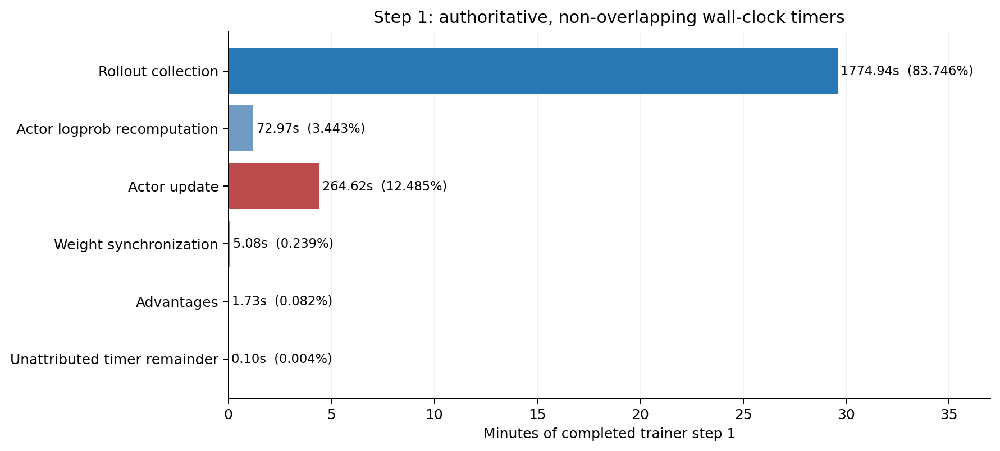

*第1步的完整墙钟计时；各项互不重复，可以相加。*


`gen`包含任务分发、等待环境、Agent多轮交互、verifier及轨迹交付等工作，不能把它理解为纯GPU生成时间。表中很小的剩余项仅表示没有落进这些timer的时间，不代表所有调度开销都只有这么少。

第2批rollout虽然完成，但第2步训练计算在结束前被打断，**不能给第2步编造完整training占比，也不能把未记录的部分当成0秒**。

## 4. rollout过程：启动爬坡、收尾与GPU利用率

| Metric | Batch 1 | Batch 2 |
|---|---|---|
| Prompt groups × n | 16 × 8 | 16 × 8 |
| Completed / resolved | 128 / 26 | 128 / 32 |
| Observed cohort span, min | 29.35 | 28.99 |
| Event-reconstructed peak live | 126 | 122 |
| 10-second API sampled peak live | 125 | 122 |
| Mean live sandboxes | 43.43 | 38.83 |
| Mean reported GPU busy | 77.37% | 71.93% |
| Time with mean GPU busy <50%, min | 7.14 | 8.32 |
| Model-generated tokens | 1,507,570 | 1,252,000 |
| Generated tokens / observed cohort second, all GPUs | 856.02 | 719.85 |

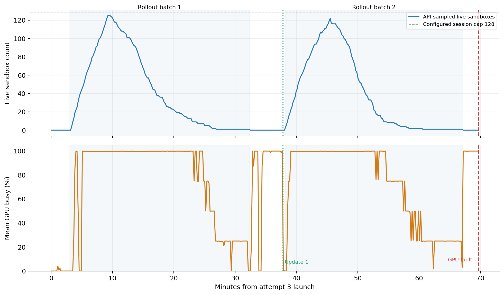

*蓝色区域对应rollout批次；绿色线是第1次更新完成；红线是GPU故障。*


从客户端事件重建，训练中sandbox峰值为126和122；10秒一次API采样看到125和122。独立容量验收则确实让128个sandbox同时存活并完成检查。训练没一直占满128，不等于E2B只能承载这些数量：样本会在创建尚未全部结束时提前完成，后段又逐渐退出。

平均存活约43和39个，是整个批次时间上的平均值，包含启动和长尾。它是“存活slot占用”，不是CPU利用率。也不能据此断言把并发降到64就不会影响性能。

这次关闭了未来批次预取。一个batch的16个题组都要返回，才进入更新；已经结束的sample释放了sandbox，但下一批还没有填入。因此后段常只剩少数任务、只有部分vLLM副本工作。第1步记录的policy staleness为0，也与这一调度方式一致。

## 5. 起sandbox最初为什么慢

| Metric | Batch 1 | Batch 2 |
|---|---|---|
| First-to-last successful create, s | 358.88 | 440.51 |
| Last create after cohort session-open, s | 372.11 | 441.12 |
| Observed creation slope, instances/s | 0.354 | 0.288 |
| Creation wait + API P50, s | 133.79 | 175.68 |
| Post-create work still inside create gate, mean s | 7.76 | 9.54 |
| Of that: cached tmux provisioning, mean s | 2.35 | 2.91 |
| Of that: readiness/probes/other, mean s | 5.41 | 6.63 |
| Lower bound: gate capacity occupied AFTER create success | 91.1% | 92.0% |
| Dispatch/import log upper-bound median, s | 35.45 | 0.049 |

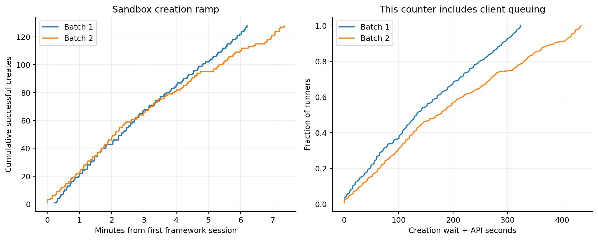

*注意右图是客户端排队＋create API，并非服务端纯启动时间。*


256次创建计时的中位数149.12秒、P95为385.81秒、最大434.11秒。源码表明timer在等待创建semaphore之前启动，所以这些数值**包含等待名额的时间**。

本次名额的实际占用范围是：

```text
等待3个创建名额之一
  → E2B create
  → /bin/true就绪检查
  → command -v tmux、读取OS信息
  → 上传缓存包、dpkg安装、tmux检查
  → 释放创建名额
```

每批最前面的3个create计时只有约0.41–0.72秒、0.58–0.63秒。这说明后续几分钟计时不能直接归因于E2B API，但这几个数据点也不足以代表服务端boot分布；API返回后，执行通道还可能需要就绪时间。

create成功后仍占着名额的工作，平均7.76和9.54秒。其中明确计时的缓存包上传/安装平均2.35和2.91秒，其余5.41和6.63秒是就绪检查、探测、OS读取等路径。只累计“create返回到工具准备完成”这一确定占着名额的区间，就已消耗启动窗口中3个名额容量的至少91.1%和92.0%；这个结论不需要猜测未记录的API请求开始时刻。

另一个成本来自runner冷启动：首批framework到runner入口的日志差，中位数约35.45秒，最大268秒；第二批中位数变成亚秒，日志给出的上界约0.049秒。这项包含Ray调度、进程启动/import和入口开销，不能全部叫作Ray排队。第二批创建爬坡仍更慢，说明只解决worker冷启动还不够。

**优先方案**是修好模板构建，把tmux等工具预装进模板，再把“create API并发”和“就绪/依赖准备并发”分开控制。不能直接无限放开：首次容量检查出现过连接重置，后续成功的复查同时调整了就绪探测和命令突发并发，尚未隔离单一根因。

## 6. 一条runner的时间花在哪里

| Runner component | Cumulative hours | Share of summed runner lifetimes |
|---|---|---|
| Creation wait + API | 12.06 | 23.15% |
| Post-create prep | 1.49 | 2.87% |
| Model roundtrips | 30.12 | 57.82% |
| Logical tools | 7.43 | 14.27% |
| Verifier | 0.84 | 1.62% |
| Destroy | 0.00 | 0.00% |
| Agent local/resolution residue | 0.07 | 0.14% |
| Other runner/resolution residue | 0.07 | 0.13% |

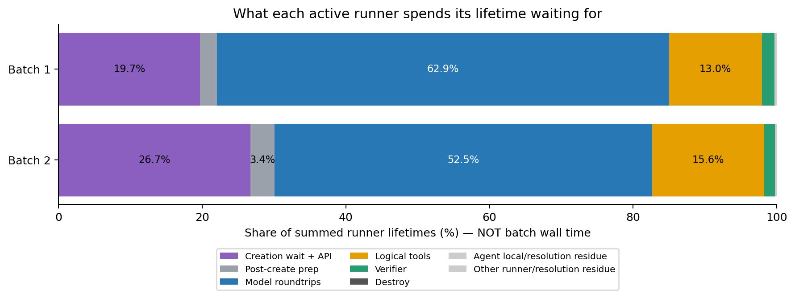

*累计并行时间占比，分母不是训练step墙钟时间。*


| Component | Mean s | P50 s | P95 s | Max s |
|---|---|---|---|---|
| Runner total | 732.52 | 693.57 | 1,173.42 | 1,739.18 |
| Creation wait + API | 169.54 | 149.12 | 385.81 | 434.11 |
| Post-create preparation | 21.02 | 17.61 | 53.30 | 80.88 |
| Model roundtrips per runner | 423.53 | 374.00 | 794.75 | 1,472.00 |
| Logical tools per runner | 104.55 | 104.50 | 173.75 | 264.00 |
| Verifier | 11.88 | 8.72 | 26.88 | 48.83 |
| Destroy acknowledgement | 0.012 | 0.011 | 0.013 | 0.047 |

256条runner累计约52.09小时，sandbox成功创建至销毁确认累计约40.01小时。等待模型响应的区间覆盖了约75.3%的sandbox存活时间，以及80.0%的Agent-loop时间。这说明状态化sandbox常常要在等待模型时继续存在；**不能把75.3%直接当成CPU空闲率**，因为可能存在后台进程，而且没有服务端CPU指标。

“post-create准备”已包括就绪、工具、Git历史清理和shell初始化；tmux安装是它的子项，不能再重复相加。销毁平均约11.6毫秒，是客户端API确认时间，并不等于测量了服务端物理资源回收全过程。

## 7. 同一道题的8个sample差异与长尾

| Tail measure | Batch 1 | Batch 2 |
|---|---|---|
| After 90% complete: remaining min | 9.44 | 13.08 |
| After 90% complete: share of cohort time | 32.2% | 45.1% |
| Mean GPU busy in that tail | 45.41% | 43.14% |
| After 95% complete: remaining min | 7.43 | 10.86 |
| Last one sample alone adds, min | 5.53 | 6.61 |
| Critical task | agronholm__anyio-639 | hylang__hy-2522 |
| Critical sample verifier, s | 15.73 | 6.35 |

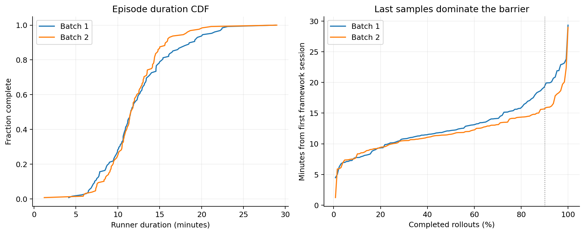

*90%完成点按nearest-rank取116/128；曲线末端直接影响整批结束。*


32个题组中，最慢/最快耗时比中位数1.69倍，最大11.72倍；最慢/组内中位数的比值中位数为1.31倍。题组需要等待8次尝试中最慢的一个，而本次全批barrier又要等待128次尝试中最慢的一个。

这说明长尾代价，但**不能仅凭这次数据断言固定128条rollout时n=4一定比n=8快**：n变了，题目数、难度混合、组内奖励信号和调度都会变，需要对照实验。

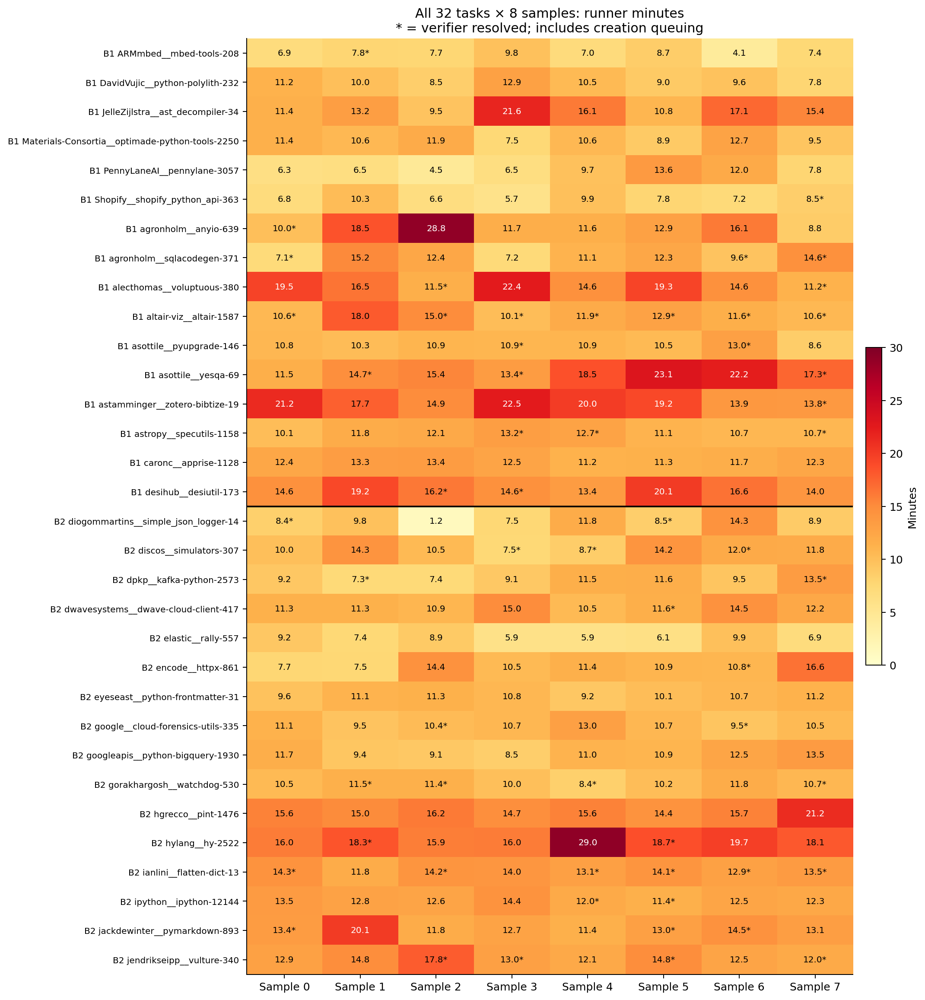

*32道题全部8次尝试的耗时；星号表示reward=1。*


### AnyIO：第1批的关键长尾

同题最快8.75分钟，最慢28.84分钟。最慢sample进行了110轮，生成43,223 token；最快进行了41轮，生成7,326 token。最慢sample里，等待模型累计1,472秒，工具128秒，verifier仅15.73秒。

| Sample | Total min | Create+wait s | Model min | Tools s | Verifier s | Turns | Generated tokens | R |
|---|---|---|---|---|---|---|---|---|
| 0 | 9.98 | 100.95 | 6.05 | 104 | 18.96 | 46 | 8,997 | 1 |
| 1 | 18.47 | 106.82 | 13.85 | 142 | 15.77 | 78 | 20,819 | 0 |
| 2 | 28.84 | 101.40 | 24.53 | 128 | 15.73 | 110 | 43,223 | 0 |
| 3 | 11.69 | 108.67 | 8.15 | 74 | 17.56 | 35 | 12,447 | 0 |
| 4 | 11.55 | 114.02 | 7.58 | 93 | 17.96 | 40 | 11,422 | 0 |
| 5 | 12.90 | 121.16 | 8.55 | 107 | 18.07 | 42 | 12,620 | 0 |
| 6 | 16.08 | 111.18 | 12.37 | 81 | 16.71 | 47 | 19,358 | 0 |
| 7 | 8.75 | 114.55 | 4.72 | 95 | 18.74 | 41 | 7,326 | 0 |

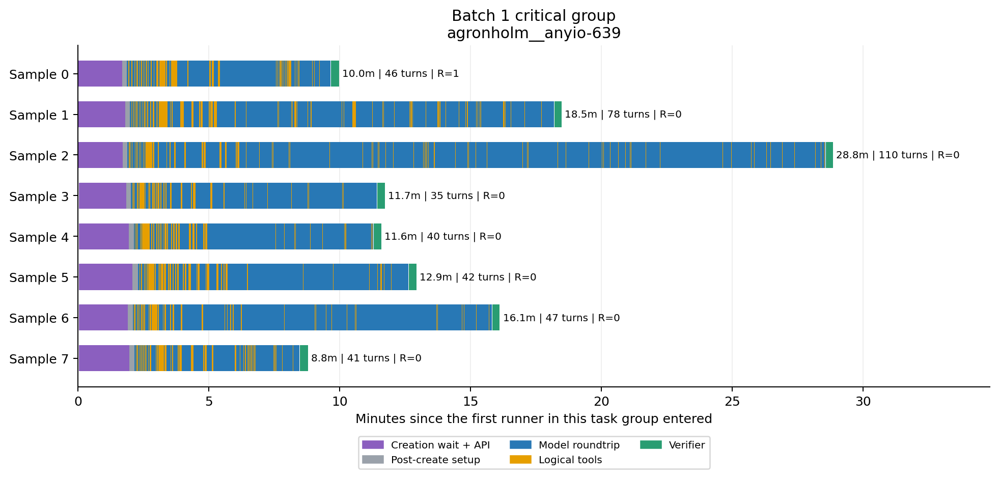

*同题8次尝试的真实时间线，能看出各自不同的模型与工具路径。*


### Hy：第2批最后结束的sample

最快15.90分钟，最慢28.99分钟；生成token分别为12,324和37,973。最慢sample有424.12秒创建排队＋API时间、1,235秒模型响应等待、47秒逻辑工具时间，verifier仅6.35秒。它比整批倒数第二个结束的sample晚了6.61分钟。

| Sample | Total min | Create+wait s | Model min | Tools s | Verifier s | Turns | Generated tokens | R |
|---|---|---|---|---|---|---|---|---|
| 0 | 15.98 | 409.76 | 7.90 | 48 | 6.92 | 27 | 12,402 | 0 |
| 1 | 18.33 | 415.42 | 9.73 | 69 | 6.22 | 48 | 15,986 | 1 |
| 2 | 15.90 | 358.64 | 7.97 | 55 | 6.81 | 40 | 12,324 | 0 |
| 3 | 15.96 | 417.72 | 7.92 | 32 | 7.11 | 29 | 11,545 | 0 |
| 4 | 28.99 | 424.12 | 20.58 | 47 | 6.35 | 57 | 37,973 | 0 |
| 5 | 18.66 | 422.91 | 10.03 | 62 | 4.22 | 43 | 15,535 | 1 |
| 6 | 19.72 | 335.40 | 11.93 | 93 | 6.52 | 41 | 19,971 | 0 |
| 7 | 18.12 | 424.26 | 9.72 | 46 | 6.67 | 40 | 14,890 | 0 |

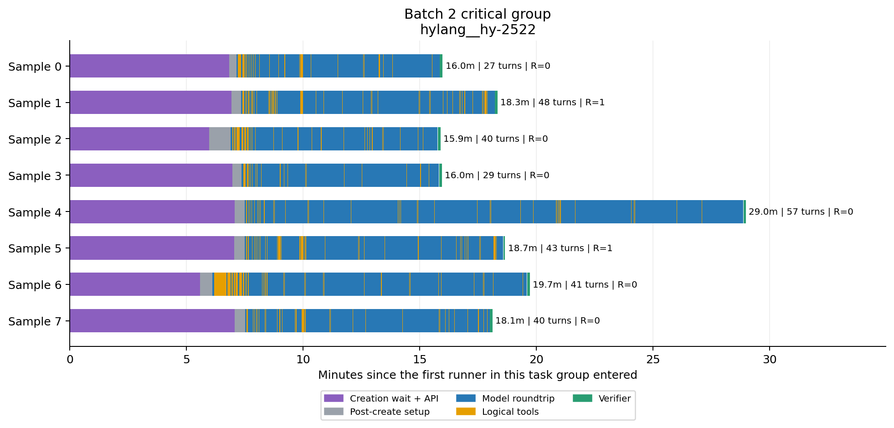

*Hy样本既受启动排队影响，也受生成路径长度影响。*


### simple_json_logger：最大11.72倍差异

最快sample只用了73.41秒、8轮、601个生成token；最慢用了860.08秒、44轮、16,864个生成token。不过它并不是整批最后结束的任务。**“组内相对差异最大”与“决定batch结束时间”不是同一件事。**

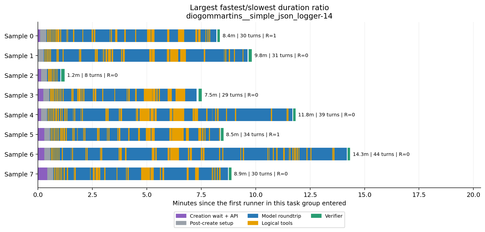

*极端组内差异的例子；完整数值可在交互查看器中选择该题。*


`groups.csv`还给出了各sample完成后到组内最慢sample结束的等待等价值。它只是诊断性的slot-seconds，不能算作额外sandbox占用或GPU空闲：那些sample完成时环境已经销毁。

## 8. n=8的成本是否都产生奖励学习信号

32组中有9组的8次reward完全相同，共72条rollout。这9组占约25.7%的累计runner时间、25.5%的生成token；其中9组全0、0组全1。

对组内归一化的GRPO来说，同组reward完全相同会得到0的奖励差异advantage。这能帮助评估采样成本，但不能事后因为结果差就删除长样本：采样前不知道它们的reward，组过滤也会改变训练分布并增加补采量。后续可比较固定128session预算下的`n=4/B=32`与`n=8/B=16`，同时衡量组内reward方差、补采成本和训练质量。

## 9. verifier、RPC以及实际timeout

所有256次评测都有可解析结果，没有记录到verifier超时；最长48.83秒，低于600秒限制。verifier累计50.68分钟是并行累计值，不能加到两批墙钟时间上。它只占累计runner时间1.62%；两条关键长尾中分别只占15.73和6.35秒。

verifier timer覆盖exec名额等待、SDK/传输和执行；内层exec timer在拿到名额后才开始。二者差值只能称为gate/wrapper开销，不能直接当成服务端计算时间。评测脚本正常结束也不意味着修复成功：两批总共58/256次通过了测试。

| Logical tool | Calls | Mean s | P50 s | P95 s | P99 s | Max s |
|---|---|---|---|---|---|---|
| shell | 4,791 | 3.36 | 2.00 | 8.00 | 28.00 | 138.00 |
| str_replace_editor | 4,923 | 2.16 | 1.00 | 6.00 | 19.00 | 31.00 |
| submit | 236 | 0.00 | 0.00 | 0.00 | 0.00 | 0.00 |

| Instrumented operation | Calls | Mean s | P50 s | P95 s |
|---|---|---|---|---|
| exec/agent | 34,403 | 0.4556 | 0.2897 | 0.8298 |
| exec/setup_or_cleanup | 2,329 | 0.9559 | 0.4960 | 2.0374 |
| exec/verifier | 256 | 11.7872 | 8.6475 | 26.7475 |
| file_read/agent | 3,219 | 0.0093 | 0.0080 | 0.0164 |
| file_write/agent | 7,023 | 0.0166 | 0.0059 | 0.0124 |
| file_write/setup_or_cleanup | 512 | 0.0065 | 0.0058 | 0.0098 |

当前provider没有提供native persistent-shell接口，所以`stateful_shell`回退到tmux-over-exec：写命令文件、发送tmux指令、轮询exit-code文件、必要时等待信号、再读stdout/stderr。文件编辑也会做多次存在性检查。

36,988次exec里，`cat`为16,052次、`test`为12,462次、`tmux`为6,073次；agent阶段96.7%的exec短于1秒。对比之下，直接文件读取平均约9ms、写入约17ms，而agent exec中位数约290ms。这支持优化控制RPC数量或native shell路径，而不是只优化文件payload传输。

exec gate确实到过16并发，分别满载约291.8和349.3秒，占各自批次约16.6%和20.1%；但平均只使用了16个名额容量的37.1%和37.6%。它可能产生突发排队，并非整个batch一直饱和。直接就绪/依赖准备调用和文件API不属于这个exec gate统计。

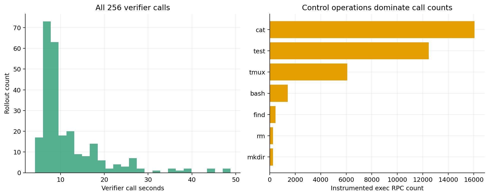

*verifier耗时分布与低层RPC数量构成。*


正式运行只观测到两类逻辑工具问题：

- Shopify某个sample执行的`find -exec grep`缺少`{}`文件占位符，导致`grep`读取标准输入，符合等待输入的超时表现。命令上限120秒，完整逻辑调用耗时138秒，包含轮询、中断和读取输出。agent随后继续完成；它不是batch长尾。
- Watchdog某个sample向shell工具多传了一个不支持的`shell`参数，被参数校验拒绝；随后修正调用。该操作的日志耗时低于1秒分辨率。

正式attempt没有记录到E2B传输错误事件或模型客户端重试warning。先前容量检查的2次connection reset，以及初始化时租期配置被API拒绝，属于不同阶段，不能混在一起。低层exec共有7,530次非零退出码，也不能作为基础设施失败数：`test`、轮询结果文件的`cat`等经常正常返回非零。

所有256个Agent最终都返回`finished=True`，没有耗尽200轮或128K预算。最大实际Agent轮数110，最大最后一次上下文＋输出122,743 token。

## 10. 模型等待与指标误读

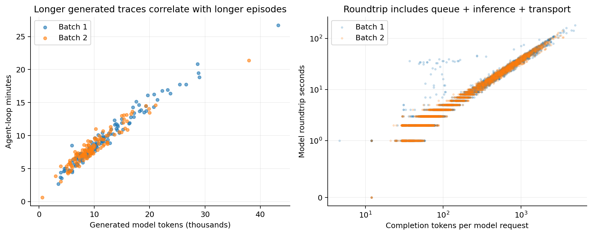

*图中是描述性关联；没有分离GPU排队、prefill、decode与传输。*


总计9,970次完成的Agent模型查询，生成2,759,570 token，与轨迹mask标记的模型token逐条相等。API输入prompt累计200,993,200 token，因为多轮请求反复携带历史；它不能等同于GPU实际重算了2亿token，prefix-cache命中没有被记录。

单次模型查询往返平均10.88秒，P50为3秒、P95为45秒、P99为76秒，最长180秒；单次输出为7–4,972 token，中位数75。长请求并不自动等于infra timeout：这些请求均完成了，且输出长度和历史上下文各不相同。往返时间混合了客户端处理、服务排队、推理和传输，下一次需要分别记录这些分段，才能判断增加推理容量、改善cache或降低RPC延迟哪个更有效。

同题组内去均值后，Agent耗时与生成token数量的Pearson相关系数约0.976；跨全部样本，runner耗时与生成token的Spearman相关系数约0.779。生成工作量能解释很多时间差异，但这不是隔离变量后的因果测量。

三个指标尤其容易误读：

1. `perf/throughput=267.19`是轨迹总token数除以step时间再除8张卡，**不是decode TPS**。轨迹response长度也包含工具观测和多轮历史。
2. 当前V1在统计前把变长tensor补齐到batch最大长度，`clip_ratio`是与这个padding最大值比较。第1步的`response_length/clip_ratio=1/128`与`prompt_length/clip_ratio=8/128`，不能单独证明撞到了配置上限。
3. Gateway的`num_turns`统计user/assistant消息再加1，本次每条都比实际Agent查询次数多2。因此trainer里的最大112，与Agent日志最大110对应，并不是多做了两次模型调用。

## 11. 基础设施问题与恢复代价

新模板导入在E2B环境初始化阶段返回内部错误，最小的“只导入镜像”复查也失败；精确的服务端根因没有确定。因此本次使用已有模板，不能据此声称完整1150题的任意新镜像构建链路已经跑通。

开始时训练配置请求7200秒租期，被E2B的1小时限制拒绝。失败补采进一步走到未准备的题目才出现映射报错，所以映射报错是次生现象。最终按3600秒创建，并用**正式解析后的Task配置**做实际启动检查，同时加了48题提交上限。这个案例说明：只测“能创建一个sandbox”或“配额够128”还不够，预检参数必须与最终配置一致。

最严重的问题发生在09:52:53 UTC附近：内核报告`0000:66:00.0`不可纠正ATHUB事件，`0000:96:00.0`同期出现XGMI可纠正错误；随后ROCm报告GPU Hang，驱动自动重置全部8卡并明确记录VRAM丢失。日志只能支持硬件/驱动层故障这一结论，不能凭此断言具体坏件、固件缺陷或某条性能warning就是根因。

第1步确实更新了模型：梯度0.084919，8个rank成功，参数抽样有1,149/131,072个元素变化，更新后的模型还执行了第二批rollout。但因为只计划第3步保存，**没有可恢复的新checkpoint**。本次有效运行尝试约69.75分钟的状态都无法从训练checkpoint继续；现有指标和轨迹仍可分析。checkpoint写入开销本次没有测到，不能猜一个百分比。

故障发生时第二批sandbox已经销毁，所以故障后残留为零，**并不证明在rollout中途SIGABRT也一定能自动清理干净**。Python的finally没有在这次abort后完整执行；独立于训练进程的run-ID/lease清理器和heartbeat记录更可靠。部分CPU协调/runner进程也收到ROCm硬件异常，说明故障域存在耦合，后续可检查能否让纯CPU控制面尽量不初始化GPU runtime。

## 12. 建议的优化顺序与验证方法

| 优先级 | 建议 | 为什么优先 | 应测什么 |
|---|---|---|---|
| P0 | 排查GPU/XGMI，做持续负载稳定性验证 | 不可纠正事件导致显存和未保存状态丢失 | 代表性长负载、内核/RAS记录、无自动reset；短预检通过不能当成已修复 |
| P0 | 修复新模板构建 | 已有模板绕过了问题，尚不能覆盖完整recipe部署 | 新镜像build、base/reference评测、固定digest |
| P1 | 预装工具，拆分创建与就绪gate | 91–92%的创建名额容量被返回后的工作占用 | 当前方案/预装/分gate对照；爬坡、首次模型请求、错误率、并发和清理 |
| P1 | 准备足够模板后恢复受支持的prefetch/partial rollout | 90%完成后仍占32–45%时间 | 调整48题guard与收尾逻辑；测消耗的数据、staleness、吞吐、reward、取消/残留 |
| P1 | 稳定性阶段每step保存，只留最新 | 已完成的1步权重丢失 | 实测写入秒数/字节数与可恢复性，不预估免费保存 |
| P1 | 独立清理与心跳 | SIGABRT会绕过finally | 隔离测试中途故障；只清本run实例；验证无孤儿租期 |
| P2 | native shell或批量控制RPC | 逻辑工具被放大为4.49次RPC | 保持cwd/env/输出/中断语义，对照相同工具工作负载与最终评分 |
| P2 | 稳定后做kernel/graph分析 | actor MFU约6.86%，有通用fallback和重编译 | 受控数值检查和端到端时间，不凭warning文字推断提速幅度 |
| P2 | 固定session预算比较n/B组合或group filtering | 9个同reward题组占约四分之一成本 | 多次重复、reward方差、补采成本、策略陈旧度与训练质量 |

当前最有证据支持的性能方向是**启动门控和rollout调度**。优先优化平均12秒的verifier，很难消除已经观测到的几分钟长尾。

## 附录：全部32个题组

下表耗时来自runner入口到返回，包含创建排队；不是从统一batch时刻开始计时。

| Batch | Task | R=1 /8 | Fastest min | Median min | Slowest min | Max/min | Max/median |
|---|---|---|---|---|---|---|---|
| 1 | ARMmbed__mbed-tools-208 | 1/8 | 4.15 | 7.55 | 9.83 | 2.37× | 1.30× |
| 1 | DavidVujic__python-polylith-232 | 0/8 | 7.76 | 9.81 | 12.93 | 1.67× | 1.32× |
| 1 | JelleZijlstra__ast_decompiler-34 | 0/8 | 9.50 | 14.29 | 21.57 | 2.27× | 1.51× |
| 1 | Materials-Consortia__optimade-python-tools-2250 | 0/8 | 7.49 | 10.63 | 12.67 | 1.69× | 1.19× |
| 1 | PennyLaneAI__pennylane-3057 | 0/8 | 4.55 | 7.14 | 13.60 | 2.99× | 1.91× |
| 1 | Shopify__shopify_python_api-363 | 1/8 | 5.70 | 7.54 | 10.30 | 1.81× | 1.37× |
| 1 | agronholm__anyio-639 | 1/8 | 8.75 | 12.29 | 28.84 | 3.29× | 2.35× |
| 1 | agronholm__sqlacodegen-371 | 3/8 | 7.07 | 11.72 | 15.20 | 2.15× | 1.30× |
| 1 | alecthomas__voluptuous-380 | 2/8 | 11.21 | 15.51 | 22.40 | 2.00× | 1.44× |
| 1 | altair-viz__altair-1587 | 7/8 | 10.10 | 11.72 | 18.02 | 1.79× | 1.54× |
| 1 | asottile__pyupgrade-146 | 2/8 | 8.61 | 10.83 | 13.03 | 1.51× | 1.20× |
| 1 | asottile__yesqa-69 | 3/8 | 11.49 | 16.34 | 23.12 | 2.01× | 1.42× |
| 1 | astamminger__zotero-bibtize-19 | 1/8 | 13.77 | 18.42 | 22.47 | 1.63× | 1.22× |
| 1 | astropy__specutils-1158 | 3/8 | 10.12 | 11.43 | 13.16 | 1.30× | 1.15× |
| 1 | caronc__apprise-1128 | 0/8 | 11.18 | 12.34 | 13.41 | 1.20× | 1.09× |
| 1 | desihub__desiutil-173 | 2/8 | 13.37 | 15.39 | 20.13 | 1.50× | 1.31× |
| 2 | diogommartins__simple_json_logger-14 | 2/8 | 1.22 | 8.70 | 14.33 | 11.72× | 1.65× |
| 2 | discos__simulators-307 | 3/8 | 7.46 | 11.18 | 14.28 | 1.91× | 1.28× |
| 2 | dpkp__kafka-python-2573 | 2/8 | 7.35 | 9.33 | 13.47 | 1.83× | 1.44× |
| 2 | dwavesystems__dwave-cloud-client-417 | 1/8 | 10.53 | 11.45 | 15.00 | 1.42× | 1.31× |
| 2 | elastic__rally-557 | 0/8 | 5.88 | 7.15 | 9.92 | 1.69× | 1.39× |
| 2 | encode__httpx-861 | 1/8 | 7.50 | 10.86 | 16.57 | 2.21× | 1.53× |
| 2 | eyeseast__python-frontmatter-31 | 0/8 | 9.18 | 10.72 | 11.30 | 1.23× | 1.05× |
| 2 | google__cloud-forensics-utils-335 | 2/8 | 9.48 | 10.60 | 13.02 | 1.37× | 1.23× |
| 2 | googleapis__python-bigquery-1930 | 0/8 | 8.54 | 11.00 | 13.51 | 1.58× | 1.23× |
| 2 | gorakhargosh__watchdog-530 | 4/8 | 8.36 | 10.58 | 11.84 | 1.42× | 1.12× |
| 2 | hgrecco__pint-1476 | 0/8 | 14.36 | 15.62 | 21.16 | 1.47× | 1.35× |
| 2 | hylang__hy-2522 | 2/8 | 15.90 | 18.23 | 28.99 | 1.82× | 1.59× |
| 2 | ianlini__flatten-dict-13 | 6/8 | 11.80 | 13.77 | 14.31 | 1.21× | 1.04× |
| 2 | ipython__ipython-12144 | 2/8 | 11.43 | 12.56 | 14.38 | 1.26× | 1.14× |
| 2 | jackdewinter__pymarkdown-893 | 3/8 | 11.41 | 13.09 | 20.07 | 1.76× | 1.53× |
| 2 | jendrikseipp__vulture-340 | 4/8 | 12.00 | 12.96 | 17.83 | 1.49× | 1.37× |

## 数据与复算

详见[METHODS.md](METHODS.md)、[完整明细](data/episodes.csv)、[题组明细](data/groups.csv)、[来源hash清单](data/source-manifest.json)和[可复算脚本](analysis/)。先运行`analysis/extract.py`，再运行`analysis/render.py`和`analysis/write_report.py`。这些脚本只读历史运行数据并生成CPU分析结果，不会启动训练或sandbox。
